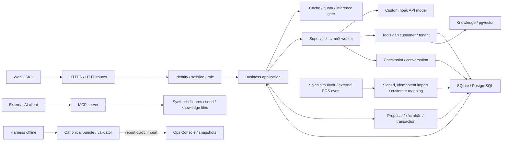

# Codebase Map — RetailOps hiện tại

> Cập nhật **2026-10-19** (P5-E Round 3 remediation; merged/runtime evidence vẫn theo mốc riêng). Local checkout vẫn ở `feat/phase5-sales-simulator-import`, HEAD `dd544800…`, và có nhiều thay đổi chưa commit; không reset/pull đè. PR #41 K3/K7 merged `8ef8278108c6d82e03d3c89ae304946ec4b53254`; deploy run `39007432153` failed at SSM preflight. Latest PR #42 `44540eab516831d5c8232dd80392b8e20c6cd47e` has 5/5 checks and deploy run `39015954088` succeeded per owner evidence. Its scope added orderless P-604 and left P-602 sample order unchanged; current-runtime full reconciliation and live acceptance are not inferred from workflow success.
> Current P5-E candidate: [PR #43](https://github.com/tuteemovaixlong/CSKH_ban_le/pull/43), reviewed Round 2 snapshot `982801144702b703eb9af3d4d1435a3a75b1b1e4` → Round 3 remediated code candidate `97b11bbcaa67a7b2f4297e63437d5802ee789384` (base `44540eab516831d5c8232dd80392b8e20c6cd47e`, tested merge ref `e10f9b1f24c30533c36f4b6d77aec6fb51e1baa1`). [CI 39203490030](https://github.com/tuteemovaixlong/CSKH_ban_le/actions/runs/39203490030) and [Ops Console 39203490035](https://github.com/tuteemovaixlong/CSKH_ban_le/actions/runs/39203490035) succeeded; targeted P5-E suite `14/14 PASS` (`0 skipped`). Ba finding còn mở (`AI1` reasoning canary, `AI5` PostgreSQL 429 parity, `DATA1` mixed-provenance backfill) đã được sửa (`REMEDIATED / READY FOR CODEX RE-REVIEW`); [independent review](../phase5/REVIEW_ARGON_P5_E_2026-10-18.md) giữ verdict `CHANGES REQUIRED` chờ Codex re-review. See [evidence](../phase5/PHASE_5_E_EVIDENCE_2026-10-18.md), [plan](../phase5/PHASE_5_E_AI_TRUST_ACCOUNT_GOVERNANCE_PLAN.md), [acceptance](../phase5/PHASE_5_E_ACCEPTANCE_CRITERIA.md), and [Argon handoff](../phase5/PHASE_5_E_EXECUTION_HANDOFF.md). Do not merge/deploy/modify live DB in this workstream.
> Runtime/deploy evidence được theo dõi riêng trong [current status](../CURRENT_PROJECT_STATUS.md) và [acceptance matrix](../03_EVALUATION/ACCEPTANCE_MATRIX.md).

## Đọc nhanh: hệ thống và việc sắp làm

RetailOps là web CSKH bán lẻ: đăng nhập/session → chat đa agent → tra đơn, chính sách, bảo hành và hỗ trợ → backend xử lý thao tác nghiệp vụ có kiểm quyền. Web đi qua HTTPS trên EC2; model có thể chạy ở endpoint riêng/Colab hoặc API. SQLite/PostgreSQL giữ identity và nghiệp vụ; pgvector phục vụ knowledge retrieval. Ops Console hiển thị báo cáo/usage. Harness Phase 4 tạo và kiểm bundle offline để chuẩn bị đo lường.

| Phần | Trạng thái hiện tại |
|---|---|
| Runtime, identity, workflow, cache/concurrency | Có trong code; deployed baseline và evidence được ghi riêng trong [project status](../CURRENT_PROJECT_STATUS.md). |
| Phase 4 harness / G2 | K1–K8 đã nghiệm thu theo Phase 4 criteria; G2 offline replay đã PASS trên merged SHA `8868c5c`. |
| Phase 5 A–C | Identity, sales simulator/import và runtime smoke đã có evidence; P5-C merge/deploy tại `a34b479`; xem [Phase 5 matrix](../03_EVALUATION/ACCEPTANCE_MATRIX.md). |
| Phase 5-D / PR #41 | PR #40 merged/deploy-smoked at `709928…`; PR #41 K3/K7 merged `8ef8278…`; auto-deploy run `39007432153` failed at SSM preflight. |
| PR #42 / P-604 | Merged `44540ea…`; CI 5/5 and deploy workflow `39015954088` succeeded. P-604 is catalog-only; P-602 sample order remains unchanged. |
| P5-K3 | Offline implementation/regression gates merged in PR #41; post-merge CI PASS. Live OAuth and EC2 `ambiguous_tenant` root-cause confirmation remain pending/unconfirmed. |
| P5-E | [PR #43](https://github.com/tuteemovaixlong/CSKH_ban_le/pull/43), reviewed `9828011…` → Round 3 remediated `97b11bbcaa67a7b2f4297e63437d5802ee789384` (tested merge `e10f9b1f24c30533c36f4b6d77aec6fb51e1baa1`); CI `39203490030` & Ops Console `39203490035` SUCCESS; targeted `14/14 PASS`. `AI1`/`AI5`/`DATA1` remediated (`READY FOR CODEX RE-REVIEW`); overall review verdict `CHANGES REQUIRED` pending Codex re-review. Not merged/accepted/deployed. |
| Còn chờ | Codex re-review cho P5-E Round 3; latest-release K1/K2 reconciliation; live K3/K7/K8. G4 AI-lane evidence and G5–G7 remain pending/held. |

**Bước kế tiếp:** Dừng sau Round 3 remediation + CI + docs trên PR #43 để Codex re-review độc lập theo [handoff P5-E](../phase5/PHASE_5_E_EXECUTION_HANDOFF.md). Account/quota UI/API đã có trong candidate; review không còn mở finding ADM. Không cần EC2 cho remediation/CI. Giữ nguyên workspace chính bẩn; candidate code nằm ở worktree riêng. [Review](../phase5/REVIEW_ARGON_P5_E_2026-10-18.md) và [evidence](../phase5/PHASE_5_E_EVIDENCE_2026-10-18.md) là trạng thái hiện hành.

Nguồn chuẩn cho trạng thái hiện tại: [Phase 5 acceptance](../phase5/PHASE_5_ACCEPTANCE_CRITERIA.md), [acceptance matrix](../03_EVALUATION/ACCEPTANCE_MATRIX.md), [current status](../CURRENT_PROJECT_STATUS.md), [Phase 5 parent handoff](../phase5/PHASE_5_EXECUTION_HANDOFF.md) và [P5-E implementation handoff](../phase5/PHASE_5_E_EXECUTION_HANDOFF.md). [P5-D review](../phase5/REVIEW_GEMINI_P5_D_2026-10-13.md) / [evidence](../phase5/PHASE_5_D_EVIDENCE.md) là hồ sơ lịch sử; D-specific execution handoff đã consumed. Phase 4 criteria/evidence vẫn là hồ sơ có thẩm quyền cho G2/K1–K8.

## 1. Kiến trúc và luồng dữ liệu



Mũi tên biểu diễn quan hệ chính, không phải mọi lời gọi. Graph chat chính gọi `BoundTools` trực tiếp. MCP server có tool implementation riêng trên synthetic fixtures/seed và knowledge files; không dùng session/customer binding của web. Supervisor hiện chọn một worker trong mỗi lượt; checkpoint giữ state để resume hội thoại/approval.

## 2. Bản đồ thư mục

Inventory directory: các số đếm ngoài `docs/` được quét ngày **2026-10-15** (**70** file Python trong `retailops/`, **8** `retailops_*.py` ở repo root, **12** file Python trong `evals/harness/`, **61** file trong `tests/`, **19** Python scripts, **21** file deploy, **6** web assets, **14** file trong `opsconsole/`); `docs/` được đếm lại ngày **2026-10-17**: **179 files, gồm 134 Markdown**, tính cả archive và compatibility pointers. Đây là kiểm kê cấu trúc, không phải rà soát nội dung toàn repo; loại `.git`, bytecode/cache, `node_modules`, virtualenv, `_archive/` và nội dung sinh lớn trong `scratch/`/`artifacts/` khỏi phân tích. Fixtures, reports và evidence không được đọc tuần tự như source code.

| Khu vực | Vai trò | File nên mở trước |
|---|---|---|
| `retailops/` | Composition root, cấu hình, gateway, quota/concurrency | [bootstrap.py](../../retailops/bootstrap.py), [config.py](../../retailops/config.py), [inference_gate.py](../../retailops/inference_gate.py) |
| `retailops/http/` | Public/private adapter, API, OAuth, assets | [public.py](../../retailops/http/public.py), [routes.py](../../retailops/http/routes.py), [auth_google.py](../../retailops/http/auth_google.py) |
| `retailops/identity/` | Account, tenant membership, session, credential, reconciliation | [store.py](../../retailops/identity/store.py), [persistent.py](../../retailops/identity/persistent.py), [reconcile.py](../../retailops/identity/reconcile.py) |
| `retailops/business/` | Chat use cases, đơn/catalog, cache, permissions, feedback/export | [application.py](../../retailops/business/application.py), [store.py](../../retailops/business/store.py), [cache.py](../../retailops/business/cache.py) |
| `retailops/workflow/` | LangGraph routing, model/tool loop, checkpoint, approval | [graph.py](../../retailops/workflow/graph.py), [supervisor.py](../../retailops/workflow/supervisor.py), [approval.py](../../retailops/workflow/approval.py) |
| `retailops/workflow/subagents/` | Order, policy, dispute, general workers | [order_agent.py](../../retailops/workflow/subagents/order_agent.py), [policy_agent.py](../../retailops/workflow/subagents/policy_agent.py), [dispute_agent.py](../../retailops/workflow/subagents/dispute_agent.py), [witty_agent.py](../../retailops/workflow/subagents/witty_agent.py) |
| `retailops/guardrails/` | Topic/sentiment/abuse triage | [topic_filter.py](../../retailops/guardrails/topic_filter.py), [sentiment.py](../../retailops/guardrails/sentiment.py) |
| `retailops/storage/` | PostgreSQL adapter/schema, import/backfill | [postgres.py](../../retailops/storage/postgres.py), [pg_schema.py](../../retailops/storage/pg_schema.py), [import_sqlite.py](../../retailops/storage/import_sqlite.py) |
| `retailops/knowledge/` | Ingest/chunk/embed/retrieve, citation provenance | [repository.py](../../retailops/knowledge/repository.py), [tool.py](../../retailops/knowledge/tool.py), [embedding.py](../../retailops/knowledge/embedding.py) |
| `retailops/sales/` | Synthetic sales simulator, signed event contract, import/customer-mapping adapter | [simulator.py](../../retailops/sales/simulator.py), [events.py](../../retailops/sales/events.py), [adapter.py](../../retailops/sales/adapter.py), [fixtures.py](../../retailops/sales/fixtures.py) |
| `web/` | Chat, lịch sử, provider selector, nghiệp vụ theo role | [app.js](../../web/app.js), [index.html](../../web/index.html), [chat-focus.js](../../web/chat-focus.js) |
| `opsconsole/` | Dashboard report/usage/deployment snapshots; CLI import/evaluation | [server.py](../../opsconsole/server.py), [evaluation.py](../../opsconsole/evaluation.py), [usage.py](../../opsconsole/usage.py) |
| `evals/` | Frozen scenarios, qrels, harness Phase 4 | [README](../../evals/README.md), [runner.py](../../evals/harness/runner.py), [validator.py](../../evals/harness/validator.py) |
| `notebooks/` | Colab agent/model runtime, vLLM/GGUF helpers, smoke | [colab_agent.ipynb](../../notebooks/colab_agent.ipynb), [colab_runtime.py](../../notebooks/colab_runtime.py), [colab_vllm_l4.py](../../notebooks/colab_vllm_l4.py) |
| `deploy/`, `.github/workflows/` | Container, Caddy, PostgreSQL, rollout, CI/deploy guard | [SETUP](../../deploy/SETUP.md), [ci.yml](../../.github/workflows/ci.yml), [deploy-ec2.yml](../../.github/workflows/deploy-ec2.yml) |
| `scripts/`, `tests/` | Contracts, notebook generation, evaluation/deploy checks, unit/integration regressions | [check_docs_contract.py](../../scripts/check_docs_contract.py), [prepare_test_pgvector.py](../../scripts/prepare_test_pgvector.py), [test_phase5_complaint_e2e.py](../../tests/test_phase5_complaint_e2e.py) |
| `docs/00_OVERVIEW`…`04_OPERATIONS` | Public docs 5 tầng; `_digest/` là snapshot; `_audit/` là inventory; `phase4/`/`phase5/` là evidence/acceptance/handoffs | [docs index](../README.md), [Phase 5 index](../phase5/README.md), [acceptance matrix](../03_EVALUATION/ACCEPTANCE_MATRIX.md) |

## 3. Entry points và file root

`python -m retailops` → [__main__.py](../../retailops/__main__.py) → `bootstrap.py`. Commands: `check-config`, `serve-public`, `serve-private`, `identity`, `database`, `knowledge`.

| File / entry | Vai trò hiện tại |
|---|---|
| [retailops_public.py](../../retailops_public.py) | Wrapper public HTTP; Docker public dùng entry này, implementation trong package. |
| [retailops_api.py](../../retailops_api.py) | Wrapper private HTTP cho local/SSM/test; không phải cách đăng nhập EC2. |
| [retailops_agent.py](../../retailops_agent.py) | RemoteAgent giao tiếp endpoint Custom, lớp tương thích graph. |
| [retailops_providers.py](../../retailops_providers.py) | API gateway: OpenRouter/Anthropic/Google hoặc endpoint OpenAI-compatible theo cấu hình. |
| [retailops_tools.py](../../retailops_tools.py) | BoundTools theo tenant/customer: tra dữ liệu, chuẩn bị hủy, yêu cầu hỗ trợ. |
| [retailops_mcp_server.py](../../retailops_mcp_server.py) | External AI integration qua stdio/SSE; tool implementation riêng trên synthetic fixtures/seed và knowledge files. |
| [retailops_conversation.py](../../retailops_conversation.py) | Catalog/presentation helper cho UI; chat reasoning đi qua agent. |
| [retailops_baseline.py](../../retailops_baseline.py) | Model config, scaffold intent/slot và baseline/compatibility helpers. |
| [phase4_harness.py](../../scripts/phase4_harness.py) | CLI mock-run/validate/recompute/sidecar-check/qrels-check. |
| `python -m opsconsole.server` | Dashboard đọc snapshot, Waitress8100 phía sau Caddy theo admin deployment. |

Public runtime dùng Waitress8000 phía sau Caddy HTTPS. Người dùng mở web EC2 theo [EC2 workflow](../EC2_WEB_WORKFLOW.md); kiểm host/origin theo runbook, không hardcode IP cũ.

## 4. Một lượt chat và thao tác nghiệp vụ

1. Public HTTP xác thực cookie và lấy binding do server quản lý: tenant, principal/customer và role. Private demo xác thực Bearer, dùng customer do server ánh xạ trong Application/SQLite demo.
2. `http/routes.py` gọi `business/application.py`; application quản lý conversation/provider, cache, quota và inference gate.
3. Khi cache miss/bypass, graph supervisor dùng intent/context cùng topic/sentiment để chọn `order`, `policy`, `dispute` hoặc `witty` worker; model/tool loop có giới hạn. Runtime với model thật mặc định `multi_agent`; `single_agent` là lựa chọn cấu hình/test.
4. Tools dùng bound customer/tenant để tra đơn/knowledge; kết quả và trace đưa về worker. Conversation/checkpoint hỗ trợ resume.
5. Application lưu turn/usage và chỉ cache kết quả đủ điều kiện; provider giữ nhất quán, không tự đổi model khi lỗi.
6. Hủy đơn: prepare → proposal → xác nhận rõ ràng → backend kiểm role/ownership, trạng thái/version, thời hạn/idempotency → transaction/audit.

Prepare_cancellation không tự hủy đơn; `request_human_support` có thể lưu feedback/handoff. Vì vậy không gọi toàn bộ tool surface là “chỉ đọc”. Staff desk và manager CRUD là API có permission riêng.

Nguồn: [LangGraph](../LANGGRAPH.md), [identity](../PERSISTENT_IDENTITY.md), [system foundation](../SYSTEM_FOUNDATION.md).

## 5. Identity, dữ liệu, model và RAG

| Phần | Cơ chế trong code |
|---|---|
| Private/synthetic demo | Seeded SQLite; public guest demo có workspace/session riêng. |
| Public persistent-demo/live | SQLite identity + tenant business DB, hoặc PostgreSQL identity/tenant schemas theo cấu hình. Có lane live trong code không đồng nghĩa đã nghiệm thu dữ liệu/model live. |
| Identity schema | v4; migration v1/v2/v3, unresolved-collision guard, reconciliation journal. [reconcile.py](../../retailops/identity/reconcile.py) phối hợp Identity/Business; journal hỗ trợ recovery, không phải distributed ACID. |
| Business schema | SQLite v3 / PostgreSQL v4; tách version khỏi Identity v4. |
| Model Custom | RemoteAgent protocol `/agent/identity`, `/agent/chat`; Colab/Ollama proxy là một deployment path. |
| Model API | Server adapter cấu hình API provider hoặc OpenAI-compatible endpoint. Custom/API chỉ bật khi được cấu hình; provider của conversation được giữ nhất quán. |
| Quota/concurrency/cache | [account_usage.py](../../retailops/account_usage.py), `inference_gate.py`, `business/cache.py`; reservation/bounded inference được ghép trong application. |
| Knowledge/RAG | PostgreSQL/pgvector theo tenant, hybrid vector/lexical retrieval. Embedding `feature-hash-v1`, 384 chiều, là baseline xác định; chưa mặc định neural embedding/reranker mới. |
| Citation | Kiểm provenance source/chunk; correctness/entailment của câu trả lời cần được đánh giá riêng. |

Nâng model/embedding/reranker, OCR hoặc ablation thuộc workstream đo/Phase4B có điều kiện; không kéo vào closure PR harness.

## 6. Harness Phase 4 và R10–R13

Harness là evaluation tooling riêng với business runtime. Runner hiện là **mock offline**, không chứng minh chất lượng model thật hoặc readiness của lane live.

```text
Frozen scenarios + sidecar + qrels
  → Phase4MockRunner / grader / telemetry
  → writer: manifest.json, attempts.jsonl, grading.jsonl, retrieval.jsonl,
            errors.jsonl, aggregate.json, checksums.sha256
  → validator: schema / joins / provenance / checksums / aggregate recompute
  → evidence / acceptance v1
```

| Phần trọng tâm | Module / vai trò | Trạng thái v1 |
|---|---|---|
| R10 — grader/safety | [grader.py](../../evals/harness/grader.py), [schema.py](../../evals/harness/schema.py): rubric, tool/safety types, hard veto | DONE OFFLINE; semantic tool evidence ở backlog. |
| R11 — readiness gates | [gates.py](../../evals/harness/gates.py): G0–G7; chỉ G5 grant measurement readiness | DONE OFFLINE GUARD; live lane chưa nghiệm thu. |
| R12 — bundle/reproducibility | [runner.py](../../evals/harness/runner.py), [writer.py](../../evals/harness/writer.py), [validator.py](../../evals/harness/validator.py), [constants.py](../../evals/harness/constants.py) | Hash mutation/blocked denominator DONE; actual-source replay hardening/count semantics deferred. |
| R13 — packaging/deploy guard | [eligibility](../../scripts/check_deploy_eligibility.py), [deploy workflow](../../.github/workflows/deploy-ec2.yml), [deployment contract](../../scripts/check_deployment_contract.py) | DONE OFFLINE/CI; full PR mixed packaging, guard eligible=true. |

Inputs: `baseline_v1.jsonl` 30 ca, `benchmark_250.jsonl` 250 ca, `master_250_v1.jsonl` 250 ca; frozen hashes/counts ở contracts. [sidecar.py](../../evals/harness/sidecar.py) bổ sung identity/fixture labels; [qrels.py](../../evals/harness/qrels.py) quản lý retrieval labels. [build_agent_notebook.py](../../scripts/build_agent_notebook.py) giữ generated notebook đồng bộ source.

N1 replay hardening, N3 completeness/counts, N4 positive-count thiếu tool names và L2/L4/L5 ở [Phase5 backlog](../phase4/PHASE_5_BACKLOG.md); không dùng để giữ merge hoặc mở audit mới.

## 7. Ops Console, CI và triển khai

| Nhánh | Vai trò |
|---|---|
| Ops Console server/UI | Đọc report/usage/deployment snapshots; không có endpoint thực thi chat/hủy đơn/deploy. CLI/importer riêng; dashboard không tự đóng G5. |
| `ci.yml` | Offline contracts/tests, PostgreSQL/pgvector integration, Docker packaging, Colab Python3.13 source/runtime compatibility theo workflow. |
| `ops-console.yml` | Portable Windows/Ubuntu và PostgreSQL integration; console/UI/quota regressions. |
| `live-e2e.yml` | Live verification riêng; CI offline không thay bằng chứng live. |
| `deploy-ec2.yml` | Guard changed-files trước deploy; cần main, deploy-enabled variable và eligibility. |
| `deploy/` | Compose/Caddy/PostgreSQL, publish/activate, rollout/source consistency, live-E2E scripts. |

P5-D candidate verification phải dùng job `offline` trong `ci.yml`, job này provision PostgreSQL/pgvector và `RETAILOPS_TEST_DATABASE_URL`; xác nhận test pgvector không bị skip. `ops-console.yml` không thay thế gate này. Bản đồ không commit, merge hoặc triển khai.

## 8. Khi cần hiểu/sửa X, mở đâu

| Nhu cầu | Đọc trước |
|---|---|
| Khởi động/cấu hình | `retailops/__main__.py`, `retailops/bootstrap.py`, `retailops/config.py` |
| Login/session/role/tenant | `retailops/http/public.py`, `retailops/identity/store.py`, `retailops/identity/persistent.py` |
| Collision/migration/reconciliation | `retailops/identity/reconcile.py`, `retailops/storage/pg_schema.py`, `retailops/identity/store.py` |
| Chat/provider/history | `retailops/business/application.py`, `retailops/models.py`, `retailops_providers.py` |
| Routing/worker/tool loop | `retailops/workflow/graph.py`, `retailops/workflow/supervisor.py`, worker tương ứng trong `retailops/workflow/subagents/` |
| Hủy đơn/approval/idempotency | `retailops/http/routes.py`, `retailops/business/store.py`, `retailops/workflow/approval.py` |
| Catalog/bảo hành/staff desk | `retailops/http/routes.py`, `retailops/business/store.py`, `retailops/business/warranty.py` |
| Quota/concurrency/cache | `retailops/account_usage.py`, `retailops/inference_gate.py`, `retailops/business/cache.py` |
| RAG/citation | `retailops/knowledge/repository.py`, `retailops/knowledge/tool.py`, `retailops/knowledge/citations.py` |
| MCP external integration | `retailops_mcp_server.py`, `retailops/workflow/mcp_client.py` |
| Sales simulator/import/mapping | `retailops/sales/events.py`, `retailops/sales/adapter.py`, `retailops/sales/simulator.py`, `tests/test_phase5_sales_simulator_import.py` |
| Same-customer complaint lifecycle | `retailops/workflow/subagents/dispute_agent.py`, `retailops/workflow/approval.py`, `tests/test_phase5_complaint_e2e.py`, [P5-D review](../phase5/REVIEW_GEMINI_P5_D_2026-10-13.md) |
| Ops reports/usage/import | `opsconsole/server.py`, `opsconsole/evaluation.py`, `opsconsole/usage.py` |
| Harness R10–R12 | `evals/harness/schema.py`, `evals/harness/grader.py`, `evals/harness/validator.py`, tests liên quan |
| Deploy guard R13 | `scripts/check_deploy_eligibility.py`, `.github/workflows/deploy-ec2.yml`, `tests/test_deploy_guard.py` |
| P5-D candidate CI (historical evidence) | [P5-D evidence](../phase5/PHASE_5_D_EVIDENCE.md) / [review](../phase5/REVIEW_GEMINI_P5_D_2026-10-13.md) → [Phase 5 acceptance](../phase5/PHASE_5_ACCEPTANCE_CRITERIA.md) → [matrix](../03_EVALUATION/ACCEPTANCE_MATRIX.md). Do not reuse the consumed D execution trigger. |

Path trong bảng tính từ repo root. Chọn 2–3 file đầu rồi mở dependency khi cần. Không nạp toàn bộ `data/`, `evals/`, `scratch/`, `artifacts/`; chỉ lấy case/report liên quan. Bỏ bytecode, secret/env và `__pycache__/` khỏi context.

## 9. Current delivery state and boundaries

| Bước | Ai thực hiện | Phạm vi / kết quả |
|---|---|---|
| Phase 4 / G2 | Accepted | G2 offline replay PASS trên merged SHA `8868c5c`; Phase 4 criteria/evidence remain authoritative for frozen K1–K8. |
| P5-C | Merged/deployed | `a34b479`; owner-provided runtime/smoke evidence is recorded in the acceptance matrix. |
| P5-D | Merged/deploy-smoked | Candidate `dd54480` passed Section 17 independent source review and offline CI on merge ref `18c7e5f…`; PR #40 merged at `709928…`; deploy run `38886385884` reports image `64c18…` and web/admin smoke. Latest runtime/report reconciliation and live K3/K7/K8 remain pending. |
| Next — P5-E | Round 3 remediated on PR #43 / `97b11bbcaa67a7b2f4297e63437d5802ee789384` (from `9828011`) | `AI1`, `DATA1`, `AI5` remediated and verified in CI (`39203490030`) & Ops Console (`39203490035`); preserve primary dirty tree; stop for independent Codex re-review; no EC2 for offline work. |
| Later — P5-D runtime/K1–K2 | Read-only runtime/report reconciliation | Inspect existing post-deploy reports and timestamped service/image state; no redeploy. Not a prerequisite for the offline K7 assertion task. |
| P5-K3 live OAuth / remaining G4 / P5-F/G5–G7 | Pending / HOLD | Live OAuth, per-lane G4 evidence, measurement gates need their own acceptance/authorization; none is implied by offline CI or operational smoke. |

This map is a navigation aid, not an acceptance verdict or deployment instruction. For current status, consult linked status/matrix/criteria; for source details, follow package/file links above. Historical plans and evidence remain preserved and should be read with their own snapshot dates.
