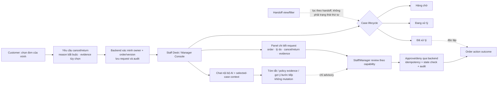

# Phase R1 — Role-aware Staff & Manager Operations

> **Trạng thái:** W0 CLOSED OUT (2026-10-31; see [owner delta §10/§11](W0_OWNER_DECISION_DELTA_2026-10-29.md#10-final-owner-decisions-2026-10-31)) · DOCS REVIEW LOOP CLOSED (2026-10-30; see [review reconciliation](W0_REVIEW_RECONCILIATION_2026-10-28.md)) · IMPLEMENTATION READINESS `BLOCKED` ([readiness gate](IMPLEMENTATION_READINESS_BLOCKED_2026-10-27.md); no `READY` review claimed) · **W1-ONLY AUTHORIZED BY OWNER (2026-10-31)** · **W1 REMEDIATED & VERIFIED; W1 POLICY DECIDED BY OWNER — NO OPEN W1 BLOCKER, W1 COMPLETE (OWNER CONFIRMED 2026-10-31) · **W1 IN PRODUCTION 2026-11-01** · **W2 READY / EXECUTION PER [W2 handoff](W2_EXECUTION_HANDOFF_2026-11-01.md)** ([§13](W0_OWNER_DECISION_DELTA_2026-10-29.md#13-w2-owner-decisions-2026-11-01))** ([closure status](IMPLEMENTATION_READINESS_BLOCKED_2026-10-27.md#2026-10-31-w1-owner-policy-decisions-and-closure-status), [owner delta §12](W0_OWNER_DECISION_DELTA_2026-10-29.md#12-w1-policy-decisions-2026-10-31)) · `W2–W6`, LIVE-DB MIGRATION, RUNTIME, DEPLOY, COMMIT & PUSH NOT AUTHORIZED · RUNTIME NOT VERIFIED
> **Ngày lập/cập nhật:** 2026-10-25 / 2026-10-31
> **Review baselines:** the 2026-10-25/26 source reviews used committed HEAD `dd544800` and then-cached `origin/main` `bbfd11d0`. Argon's supplied W0 report records a read-only remote check at `2026-10-29T23:11:17+07:00`, and Argon repeated `git ls-remote origin refs/heads/main` on `2026-10-31` during W1 preflight, again returning `bbfd11d0ba4c13514a197a6b25802c4e217bedb3` (matching local `HEAD`). These Git checks are timestamp-bounded and do not infer deployment/runtime. Code-review claims remain tied to their cited source refs.
> **Phase numbering:** R1 is a separate operational workstream label, not a renumbering of the legacy roadmap phases 0–6 and not a new G4/G5/G6/G7 acceptance gate.

## Document map and authority

- This page is the **canonical product/architecture and acceptance design**; it does not override the current owner record or authorize implementation.
- [Historical owner decision snapshot 2026-10-28](OWNER_DECISIONS_2026-10-28.md) is the prior policy record; the newer W0 owner decision delta and proposals 2026-10-29 (linked below) supersedes it only for the OD items explicitly covered there. Proposals in that file are not owner approvals.
- [W0 baseline and decision register](W0_BASELINE_AND_DECISION_REGISTER_2026-10-27.md) tracks evidence provenance, frozen direction, and unresolved decisions.
- [W0 read-only role inventory](W0_ROLE_INVENTORY_2026-10-29.md) records the verified-base source inventory for `viewer`, `platform_admin`, `opsadmin` and Google role resolution; it does not count live data or authorize implementation.
- [W0 contract freeze and gap register](W0_CONTRACT_FREEZE_AND_GAP_REGISTER_2026-10-29.md) separates frozen owner invariants from unresolved `ExecutionContext`, API, lifecycle, cache/checkpoint and attachment policy gaps.
- [W0 owner decision delta and proposals 2026-10-29](W0_OWNER_DECISION_DELTA_2026-10-29.md) records the 2026-10-29 proposals/assessments in §1–§9 and the **settled 2026-10-31 owner decisions (§10) and accepted mechanics (§11)**, which govern wherever earlier text says open or proposal-only.
- [W0 review reconciliation](W0_REVIEW_RECONCILIATION_2026-10-28.md) is the **only** review chronology: Argon/Opus source findings, the different checkouts, and the closed 2026-10-30 docs-review loop. Other pages link there instead of repeating review rounds.
- [Implementation readiness](IMPLEMENTATION_READINESS_BLOCKED_2026-10-27.md) remains `BLOCKED` (no new readiness review `READY` is claimed); on 2026-10-31 the owner granted a bounded **W1-only** execution authorization while `W2–W6` remain gated.
- All completed review results, review prompts/handoffs, the source audit synthesis and the reference-only implementation handoff are in the [archive index](archive/README.md). Archived prompts must not be executed; any future implementation prompt must be newly issued by the owner after readiness gates are met.

## 1. Mục tiêu và quyết định phạm vi

Thiết kế role profiles **Customer, Staff và Manager** trên cùng lõi ứng dụng, cùng chuẩn an toàn và workflow dùng chung. Khác biệt nằm ở ngữ cảnh, công cụ và phạm vi dữ liệu được cấp; không nhân đôi toàn bộ agent/workflow.

**Owner direction (2026-10-25): một workflow dùng chung, không dựng ba workflow riêng cho Customer, Staff và Manager.** Dùng chung một LangGraph/orchestration core và các nguyên tắc grounding, guardrails, telemetry; từng request mang một `execution_profile`/task context để điều chỉnh prompt instructions, context projection, tool capabilities và nơi lưu kết quả. Đây là các profile/nhánh có điều kiện trong cùng workflow, không phải ba graph độc lập. Các API/UI ingress và output stores vẫn có thể khác nhau để giữ đúng ranh giới quyền và dữ liệu.

**Owner direction bổ sung (2026-10-26, được chốt thêm ngày 2026-10-28/29; chi tiết tại [latest owner delta](W0_OWNER_DECISION_DELTA_2026-10-29.md)):** business roles của ứng dụng chỉ có `customer`, `staff`, `manager`; chủ cửa hàng dùng role `manager`, không tạo role Owner riêng. `opsadmin` là account/đường đăng nhập riêng của Ops Admin Console, không phải business-chat role. `viewer` là role legacy ngoài target: disable app access trước, chỉ xóa membership nếu an toàn; nếu không thì freeze/lock và retire dần. Không tự đổi Viewer thành `customer`. `platform_admin` là technical debt cần deprecate/remove dần; không runtime-alias vào `manager`, không gộp với `opsadmin`, và không chuyển quyền cross-tenant cũ sang Manager.

Staff Desk là một workspace chung có ba nhóm trạng thái **Hàng chờ / Đang xử lý / Đã xử lý**. Handoff là góc nhìn/lọc riêng trên các case, không phải trạng thái thứ tư. Request hủy/đổi-trả, trạng thái xử lý hội thoại và lịch sử tra cứu đơn là các đối tượng/trạng thái riêng, chỉ liên kết khi backend xác minh liên hệ. Staff/Manager có thể chọn một case rồi hỏi AI trong chat nội bộ về lịch sử, tình trạng, policy/evidence và bước tiếp theo; AI chỉ hỗ trợ, không tự hủy đơn/hoàn tiền hay ghi nội dung nội bộ vào transcript khách.

**Không phải mục tiêu:** tạo hai sản phẩm/AI stack độc lập; mặc định tạo queue hoặc giao diện “ca của tôi”; tự thêm assignment, SLA, ưu tiên hay tích hợp Facebook/Zalo; coi system prompt hoặc ẩn nút UI là biện pháp phân quyền; mở dữ liệu toàn shop cho model chỉ vì actor là Manager.

### Ground truth từ code đã review

- Đăng nhập Staff mở Staff Desk, đăng nhập Manager mở Manager Console. Có nhiều entry point để Manager mở Desk: top-nav `#toggle-staff-desk` gọi `openStaffDesk()` nên tải queue và khởi động polling; ngược lại, nút `#btn-manager-open-staff-desk` trong Manager Console và đường SOP 6 kiểm tra `typeof refreshStaffQueue === 'function'`, nhưng `refreshStaffQueue` là DOM button chứ không phải hàm, nên hai đường này hiện không tải queue lần đầu và không bật polling (`web/app.js:1493–1510, 1773–1782, 2138–2153` at `HEAD dd544800`; offsets differ at local `origin/main`). R1.0 phải kiểm thử riêng cả ba entry point.
- Ma trận quyền hiện tại ở cả hai source refs được Argon đối chiếu: Staff có `orders:read`, `orders:cancel`, `staff:desk`; Manager kế thừa các quyền này và thêm `store:manage` (`retailops/business/permissions.py:7–11` tại `dd544800` và `bbfd11d0`). Backend bảo vệ endpoint Staff Desk và endpoint quản trị (`retailops/http/routes.py:224–226, 259–294`); đây là historical source behavior, không phải target cho AI mutation.
- Staff Desk lấy các handoff trong tenant hiện hành qua `/api/staff/escalations`; query lấy tối đa 20 bản ghi `human_handoff` mới nhất nhưng không lọc `reason_code='resolved'`. UI tính count trên toàn bộ bản ghi trả về (`retailops/business/store.py:815–826`; `web/app.js:1540–1555`). Tenant scope đến từ session resolution tạo Application với business store theo membership tenant (`retailops/identity/persistent.py:150–170` at audited HEAD), không phải predicate tenant trong chính query. Vì vậy danh sách/count hiện có thể gồm ca đã xử lý.
- Các lối tạo/cập nhật handoff gồm nút customer, nội dung yêu cầu người thật/escalation workflow và tin nhắn customer trong human mode (`web/app.js:407–419, 950–961`; `retailops/workflow/supervisor.py:110–141`; escalation gọi `request_human_support` tại `retailops/workflow/graph.py:155–161`; `retailops/http/routes.py:254–258`; `retailops/business/store.py:983–994`). Hành vi customer message có thể cập nhật handoff unresolved hiện tại hoặc tạo row mới nếu không có.
- Resolve hiện đổi `reason_code='resolved'` cho **mọi** handoff row của conversation (`retailops/business/store.py:1006–1017`); phía customer, poll thoát human mode nếu thấy **bất kỳ** handoff row resolved nào (`web/app.js:358–365`). Do đó cần kiểm thử re-handoff sau một lần resolve; row resolved cũ không được đóng nhầm handoff mới.
- Quyền Staff hiện cho phép đọc transcript theo conversation ID trong tenant mà không áp dụng customer ownership check; reply cũng nhận conversation ID và ghi vào conversation tìm được trong store; resolve chưa xác nhận conversation tồn tại/trạng thái pending (`retailops/http/routes.py:229–236, 259–275`; `retailops/business/store.py:1006–1017`). Đây chưa chứng minh cross-tenant access, nhưng rộng hơn quyền “chỉ case đang chờ trong Desk” mà Phase R1 nhắm tới.
- Handoff có thể đến từ nút khách hàng, nội dung yêu cầu người thật hoặc escalation do workflow. UI hiện chuyển sang trạng thái “đã kết nối” và hiện lời chào mô phỏng trước khi xác nhận ghi handoff; lỗi request bị bỏ qua (`web/app.js:407–419`). `request_human_support` cũng có thể log lỗi ghi DB nhưng vẫn trả kết quả escalated (`retailops_tools.py:252–279`). Đây là tính toàn vẹn cần xử lý trước khi dựa vào handoff như một giao dịch đã được tiếp nhận.
- `/api/chat` gọi `app.chat` và role được nạp vào `Application` permissions/capabilities; Staff/Manager chưa có AI profile/prompt/context riêng hoặc selected-case binding. `BoundTools` gắn customer của session; đối với turn được route tới worker, graph chạy một worker rồi kết thúc; một số Supervisor path đi thẳng tới END (`retailops/http/routes.py:243–250`; `retailops/business/application.py:25–30, 269–270, 340–346`; `retailops/workflow/graph.py:53–82`). Role có hiệu lực ở authorization/capability; kết luận chỉ là chưa có profile AI theo vai trò và ngữ cảnh Staff Desk.
- `/api/tools/execute` không nhận case/conversation ID và tạo `BoundTools` với snapshot không có order/product context (`retailops/http/routes.py:281–291`); vì vậy “AI hỗ trợ case đang chọn” chưa có binding backend trong code hiện tại. Manager còn có route đọc tối đa 50 đơn shop-wide (`retailops/http/routes.py:133–138`); dữ liệu này không được tự động đưa vào prompt/profile chỉ vì actor là Manager.
- **Case/vector binding contract (owner clarification 2026-10-28):** `case_id` identifies the requested chat segment/work item; conversation/turn/message and optional handoff/order-action IDs are verified links. A copied title or free text is never an authorization key. Vector/lexical retrieval supplies separate tenant/profile-allowlisted knowledge evidence only after the case is authorized; it cannot independently select the chat segment. See [historical owner decision snapshot 2026-10-28](OWNER_DECISIONS_2026-10-28.md).
- Tên staff gửi trong body `/api/staff/reply` và `/api/staff/resolve` hiện do client cung cấp và được dùng trong store reply/event (`retailops/http/routes.py:259–275`; `retailops/business/store.py:905–947, 1006–1017`); actor/audit cần gắn principal từ session phía server.
- `PLAN_RBAC_GOOGLE_AUTH.md` và `PLAN_ECOMMERCE_OPS_COPILOT.md` có mô tả thiết kế rộng hơn runtime hiện tại. Đọc các tuyên bố chi tiết theo nhãn historical/planned, không mặc định là khả năng đã chạy.
- Role baseline drift giữa hai source ref là **historical code finding**, không thay đổi target taxonomy: `dd544800` có `customer`, `viewer`, `staff`, `manager`; local `origin/main` `bbfd11d0` được báo là có thêm `platform_admin` và permission bits `READ`, `CANCEL`, `STAFF`, `MANAGER`, `PLATFORM_ADMIN`. Owner target vẫn chỉ có 3 business roles. Trước implementation, kiểm tra đúng source ref, DB constraints, Google allowlists/`DEFAULT_ROLE`, memberships và routes để xác định nguồn phát sinh `viewer`/`platform_admin`; không migrate chúng theo tên suy đoán.
- **Admin baseline cần phân biệt theo ref:** tại `bbfd11d0`, Manager có quyền UI/API P5-E trên `/api/admin/accounts*` và `/api/admin/audit-log` trong cùng tenant (không được mutate `platform_admin`); `platform_admin` có phạm vi cross-tenant theo contract từng endpoint, nhưng không phải endpoint nào cũng yêu cầu client truyền `tenant_id`. Đây là source-ref finding, không phải owner direction. Target tách Ops Admin Console (`opsadmin`) khỏi ba business roles; phải xác minh đường auth hiện tại và xử lý `platform_admin` drift trước khi đổi RBAC. Không tự gộp `opsadmin` với `platform_admin`.
- **Cache invalidation:** trên cả `dd544800` và `bbfd11d0`, product CRUD gọi `invalidate_product(pid)` theo positional argument trong khi tham số đầu là `tenant_id`, nên product-specific invalidation sai và xóa 0 cache entries. Đây là confirmed dormant defect: `get_product` chưa thuộc `ToolCache.CACHEABLE_TOOLS`; SemanticCache/catalog revision invalidation vẫn có đường riêng. Sửa bằng keyword args và test trước khi bật cache cho catalog tools.
- **Knowledge projection:** code trả `citation_id`, `source_key`, `title`, `excerpt`, `content_sha256`, `truncated`; excerpt hiện có thể tới 1,100 ký tự và `source_key` tới 240. R1 target cap 1,000/3,000 ký tự và `source_key` ≤200 là giới hạn chặt hơn do đề xuất, không phải schema runtime. `content_sha256` là hash của excerpt, không phải version tài liệu; `cited_sources` xác nhận citation ID thuộc evidence lượt hiện tại, không tự chứng minh câu trả lời được evidence entail.
- **Request mode/provider payload:** `request_mode` có thể phân loại câu kỹ thuật như `sql`, `database`, `python` thành `general` nếu không có retail intent; `build_request` khi đó có thể đặt `tools=[]` và, nếu không có system message tường minh, dùng `GENERAL_SYSTEM`. `json` không thuộc `_GENERAL_TERMS` ở ref đã review. Đây là conditional R1 risk; phải test mọi provider/adapter và prompt serialization theo profile.
- **Conversation bootstrap và TTL:** `openSession()` gọi GET conversation list và có thể POST conversation mới trước khi phân nhánh role Staff/Manager. Nếu customer conversation routes bị chặn cho internal roles, UI cần skip các bootstrap calls customer-only; session/profile/provider/bootstrap GET cần có ma trận riêng. `new_conversation()` xóa hội thoại hết hạn trên toàn tenant khi có request tạo hội thoại mới; feedback cascade có thể xóa pending handoff, còn một số write path không kiểm tra expiry. Đây là acceptance về retention/lifecycle, không phải bằng chứng có cron hay live data loss.
- **Handoff severity:** code review xác nhận thao tác Staff hiện gắn với `conversation_id`, không phải pending episode riêng. Các reviewers thấy rủi ro wrong-object trong tenant hiện hành, nhưng không tìm thấy bằng chứng cross-tenant bypass; ghi nhận là P1 object/lifecycle authorization, không gọi là P0 cross-tenant breach.
- **Checkpoint wording:** run/checkpoint hiện đã có customer, purpose/request/conversation identity và lease/fencing. R1 gap là chưa phân biệt actor/profile/case/projection version và schema còn gắn `graph_runs.customer_id`; đây là blocker thiết kế có điều kiện trước khi thêm internal profiles, không phải collision hiện tại đã được chứng minh.
- **Audit round 2026-10-26:** 3 Codex sub-agents độc lập quét security/RBAC/API, workflow/LLM/tools/RAG/cache và UI/lifecycle; 1 agent rà docs/acceptance/baseline. Hợp nhất với báo cáo Claude Opus owner cung cấp tại [independent audit synthesis](archive/INDEPENDENT_AUDIT_SYNTHESIS_2026-10-26.md). Các kết luận là source/docs review; không xác nhận EC2/live.

## 2. Một workflow dùng chung, các profile theo role/task

Một workflow không có nghĩa là một bộ quyền dùng chung. Backend xác thực role/tenant/object tại ingress và mỗi tool call; workflow nhận request context bất biến theo từng lượt. Profile chỉ điều chỉnh cách workflow xử lý nhiệm vụ và dữ liệu tối thiểu cần thiết.

| Profile trong workflow dùng chung | Nhiệm vụ/context | Khác biệt được phép trong cùng workflow |
|---|---|---|
| `customer_chat` | Hội thoại customer; conversation/order thuộc customer của session | Customer prompt/context; customer tool allowlist; kết quả lưu trong transcript của chính khách. Đây là luồng chat LLM hiện có. |
| `staff_case_assist` | Case cụ thể mà Staff đã mở; server bind `case_id` và các liên kết tùy chọn (`handoff_id`, `order_action_request_id`) → conversation/customer/allowed objects | Chỉ context của case; active operations chỉ trên case `waiting`/`in_progress`; profile/tool scope dành cho hỗ trợ nhân viên; bản nháp nội bộ lưu riêng, tuyệt đối không ghi vào transcript customer. Chưa triển khai. |
| `manager_ops_assist` | Tác vụ quản trị được phép, dùng dữ liệu tối thiểu/aggregate đã duyệt | Có thể thêm context/tool capability quản lý đã được owner duyệt; không tự đưa raw order/event/PII vào prompt. Chưa triển khai. |

Ba tên trên là **request profiles trong cùng graph**, không phải ba agent graphs. Có thể dùng ingress/API adapters và output persistence adapters riêng mà không nhân đôi orchestration. Không được lưu selected case, role override hay request context mutable trên singleton `Application`.

### Bề mặt role mục tiêu

| Khía cạnh | Customer | Staff | Manager (bao gồm chủ cửa hàng) |
|---|---|---|---|
| Điểm vào | Chat CSKH và dữ liệu của chính khách | Staff Desk + chat nội bộ hỗ trợ case | Manager Console + cùng Staff Desk/chat nội bộ; quản lý shop theo quyền |
| Ca/hội thoại | Tạo yêu cầu/handoff và theo dõi case của mình | Xử lý case được đưa vào workspace | Có thể xử lý/review cùng workspace; thêm quyền vận hành do backend cấp |
| AI | `customer_chat`, chỉ dữ liệu/tool của chính khách | `staff_case_assist`, context của case đã chọn | Cùng `staff_case_assist` khi hỏi về case; profile quản lý riêng chỉ cho tác vụ được duyệt |
| Hành động | Có thể gửi yêu cầu hủy/đổi-trả cho đơn của mình; backend kiểm tra | Xem, trả lời, phân loại và quyết định request nếu được capability cấp | Tương tự Staff trong Desk, cùng quyền quản lý shop được cấp; audit riêng |
| Hạn chế | Không đọc case người khác | Không có quyền shop-wide mặc định; AI không tự commit hành động | Manager không tự động đưa toàn bộ PII/order/event vào AI context |

### Staff Desk — workspace và trạng thái không nhập nhằng

- Một workspace dùng chung cho Staff và Manager, có thể thu gọn/mở rộng như sidebar Codex: một nhóm/workspace khách hàng có thể chứa nhiều conversation; mỗi `case_id` là một đơn vị xử lý riêng và có thể liên kết với không hoặc một `handoff_id` đang/đã xử lý cùng các object nghiệp vụ đã xác minh. Một handoff episode mới sau khi case cũ đã đóng phải có `handoff_id` riêng; owner đã chốt: khách bấm Tiếp tục thì dùng lại `case_id` cũ. Không nhập các case thành một ca duy nhất. Yêu cầu hủy/trả đơn là order-action request riêng và có thể tồn tại mà không có handoff.
- Không hiện canned greeting/nhãn demo “Chăm sóc khách hàng Nguyễn Mai Anh” trong Staff/Manager UI. Nếu authenticated session trả display name đáng tin cậy thì thay nhãn bằng tên tài khoản đang đăng nhập; nếu không thì xóa thông báo/greeting demo để nhân viên/quản lý tự bắt đầu chat.
- **Current source gap (not fixed by this docs-only patch):** Argon found fallback/demo-name generation still present in `retailops/http/routes.py`, `retailops/business/store.py`, `web/index.html` and `web/app.js`, including `"Mai Anh"`, `"Khách mẫu"`, starter bubbles, staff reply/resolve fallbacks and customer handoff banners. The implementation contract is: `/api/session` and `/api/profile` return trusted principal `display_name` or `null`; internal Staff/Manager chat must not synthesize a demo name or inject a canned starter bubble. Removing these fallbacks is a separate code task and must be covered by UI/API tests.
- Ba bucket trạng thái là **Hàng chờ**, **Đang xử lý**, **Đã xử lý**. Handoff là một view/filter riêng (ví dụ “Handoff đang mở”), không phải bucket trạng thái thứ tư. Một case có thể vừa là handoff vừa nằm ở Hàng chờ hoặc Đang xử lý. Nếu “Đang xử lý” đòi hỏi claim/assignment bền vững thì phải thiết kế atomic claim/release/audit; không giả lập bằng UI-only state.
- Hội thoại kết thúc, case/handoff kết thúc, và kết quả request hủy/đổi-trả là các lifecycle riêng. “Đã xử lý hội thoại” không khẳng định đơn đã hủy/hoàn tiền; “đơn đã giao” cũng không kết thúc case nếu khách đang cần hỗ trợ.
- Handoff và lịch sử tra cứu đơn không tự gắn với nhau theo tên hoặc thời gian. Chỉ hiển thị cạnh nhau/link khi có order/customer/case relationship được backend xác minh. Nhiều lần tra cứu có thể tồn tại ngoài handoff; không tự tạo handoff cho mỗi lần tra cứu.
- Nếu khách yêu cầu hủy/đổi-trả: khi thiếu mã/đơn, yêu cầu khách chọn một đơn của chính họ; khi thiếu lý do thì hỏi lý do. Chỉ sau khi khách xác nhận gửi yêu cầu mới lưu order ID, loại yêu cầu (`cancel`/`return`), **lý do bắt buộc**, bằng chứng tùy chọn và trạng thái review. Staff Desk hiển thị khung chi tiết phía trên-bên phải gồm mã/trạng thái đơn, lý do, yêu cầu hủy hay trả hàng, evidence (nếu có), và AI recommendation/evidence summary có nhãn rõ là gợi ý. Staff/Manager review và ra quyết định qua API có capability, trạng thái đơn/version/idempotency check và audit. AI không hủy đơn, hoàn tiền hay quyết định thay người; quyền chốt cụ thể theo từng role phải khớp endpoint policy.
- Trong chat chính của Staff/Manager có thể chọn một case làm context để hỏi AI **trước khi nhận/bắt đầu xử lý case** hoặc trong khi xử lý. Chọn làm context không claim case và không tự chuyển `waiting` sang `in_progress`; claim/assignment là một hành động riêng theo policy còn phải chốt. UI luôn hiển thị `case_id` đang được hỏi; bỏ chọn thì context rỗng. Backend bind mỗi turn theo principal + role + tenant + `case_id` và các ID liên kết tùy chọn; chỉ lấy transcript và objects liên kết đã xác minh. Internal prompt, câu hỏi và draft được lưu riêng, không xuất hiện cho khách. Tên/tóm tắt conversation được copy chỉ là nhãn hiển thị, không được dùng để tra cứu hoặc cấp quyền.



**Ops Admin là đường riêng:** `opsadmin` đăng nhập Ops Admin Console, không thuộc ba business roles và không phải role của chat khách hàng/Staff Desk. Tài liệu Admin Console hiện mô tả một credential read-only qua Caddy Basic Auth; nếu implementation/auth khác tại target deployment, cần xác minh. Source ref `bbfd11d0` còn `platform_admin` trong business RBAC; đây là technical debt phải deprecate/remove dần theo ADR/migration riêng. Không đổi tên, runtime-alias hoặc ghép `platform_admin` thành `manager`/`opsadmin` bằng suy luận.

**Legacy Viewer:** `viewer` không phải role mục tiêu. Vô hiệu hóa toàn bộ app access trước; chỉ xóa membership sau khi aggregate inventory và integrity checks chứng minh việc xóa không gây mất lịch sử, đứt liên kết hoặc ảnh hưởng dữ liệu liên quan. Nếu chưa chứng minh được an toàn, freeze/lock membership và phiên liên quan rồi retire dần theo migration được duyệt. Không auto-promote Viewer thành Customer. W0 chỉ thiết kế/đối chiếu read-only, không thay đổi DB.

**Viewer fail-closed contract — implementation blocker:** safe migration không chỉ chặn nút ghi. Phải kiểm tra và chốt rõ `reads`, transcript reads, session/profile/provider resolution, login/provisioning, logout và active-session invalidation (`auth_version`), CLI/admin routes, cùng năm customer-bound POST paths hiện được source review ghi nhận: `/api/conversations`, `/api/conversations/{id}/focus`, `/api/chat`, `/api/feedback`, `/api/staff/customer-message`. Không tự map Viewer → Customer và không cho Viewer đi vào Staff Desk/Manager Console. Các yêu cầu này là target migration/security contract, không phải claim rằng runtime hiện tại đã đáp ứng.

**Evidence browser-serving contract — separate security requirement:** nếu bằng chứng hủy/đổi-trả được phục vụ qua browser, route phải nằm ngoài public static root, có authenticated tenant/case/order authorization, kiểm tra magic bytes, từ chối SVG/HTML, đặt `X-Content-Type-Options: nosniff`, CSP sandbox phù hợp và `Content-Disposition: attachment` cho loại không phải raster; phải có test IDOR và stored-XSS. Đây là yêu cầu target cho evidence storage/display, không phải claim runtime hiện tại đã đáp ứng.

**Shared invariants:** identity/control store là nguồn chuẩn cho principal, membership và role; tenant business store là nguồn chuẩn cho nghiệp vụ; mapping giữa hai miền phải rõ ràng. Duy trì tenant isolation; authorization ở mỗi API/tool execution; least privilege; kiểm chứng dữ liệu bằng nguồn nghiệp vụ; audit actor lấy từ session; UI/prompt không thay thế kiểm soát backend. Owner account có `manager` permissions, không có role Owner thứ tư.

### Authorization/context contract phải chốt trước khi code

**Endpoint × role matrix — target proposal aligned to owner direction; exact capability grants still require endpoint review:** `Own` = chỉ dữ liệu customer sở hữu; `Selected case` = opaque `case_id` được bind server-side, kèm `handoff_id`/`order_action_request_id` tùy chọn đã xác minh; `Manager UI` = human Manager UI/API đã cấp quyền, không tự động thành AI context; `Separate admin` = Ops Admin Console auth boundary; `Deny` = backend từ chối. Business roles có đúng 3 cột. Legacy `viewer` và source-ref `platform_admin` được kiểm toán/migrate riêng, không coi là role target.

| API/operation | Current source finding (reviewed refs only) | Customer | Staff | Manager | Separate Ops Admin |
|---|---|---|---|---|---|
| Session/profile/provider/logout | Authenticated UI bootstrap; exact fields must be checked at implementation ref | Own session | Own session; skip customer-only conversation bootstrap | Own session; bootstrap Manager/Desk only | Separate console authentication |
| Customer conversations, `/api/chat`, feedback | Session/customer-bound routes; `openSession()` currently bootstraps customer conversations before role branch | Own conversations only | Deny customer transcript writes; read case only via Selected case API | Same as Staff for customer chat; selected case via Desk | Deny |
| Orders and cancellation/return requests | Current source gives Customer and Staff `orders:cancel`; Customer can self-confirm order cancellation. Owner decision (2026-10-31): Customer submits cancel/return requests; Staff or Manager reviews and approves/rejects; Manager keeps direct status update. | Own order; submit cancel/return request (no direct cancellation) | Review the agent-built panel and approve/reject linked cancel/return requests; raise delivery-failure cancellation and refund requests for Manager decision | Approve/reject cancel/return/refund requests; direct status update | No business-order mutation through admin console |
| Staff queue, transcript, reply, resolve | Existing queue can include resolved rows; current routes bind by conversation ID, not pending episode | Deny other users' cases | Only tenant-bound selected active case (`waiting`/`in_progress`); resolved read-only only if separately approved; actor from session | Same Desk scope, plus explicitly granted Manager capabilities | Deny |
| Internal case-assist chat | Not implemented; `/api/tools/execute` lacks selected-case binding | Deny | Selected case only; private draft/history | Selected case only using same profile; task-specific manager profile if approved | Deny |
| Manager operations APIs (KPI/catalog/inventory/audit) | Manager-gated endpoints; source ref drift exists | Deny | Deny unless separately granted | Human Manager UI/API only; AI gets approved projection only | Ops console operates on its separate allowlisted read-only dataset |
| Customer-safe events vs internal audit | Existing business events are not a substitute for principal audit | Own explicitly safe events | Internal audit store only | Manager audit route only as authorized | Ops Console's sanitized read-only telemetry only |
| Account/quota admin (`/api/admin/*`) | `bbfd11d0` reports same-tenant Manager admin plus legacy `platform_admin` cross-tenant rules; older `dd544800` predates the surface | Deny | Deny | Same-tenant Manager account/quota/audit admin only (tenant from session; deny self-suspend and suspending last active Manager per [§11.1](W0_OWNER_DECISION_DELTA_2026-10-29.md#111-apiadmin-route-inventory-od-01)); never grant to `manager_ops_assist`; delete legacy `platform_admin` cross-tenant branch | This application API is not the Ops Console: `opsadmin` remains a separate read-only console path and receives no `platform_admin` role/privilege by inference |
| `/api/tools/execute` | Direct tool executor currently lacks selected-case binding | Deny | Deny in persistent/production; internal assist uses scoped executor | Same; no broad tools by role alone | Deny |

This matrix is a target, not proof that these permissions already exist. A route omission is never an implicit allow. Before implementation, make a route-by-route decision for the three business roles, the separate `opsadmin` console boundary, and safe handling of legacy Viewer/platform_admin identities. Preserve Manager human admin UI/API only if confirmed in the selected source/deployment and approved; its AI profile must remain denied unless specifically allowlisted. Test direct API calls across tenant/object/status boundaries.

**Tool × execution-profile matrix — target, not implemented:** Manager using the Staff Desk uses `staff_case_assist`; `manager_ops_assist` is for separate approved management tasks. These are request profiles inside one shared graph, not separate graphs.

| Protocol/tool group | `customer_chat` | `staff_case_assist` | `manager_ops_assist` | Server boundary |
|---|---|---|---|---|
| `get_context` | Allow for session-focused customer records | Allow for the selected case only; reply/resolve/active assistance require `waiting` or `in_progress`; resolved case is read-only only if separately approved | Deny raw case context unless explicitly required by an approved task | Context is server-created; model cannot select customer/case |
| `get_order` | Own orders only | Only server-computed `allowed_order_ids` for the case customer/tenant | Deny raw order lookup in initial slice | Verify ownership and tenant on every call |
| `list_orders` | Own orders under existing customer policy | Deny | Deny raw shop-wide order enumeration | Never infer permission from Manager role |
| `search_products`, `get_product`, `check_inventory` | Existing customer catalog flow, scoped to supported use | Allow tenant catalog facts required by the case; exact fields below | Deny until an aggregate inventory use case is approved | Read-only; allowlist fields/variants |
| `track_shipment` | Own-order flow | Only a case-authorized order; use exact allowlist below | Deny in initial slice | Exclude shipper identity/contact and compensation voucher fields |
| `search_knowledge` | Tenant/customer-appropriate policy evidence | Allow tenant-local policy evidence for the selected case | Allow only if the management task needs policy evidence | Project only `citation_id`, `source_key`, `title`, `excerpt`, `content_sha256`, `truncated`; tenant-local retrieval |
| `prepare_cancellation` / future submit-order-action-request | Customer AI may gather/validate request fields; submission requires explicit customer confirmation and creates only a pending human-review request | Deny mutation/approval | Deny mutation/approval | No Staff/Manager case mutation through model tools; human decision API only |
| `request_human_support` | Allow only with a valid customer-bound conversation and persisted handoff target | Deny | Deny | Fail closed if no persisted target |
| `get_current_time` | Allow | Allow | Allow | Backend clock; not an authorization signal |
| `get_runtime_info` | Deny by default | Deny by default | Deny by default; allow only in an approved operator diagnostic | Avoid exposing deployment/provider details to user-facing AI |
| `clear_cancellation`, `reset_cancellation` | Internal implementation helpers, not protocol tools | Deny model access | Deny model access | Never expose as model-callable schemas |
| Future manager aggregate tool | Deny | Deny | Deny until owner-approved; then named aggregates only | No raw customer/order/event rows |

The existing Dispute worker is not safe to reuse unchanged: per Argon's review it offers all 12 protocol schemas while handling 7. Every worker must receive a profile-specific schema and enforce the same allowlist in the server executor; unsupported calls fail closed with an explicit error.

**Exact initial AI projection — conservative proposal pending owner approval:**

- Case/queue item: `case_id`, `case_status` (`waiting`/`in_progress`/`resolved`), optional `handoff_id`, optional `order_action_request_id`, `conversation_id`, `created_at`, `reason_code`, `comment` (maximum 500 Unicode characters), `sentiment_flag`, server-linked `order_id` if present, and opaque `customer_ref`; no customer name, phone, address or unrelated order. Handoff is a separate view/filter over linked episodes, not a fourth `case_status`.
- Transcript: at most the 20 most recent messages, maximum 2,000 characters per message and 12,000 characters total after truncation; preserve role and timestamps. General chat attachments remain denied/omitted until a secure storage, malware/content handling and display contract is approved. Optional evidence attached specifically to a cancel/return request is a separate object: store and display only through an authenticated, tenant/order/request-bound upload contract; do not send raw evidence to AI by default. If evidence is unavailable/unsafe, show that clearly rather than silently failing.
- Order: `order_id`, item `name`, `variant`, `amount`, `status`, `version`, and linked `product_id`; no customer profile/contact or other orders.
- Order-action request, when linked: `request_id`, `order_id`, `action_type` (`cancel` or `return`), `reason` (maximum 500 Unicode characters; untrusted text), `review_status` (`pending_review`, `approved`, `rejected`), `evidence_count`, `evidence_category`, `evidence_available`, `prior_decision_status`, and `prior_decision_timestamp`. Raw evidence bytes are not sent to AI by default. The request is a separate lifecycle object; do not encode return/refund as an `orders.status` value unless the order schema explicitly supports it.
- Shipment: allow only `carrier` (≤100 chars), `tracking_code` (≤80 chars), normalized `status` (one of the approved status codes), `status_text` (≤300 chars), `current_location` (≤200 chars), `estimated_delivery` (≤120 chars), `delivery_date` (≤40 chars), `delayed_hours` (non-negative integer or null), `product_id` (≤64 chars), `warranty_eligible`/`exchange_eligible`/`can_reassign_today` (boolean or null), and `warranty_days_left` (non-negative integer or null). Deny `shipper` (name/phone), raw `steps` (free text can embed shipper identity/contact), `system_note`, free-text `reason`, `eligible_voucher`, and `voucher_code` in the first slice. If status history is later needed, add structured event codes/timestamps with a tested sanitizer before model access. These are proposed fields, not current runtime behavior.
- Product reads (`search_products`/`get_product`): normalize to `product_id` (source `id`), `name` (≤200 chars), `category` (≤100 chars), `variant_options` (≤20 entries; each `size`/`color` ≤32 chars), and `warranty_days` (non-negative integer or null). Deny `price`, `material`, `care`, product-level `stock`, aliases and all unlisted catalog keys until explicitly approved. Inventory (`check_inventory`) returns only `product_id`, `product_name` (≤200 chars), requested `size`/`color` (≤32 chars each), `stock` (non-negative integer or null), `in_stock` (boolean or null), and normalized `availability_code` from `{available, out_of_stock, unknown, variant_not_found}`; do not pass free-form `status_text` to the model. Knowledge search returns at most 3 results, each excerpt ≤1,000 characters and total excerpt text ≤3,000 characters, with `source_key` ≤200 characters (stricter than source's current 240-character maximum), `title` ≤160 characters, `content_sha256` as 64 hex characters, `truncated` boolean, and `citation_id` ≤100 characters. These are projection target caps, not current retrieval caps; current source allows excerpt ≤1,100 characters. `content_sha256` hashes the excerpt, not a document version. `cited_sources` checks cited IDs against current-turn evidence; it is not an entailment verifier. Truncate or reject over-limit values before model invocation.
- Manager AI: no raw events/orders by default; proposed KPI fields are `total_orders`, `pending_orders`, `delivered_orders`, `cancelled_orders`, `ai_resolution_rate`, `escalation_rate`, `avg_csat`, `csat_sample_size`, `active_products`. `total_revenue` is denied until owner approval.

For a selected case with no linked `order_id` or `order_action_request.order_id`, the conservative proposal is to let the server derive candidate IDs only from that case's transcript, verify each with `store.owned(db, case.customer_id, order_id)` in the same tenant, and bind that exact set to the invocation; never let the model enumerate or nominate arbitrary orders. Owner confirmation is still needed. No full contact/address fields, raw internal audit payloads, unbounded comments/transcripts, or complete Manager `/api/orders` responses go into model context.

**Shared-workflow persistence and execution contract (R1 implementation blocker):** all three profiles must enter the same `build_multiagent_graph` orchestration with immutable per-invocation state containing at least `tenant_id`, `principal_id`, `membership_id`, `role`, `execution_profile`, `subject_customer_id` when relevant, `case_id` when selected, `conversation_id` when linked, optional `handoff_id`, optional `order_action_request_id`, `allowed_order_ids`, and projection-policy version. Persisted internal history must never cross tenant or case boundaries; case A context must never load into case B. Follow-up history is private per principal within an authorized case, partition `(tenant_id, principal_id, case_id)` ([2026-10-31 owner decisions](W0_OWNER_DECISION_DELTA_2026-10-29.md#10-final-owner-decisions-2026-10-31)). Never store a selected case on mutable `Application.current_binding`. Internal profiles must fail closed if the shared graph is unavailable; do not fall back to customer `single_agent` prompt/tools. Existing run/checkpoint behavior already scopes by customer/purpose/request-conversation identity and lease/fencing; a future R1 design must distinguish actor/subject and include profile + selected case + projection version in purpose/fingerprint/thread identity, with safe resume validation. Redesign PostgreSQL `graph_runs` attribution so internal actors do not depend on a fake customer identity. Profile-specific instructions must reach each provider gateway without implicit Customer prompt injection; supervisor escalation and tool schema/executor policy must also be profile-aware. Store internal assist/audit separately from customer `business_events`; customer `/api/events` must return only explicitly allowlisted customer-safe events. For a first internal-assist slice, bypass `ToolCache` and `SemanticCache`; otherwise prove profile/projection/case isolation. Charge AI usage to the authenticated Staff/Manager membership, and ensure failure telemetry never resolves a Staff principal as a customer. Serialized-prompt tests must prove that case A context is absent from a case B invocation.

Default “pending-only Desk access” là đề xuất an toàn của Phase R1 để owner duyệt. Nếu nghiệp vụ cần tra cứu conversation ngoài queue hoặc lịch sử resolved, phải định nghĩa quyền read-only riêng, phạm vi/retention và test; không mở ngầm qua `STAFF`.

**Case lifecycle — OD-03 owner direction recorded, mechanics remain open:** `case_id` is the primary opaque identity of a Staff Desk work item. Use exactly three case statuses/buckets: `waiting` (Hàng chờ), `in_progress` (Đang xử lý), `resolved` (Đã xử lý). Do not use “cancel” as a case status or completion label. After 3 minutes without a customer reply, mark the interaction inactive; every customer reply resets that timer. The timer starts when the bot sends a message awaiting the customer's reply and applies only to cases not held by Staff/Manager; on expiry the case becomes `resolved` with reason `inactivity`. The 1.5-minute flag is allowed only for non-production evaluation and specialized test states and must never be enabled in production. System overload must never automatically close a staff-owned case. When the customer signals completion, ask tactfully if they need anything else, then present explicit satisfaction controls if not; the separate post-feedback timer anchor remains open (prior direction was about 5 minutes). A human handoff that has been handled also moves to `resolved`/Completed. After resolution the customer can press Continue to resume the same `case_id` in `waiting` with a new handoff episode. Resolve releases runtime resources (polling, lease, holder, timer, in-memory context); Continue reloads a bounded transcript window from the DB and allocates resources only for the active chat (owner delta §11.2). Concurrency/idempotency and assignment still require technical specification. Case resolution is not order cancellation. A handoff or order-action status is separate from the three case buckets. See the [2026-10-29 owner decision delta](W0_OWNER_DECISION_DELTA_2026-10-29.md).

The candidate handoff episode has its own status, for example `pending`, `resolved`, or `customer_closed`. If episodes are persisted, `handoff_id` must be a dedicated opaque identifier (do not expose the sequential `conversation_feedback.id` as the external identity). `conversation_id` identifies the transcript container and may have multiple cases/episodes over time. The order-action request is a separate lifecycle. Owner decision ([2026-10-31 owner decisions](W0_OWNER_DECISION_DELTA_2026-10-29.md#10-final-owner-decisions-2026-10-31)): Customer submits/requests a return; Staff or Manager may approve/reject it. Staff may raise, but not decide, a delivery-failure cancellation request. Preserve decision history and update the DB. Use JSONL as one common data format/schema for inbound and outbound integration records; the exact versioned event envelope and delivery/retry contract remain to be specified. Keep case resolution, handoff closure, order cancellation/return/refund outcomes and satisfaction feedback distinct. A separate handoff table versus another durable representation is an implementation choice; preserving episode identity and resolving only the addressed episode are required behavior.

For a new customer escalation or cancel/return request, persist required records atomically and return an accepted result only after durable persistence. The exact case-creation, repeated-message, post-resolution and active-episode rules remain OD-03 candidates. Resolve must identify and update only the authorized case/episode, never every row for a conversation. Keep resolved cases/episodes for history without counting them as waiting. Identifier opacity is defense-in-depth, never authorization.

**Selected-case binding:** UI sends opaque `case_id`; the backend resolves its tenant-bound conversation/customer and optional `handoff_id`/`order_action_request_id`, verifies the case status and object relationship, and binds `principal_id`, role, tenant, `case_id`, linked IDs, allowed order IDs and projection policy into immutable request context. Model cannot choose or change case/customer/order scope via prompt/tool arguments. Reply, assist, claim and resolve re-check the addressed case atomically. If no case is selected, `staff_case_assist` fails closed with HTTP 400/403 and the UI disables Send; only an explicitly allowlisted `manager_ops_assist` task may be unbound from a case.

**Order cancellation/return current behavior versus R1 target:** the reviewed source currently exposes `POST /api/cancellation-proposals` and `POST /api/cancellation-proposals/{id}/confirm`; a customer with the current `orders:cancel` capability can reach a confirm path that mutates `orders.status = cancelled`. Owner decision (2026-10-31): Customer submits cancel/return requests and customer confirmation no longer cancels directly; the agent fills the right-side detail panel; Staff or Manager confirms the details and approves/rejects; refunds are Staff-requested and Manager-decided; Manager keeps the direct order-status path. Persist decision actor/time, request/order linkage, decision and state/version; update DB and produce inbound/outbound integration data using JSONL. Staff scope and the order/return/refund vocabulary are decided in the [2026-10-31 owner decisions](W0_OWNER_DECISION_DELTA_2026-10-29.md#10-final-owner-decisions-2026-10-31); proposed JSONL/outbox mechanics are in [owner delta §11](W0_OWNER_DECISION_DELTA_2026-10-29.md#11-accepted-mechanics-2026-10-31). Do not conflate case resolution with order cancellation, or put `return`/`refund` into the current order enum without an approved schema decision. Preserve benchmark/fixture behavior and define route compatibility before changing current behavior.

**Customer satisfaction feedback direction:** make satisfaction explicit with mechanical UI controls, not model-inferred sentiment. For a successful end-to-end agent-resolved case, offer Like/Dislike and/or 1–5 stars; normalize Like or 4–5 stars to preference label `chosen`, and Dislike or 1–3 stars to `rejected`. For a case requiring Staff/Manager intervention (including an order-cancellation case), ask the customer to rate the handling too. After submission, show a brief thank-you that explains the feedback helps improve the system. Store this as a case-linked feedback event, separate from case status and any order decision, for later offline evaluation/model improvement. Do not automatically train or change the live model from an individual rating. Use the same JSONL integration record family for feedback inputs/outputs; exact schema, privacy/retention and dataset-selection rules remain to be finalized.

## 3. Sơ đồ kiến trúc mục tiêu — một workflow, nhiều profile

Sơ đồ dưới là **target design**, không phải mô tả runtime đã triển khai. Các ingress khác nhau vẫn đi vào cùng workflow; authorization, context projection và output persistence được chọn theo profile/task ở cấp request.

```mermaid
flowchart LR
    C["Customer"] --> CUI["Customer Chat"]
    S["Staff"] --> SUI["Staff Desk"]
    M["Manager"] --> MUI["Manager Console"]
    MUI -. "có thể mở Desk dùng chung" .-> SUI

    CUI --> CIN["Customer API ingress"]
    SUI --> SIN["Staff case-assist API ingress<br/>case_id + session<br/>optional handoff/action link"]
    MUI --> MIN["Manager task API ingress"]

    CIN --> AUTH["Session principal + backend authorization<br/>role · tenant · object · operation"]
    SIN --> AUTH
    MIN --> AUTH
     AUTH --> CTX["Immutable per-request context builder<br/>case_id + optional links + allowed object IDs"]
     CTX --> SC["SemanticCache lookup at turn boundary<br/>scope by profile/case/projection or bypass"]
     SC -->|"miss"| WF["ONE shared LangGraph workflow<br/>shared orchestration / guardrails / telemetry"]
     SC -->|"hit: candidate"| POST["Common server output validation<br/>grounding · sanitize · profile check"]
     WF --> ROUTER["Profile-aware routing<br/>one selected specialist per turn in current graph"]
     ROUTER --> WORKER["Specialist worker(s)<br/>inside the same graph"]
     ROUTER --> DIRECT["Supervisor direct/fallback candidate"]
     WORKER --> LLM["Model Gateway<br/>profile instructions per adapter;<br/>request_mode must preserve profile policy"]
     LLM -->|"tool call"| TP["Server tool executor<br/>authorize profile + tenant + object first"]
     TP --> TC["ToolCache lookup inside executor<br/>only after authorization; scope or bypass"]
     TC -->|"miss"| DATA["Tenant SSOT / RAG<br/>exact field projection before return"]
     DATA --> TC
     TC -->|"projected result"| LLM
     LLM -->|"answer candidate"| POST
     DIRECT --> POST
     WF -. "run identity: actor + subject + profile + case + projection" .-> CKPT["Checkpoint / run store"]
     POST --> OUT{"Profile-specific output adapter"}
    OUT -->|"customer_chat"| CTR["Customer transcript"]
     OUT -->|"staff_case_assist"| SNOTE["Internal assist draft/history<br/>partition (tenant_id, principal_id, case_id)<br/>separate from customer transcript"]
    OUT -->|"manager_ops_assist"| MRPT["Manager UI / approved aggregate result"]
    CTR --> ACK["UI confirms persisted result"]
    SNOTE --> ACK
    MRPT --> ACK
```



Quy tắc thiết kế: profile chọn nhiệm vụ, hướng dẫn, projection, tool capability và adapter lưu kết quả; **backend** vẫn kiểm tra mỗi lần đọc/ghi theo actor, tenant và đối tượng cụ thể. Profile không phải authorization token. R1 không tạo ba LangGraph, cũng không buộc mọi role dùng chung endpoint hoặc chung transcript.

## 4. Luồng handoff mục tiêu

```mermaid
sequenceDiagram
    actor C as Customer
    participant UI as Customer UI
    participant API as Backend API
    participant CASE as Tenant case store
    participant Q as Handoff episode store
    participant AR as Order-action request store
    participant SNOTE as Internal Assist Store
    participant D as Staff Desk / Manager Console
    participant SC as SemanticCache (turn-level)
    participant WF as ONE shared workflow graph
    participant CKPT as Checkpoint / run store
    participant GW as Provider gateway
    participant TC as ToolCache (executor-level)
    participant DATA as Tenant SSOT / RAG

    C->>UI: Bấm yêu cầu hỗ trợ hoặc yêu cầu người thật
    UI->>API: POST feedback / handoff intent
    API->>API: Xác thực session + tenant + conversation
    API->>CASE: Create case_id with case_status=waiting
    opt Request includes a human handoff
        API->>Q: Create/upsert pending episode under unique active-per-conversation rule
        Q-->>API: Persist optional handoff_id
    end
    opt Request is cancel or return
        API->>AR: Create order_action_request_id with pending_review
        AR-->>API: Persist request with required reason and optional evidence reference
    end
    CASE-->>API: Persist linked case and return case_id
    API-->>UI: Return accepted IDs only after durable persistence
    D->>API: Tải case_id theo waiting/in_progress/resolved
    API-->>D: Case buckets; Handoff là view/filter riêng; order action là panel riêng
    D->>API: Mở một case_id cụ thể
    API->>API: Bind case_id → conversation + optional handoff/action + allowed order/product
      D->>API: POST assist + session cookie + case_id
      API->>API: Xác thực principal; resolve case và immutable request context
      API->>SC: Lookup turn result theo profile/case/projection (hoặc bypass)
      alt SemanticCache hit
          SC-->>API: Candidate result
          API->>API: Common output validation/grounding/sanitization
      else SemanticCache miss
          API->>WF: Invoke shared graph với immutable profile context
          WF->>CKPT: Read/write scoped actor + subject + profile + case + projection
          loop Model/tool iterations until final candidate
              WF->>GW: Gọi provider qua adapter với prompt/schema đúng profile
              GW-->>WF: Tool call hoặc model response
              opt Provider requests a tool
                  WF->>API: Tool name + arguments
                  API->>API: Re-authorize profile/actor/tenant/object trước cache
                  API->>TC: Lookup ToolCache theo scope hoặc bypass
                  alt ToolCache hit
                      TC-->>API: Cached, already-projected tool result
                  else ToolCache miss
                      API->>DATA: Đọc dữ liệu nghiệp vụ/RAG
                      DATA-->>API: Source result
                      API->>API: Enforce exact projection allowlist
                      API->>TC: Store scoped projected result
                      TC-->>API: Projected tool result
                  end
                  API-->>WF: Trả result đã authorize/project
              end
          end
          WF-->>API: Candidate từ worker hoặc direct Supervisor/fallback
          API->>API: Common output validation/grounding/sanitization
      end
    API->>SNOTE: Persist internal draft/history separately; sharing scope remains OD-03
    API-->>D: Trả evidence/nháp đã lưu
      opt Staff claims the case
          D->>API: Claim case_id
          API->>CASE: Atomic waiting → in_progress + actor audit
          CASE-->>API: Persist claim
          API-->>D: Xác nhận case đang xử lý
      end
      opt Staff gửi reply; case vẫn mở
          D->>API: Reply cho case_id
          API->>API: Recheck case scope/status; persist reply + actor từ session
          API-->>D: Xác nhận reply đã lưu; case vẫn mở
      end
      alt Staff resolves the case
          D->>API: Resolve case_id
          API->>CASE: Atomic in_progress → resolved cho đúng case
          CASE-->>API: Persist trạng thái resolved
          API-->>D: Xác nhận case đã xử lý; không suy ra order outcome
      else Case remains waiting/in_progress
          API-->>D: Giữ case mở trong đúng bucket
      end
      opt Handoff episode closes independently
          alt Staff resolves the linked handoff
              D->>API: Resolve handoff_id
              API->>Q: Atomic pending → resolved cho đúng episode
              Q-->>API: Persist trạng thái resolved
          else Customer returns to bot
              C->>UI: Chọn quay lại bot
              UI->>API: Đóng đúng handoff_id: pending → customer_closed
              API->>Q: Atomic transition cho đúng pending episode
              Q-->>API: Persist trạng thái customer_closed
          end
      end
      opt Human reviews linked order action
          D->>API: Approve/reject order_action_request_id
          API->>AR: Recheck ownership + order version + idempotency
          AR-->>API: pending_review → approved/rejected + audit
      end
     UI->>API: Poll trạng thái của active handoff_id nếu có
     API-->>UI: Chỉ đóng Human Mode khi đúng episode đã kết thúc
```

Luồng đích không hứa “nhân viên đang online”, ETA hay kết nối trực tiếp nếu hệ thống chưa có staffing/presence thật. Nếu muốn lưu lịch sử đã xử lý, lịch sử phải được phân biệt khỏi pending queue và count.

## 5. Ba đợt delivery trong Phase R1 (giữ mã W0–W6 để truy vết)

> **Cách tổ chức được owner đề xuất (2026-10-29):** gom bảy work package thành ba đợt theo dependency. `W0` vẫn là cổng contract/reconciliation read-only ở đầu Đợt 1; nó không phải feature behavior và không tự mở quyền code. Các mã `W0`–`W6` phải được truy vết riêng tới acceptance, reviewer và evidence.
>
> **OD-08 cross-cutting guard:** the eventual production-capable Colab path may handle real customer data only after explicit security/privacy/release approval, with a compact server-authorized case-bound projection rather than a full transcript by default. The supplied public ngrok/vLLM launch has no configured vLLM `--api-key` and its privacy/request controls are unverified; do not send real data through it. The current serving limit is 8,192 tokens; 16,384 is evaluation-only unless measured L4 memory, latency and quality justify a future approved change. Model-level image support does not mean the current application adapter or endpoint forwards images: the app suppresses pixels for the named Gemma model, and the supplied Colab cell has no image/PDF end-to-end test. See the [latest OD-08 assessment](W0_OWNER_DECISION_DELTA_2026-10-29.md#8-od-08--re-evaluation-of-imagefile-support).

| Đợt | Work package | Mục tiêu giao hàng | Gate kết thúc |
|---|---|---|---|
| **Đợt 1 — Foundation & secure case operations** | `W0` + `W1` + `W2` | Contract, identity/RBAC, backend authorization, case/handoff và Staff Desk lifecycle | Role/object/case binding và lifecycle persistence được review; không còn policy owner mở ở ranh giới đã chạm |
| **Đợt 2 — Business actions & shared AI** | `W3` + `W4` | Cancel/return request, evidence boundary, shared graph và selected-case AI | Order-action/JSONL contract, profile/tool/cache/checkpoint isolation và provider payload được test/review |
| **Đợt 3 — UI, verification & rollout** | `W5` + `W6` | Staff Desk/Manager UI, direct acceptance, independent review, CI và rollout preparation | Candidate immutable SHA qua acceptance/review/CI; owner mới quyết định merge, migration và deploy |

**Cập nhật 2026-10-31 (thay thế câu "chỉ phần read-only của `W0` được phép" ở đoạn lịch sử ngay dưới):** W0 đã đóng phần tài liệu theo [§10/§11](W0_OWNER_DECISION_DELTA_2026-10-29.md#10-final-owner-decisions-2026-10-31). Owner cấp ủy quyền có giới hạn **chỉ cho `W1`**. W1 đã được thực thi trong worktree nhưng [review W1](IMPLEMENTATION_READINESS_BLOCKED_2026-10-27.md#2026-10-31-w1-implementation-readiness-review--codex) kết luận `BLOCKED`, nên W1 chưa hoàn tất và chưa READY. Readiness tổng thể vẫn `BLOCKED`. `W2–W6`, migration trên DB thật, runtime, deploy, commit và push vẫn chưa được phép. **Cập nhật sau đó cùng ngày:** remediation 5 BLOCKER đã được kiểm chứng, và owner đã chốt hai chính sách W1 ([owner delta §12](W0_OWNER_DECISION_DELTA_2026-10-29.md#12-w1-policy-decisions-2026-10-31)). W1 không còn blocker mở; owner đã xác nhận đóng W1, nên **W1 hoàn tất** ([closure status](IMPLEMENTATION_READINESS_BLOCKED_2026-10-27.md#2026-10-31-w1-owner-policy-decisions-and-closure-status)).

**Trạng thái tại 2026-10-29 (lịch sử, giữ nguyên):** readiness vẫn `BLOCKED`; chỉ phần read-only của `W0` được phép. Không được coi việc gom work package là authorization để bắt đầu `W1`–`W6`. Dependency delivery là tuần tự `W0 → W1 → W2 → W3 → W4 → W5 → W6`, **không chạy song song** (owner chốt, [2026-10-31 owner decisions](W0_OWNER_DECISION_DELTA_2026-10-29.md#10-final-owner-decisions-2026-10-31)). Mỗi nhóm phải hoàn thành gate trước khi sang nhóm kế tiếp.

### Đợt 1 — Foundation & secure case operations (`W0`–`W2`)

- **`W0` — Contract/reconciliation (hiện read-only):** xác minh checkout/ref và remote base; inventory role/source/schema ở mức tổng hợp; ghi nhận owner decisions; chuẩn bị bản contract/DTO/route/state-transition freeze và thiết kế baseline negative-test cases. Timer start/transition đã được owner chốt; W0 còn đóng khung evidence/image/file contract (loại, cap, retention, model projection), compact case-bound context, endpoint threat/privacy boundary and the 8,192/16,384 evaluation rule. The production-capable real-data Colab path is a future target only; the current public endpoint is not approved and W0 sends no live data. Khi readiness còn `BLOCKED`, chỉ được đọc/đối chiếu và cập nhật tài liệu; không viết/chạy application tests, sửa application behavior, tạo migration, chạy build/CI hoặc tác động runtime/data.
- **`W1` — Identity/RBAC/backend authorization:** mọi ingress/API/tool call lấy actor từ session server-side và kiểm tra role, tenant, object, case/profile; fail-closed Viewer; retirement `platform_admin` theo ADR/migration riêng; không dùng `staff_name` client làm audit actor. Authorization phải bao phủ upload/list/preview/download evidence theo tenant + case/order-action.
- **`W2` — Case/handoff/Staff Desk lifecycle:** persist case/episode trước UI acknowledgment; giữ đúng `waiting`/`in_progress`/`resolved` và không tạo case status `cancelled`. No-response interval là 3 phút, reset trên mỗi customer reply; 1.5 phút chỉ evaluation/specialized-test flag, không production. Timer chỉ áp dụng khi đang chờ customer response, không khi hệ thống quá tải; timer bắt đầu từ tin bot đang chờ khách, chỉ cho case chưa có Staff/Manager giữ; hết hạn → `resolved` (reason `inactivity`). Evidence reference/retention phải sống độc lập với conversation TTL. Completion follow-up/feedback, prior ~5-minute post-feedback direction, race/idempotency, resolved history vẫn mở; sau `resolved` khách bấm Tiếp tục để mở lại đúng `case_id` đó về `waiting` (episode mới). Proposed responsibility split: backend feedback event/persistence ở W2, feedback UI ở W5, integrated acceptance ở W6; cần xác nhận khi freeze contract.

### Đợt 2 — Business actions & shared AI (`W3`–`W4`)

- **`W3` — Order-action request cancel/return + evidence:** tách order cancellation/return/refund khỏi case closure. Owner decision: Customer tạo yêu cầu huỷ/trả; agent dựng panel chi tiết bên phải; Staff/Manager kiểm tra, xác nhận rồi approve/reject; Staff raise yêu cầu huỷ khi giao thất bại (không liên lạc được khách) và yêu cầu refund, Manager quyết định; Manager giữ direct order-status path; lưu decision history, update DB, thống nhất JSONL format/schema cho integration input/output. Evidence optional gắn với đúng order-action request; JSONL chỉ mang authorized evidence refs/hash, không raw bytes. transactional/audit/outbox/retry contract, MIME/cap/retention và compatibility của `/api/cancellation-proposals*` vẫn phải được chốt trước implementation. Đây là API của ứng dụng, không phải API provider LLM.
- **`W4` — Shared graph, selected-case AI + protected media projection:** ba business roles đi qua một graph với request profiles; internal AI chỉ nhận context compact của `case_id` được server bind, không gửi toàn bộ hội thoại mặc định; tool, checkpoint, cache, quota và provider payload phải tách profile/case/tenant. Xây model-capability allowlist để ảnh chỉ tới endpoint đã xác minh; PDF/text qua parser/OCR riêng thành bounded, cited projection. Serving hiện cấu hình 8,192 tokens; 16,384 là phương án evaluation nếu cần và chỉ tăng khi đo trên L4 chứng minh phù hợp về VRAM, latency và chất lượng. Raw attachment bị loại khỏi model payload mặc định; output AI chỉ tư vấn, không approve hay mutate. Owner muốn chuẩn bị production-capable path cho real customer data khi được bật, nhưng không gửi qua endpoint Colab/ngrok hiện tại trước khi xác thực/privacy controls và readiness được phê duyệt.

### Đợt 3 — UI, verification & rollout (`W5`–`W6`)

- **`W5` — UI Staff Desk, Manager Console, internal chat + evidence:** UI phản ánh ba bucket và handoff view riêng; case detail/order-action/evidence panel, selected-case indicator, upload/preview/progress/error states, trusted display name và fail-closed empty selection.
- **`W6` — Test, review và rollout:** direct API/persistence/provider/UI tests, image/PDF security and quality evaluation on synthetic/sanitized fixtures, independent review, immutable-SHA CI, read-only runtime verification and release checklist. Pin model/vLLM/template for Colab L4 evaluation and measure context length. The eventual real-data production path requires an authenticated/protected endpoint, compact case-bound payload, approved privacy/retention controls and explicit release approval; never send real customer evidence to the current public ngrok endpoint. Merge, migration and deploy still need separate owner approval.

### W0–W6 acceptance/evidence traceability

| Mã | Criteria chính trong §6 | Evidence tối thiểu khi package được ủy quyền |
|---|---|---|
| `W0` | Owner decisions/contract boundaries; verified base; negative-test design | W0 register and disposition of OD-01–OD-08; timestamped remote/base evidence; owner-approved contract; completed fresh readiness review explicitly clearing `BLOCKED` |
| `W1` | Role provisioning, Viewer/platform-admin/opsadmin separation, server-derived actor, route/tool/object authorization | Direct API/tool negative tests; membership/auth integration tests; migration tests only after approved migration plan |
| `W2` | Case/handoff persistence, exact episode integrity, three states, timers/requeue/history, feedback persistence | PostgreSQL + lifecycle/race/idempotency/retention tests; feedback schema and audit evidence ([§11.2](W0_OWNER_DECISION_DELTA_2026-10-29.md#112-timer-vs-concurrent-customer-message-and-resume-od-03-revised), [§11.3](W0_OWNER_DECISION_DELTA_2026-10-29.md#113-timer-after-feedback-od-03), [§11.5](W0_OWNER_DECISION_DELTA_2026-10-29.md#115-migration-runbook-od-07)) |
| `W3` | Cancel/return requests, order ownership, approval history/DB update, JSONL, secure evidence references, legacy endpoint compatibility | API/idempotency/authorization tests; approved JSONL examples/schema and delivery evidence; MIME/cap/ownership/retention tests |
| `W4` | Shared graph, selected-case binding, profile/tool boundary, cache/checkpoint/quota isolation, serialized provider payload, image/document projection | Provider-payload snapshots/tests; cross-tenant/case/profile isolation; validated image-to-vision path and document parser/OCR projection evidence; default raw-file exclusion |
| `W5` | Three UI buckets, handoff view, case detail/evidence panel, upload/preview states, selected-case internal chat, trusted display name, feedback controls | UI tests for lifecycle, permissions, polling, selection, evidence access and feedback display/capture |
| `W6` | Integrated acceptance, independent review, immutable candidate CI and authorized rollout checks, safe media evaluation | One immutable candidate SHA; mapped test/review/CI reports; synthetic/sanitized image/PDF evaluation on pinned runtime; owner release approval; read-only runtime evidence only if deployment is separately authorized |

The table is a traceability index, not a general W1–W6 authorization or a replacement for the detailed criteria below. Delivery order is strictly sequential **`W0 → W1 → W2 → W3 → W4 → W5 → W6`**, with no parallel execution ([owner-decided 2026-10-31, §10](W0_OWNER_DECISION_DELTA_2026-10-29.md#10-final-owner-decisions-2026-10-31)); on 2026-10-31 the owner granted a bounded **W1-only** execution authorization while `W2–W6` remain gated.

### Owner direction recorded vs. implementation policy still to finalize

| Topic | Owner direction recorded (2026-10-26; deltas 2026-10-28 & 2026-10-29) | Still to specify/verify before implementation |
|---|---|---|
| Business roles | Exactly `customer`, `staff`, `manager`; store owner uses `manager`; one shared workflow with task/role profiles | Remove/reconcile extra business roles in source, provisioning, DB constraints and APIs without breaking existing identities |
| Ops Admin and legacy platform role | `opsadmin` is a separate, read-only Ops Admin Console login; `platform_admin` is legacy technical debt to retire gradually, not an alias | Verify current Caddy/app authentication and inventory role dependencies; define eligibility, session invalidation, audit, migration and rollback; never transfer historical cross-tenant privilege to Manager or Ops Console |
| Legacy Viewer | Disable all app access first; remove memberships only after aggregate inventory and integrity checks prove removal is safe; otherwise freeze/lock and retire gradually; never auto-promote | Define the proof criteria, affected-session handling, login guard, audit, migration and rollback; preserve history and linked data |
| Staff Desk workspace | Three buckets (Hàng chờ/Đang xử lý/Đã xử lý); handoff is a separate view/filter; AI may answer questions about the explicitly selected case | Define durable case lifecycle, atomic claim semantics (if needed), resolved-history access/retention and conversation grouping |
| Cancellation/return | Customer submits cancel/return requests; Staff or Manager reviews and approves/rejects; refund is Staff-requested, Manager-decided; Manager keeps direct order status update; retain decision history, update DB and expose durable integration output using JSONL for inbound/outbound. AI recommends only and cannot approve/mutate. | Audit/export schema, consumer delivery/retry and secure evidence policy; no AI mutation |
| AI, tools, data and quota | Same graph; selected-case context only for Staff/Manager assistance; internal work stays out of customer transcript | Exact tool/data allowlists, field caps, membership quota, cache/checkpoint keys, telemetry and context retention |
| Case / Handoff identity | Exactly three case statuses `waiting/in_progress/resolved` and UI buckets Hàng chờ/Đang xử lý/Đã xử lý; 3-minute inactivity timer starts from a bot message awaiting the customer when `holder IS NULL`, resets on customer reply, and transitions to `resolved` (`inactivity`) on expiry; 1.5 minutes is non-production evaluation/specialized-test only and forbidden in production. System overload never auto-closes staff-owned work. Completed human handoff moves to `resolved`; customer completion triggers “anything else?” and explicit feedback controls, with `feedback_prompted_at` starting a single 5-minute completion timer (`completed`). Continue (or typed message after `resolved`) resumes the **same `case_id`** into `waiting` while retained (new linked `case_id` after retention ends). `handoff_id` and `order_action_request_id` have distinct lifecycles. Do not use “cancel” for case completion. | Implement in W2/W5 per accepted mechanics in [owner delta §10/§11](W0_OWNER_DECISION_DELTA_2026-10-29.md#10-final-owner-decisions-2026-10-31); enforce fail-closed persistence. Case resolve does not cancel an order; order cancel does not resolve a case. |

Treat only the first-column owner directions as settled. Until the implementation details are approved and tested, keep unresolved permissions deny-by-default and list them in the PR/acceptance packet.

Không thay đổi frozen 250-case benchmark hay nâng trạng thái G4/G5/G6/G7 chỉ nhờ hoàn tất Phase R1. Nếu cần đo chất lượng AI theo role, tạo tập task/metric riêng có versioning và approval; không trộn vào benchmark đóng băng.

## 6. Điều kiện nghiệm thu đề xuất

- Customer/Staff/Manager và cross-tenant/object requests được kiểm tra qua **direct API/tool calls**, không chỉ UI; mọi deny/allow khớp ma trận quyền/field/tool đã được owner duyệt.
- Full target API role-matrix tests cover the three business roles (`customer`, `staff`, `manager`), including session/profile/provider/logout, customer conversation routes, orders, cancellation/return requests, `/api/events`, `/api/account/usage`, manager routes, and every new R1 endpoint. Separately test `opsadmin` authentication/authorization on the Admin Console. Add migration/negative tests for legacy Viewer and source-ref `platform_admin`: neither may silently gain Customer/Manager/Staff permissions; test Viewer disable-first handling, membership removal only after aggregate integrity proof, otherwise freeze/lock and gradual retirement, affected-session invalidation and audit history.
- Staff/Manager không thể đọc/reply/resolve một case/conversation cùng tenant chỉ bằng cách đoán ID: test case hợp lệ có/không có handoff, `waiting`, `in_progress`, `resolved`, non-existent, wrong-tenant và case-switching; resolve phải xác minh tồn tại/trạng thái.
- Handoff chỉ báo “đã tiếp nhận” sau khi persist thành công trên từng entry path (customer button, customer message trong human mode, supervisor/workflow tool, direct API/tool); persistence failure, duplicate request, customer poll, re-handoff sau resolved và resolve invalid/non-pending đều có regression tests, lỗi không giả lập kết nối nhân viên.
- Case/handoff lifecycle test xác nhận mỗi handoff episode có identity riêng; sau `resolved`, Tiếp tục phải mở lại đúng `case_id` cũ với `handoff_id` mới (OD-03 decided). Message, timer, poll và resolve phải bind đúng active `case_id`/`handoff_id`; episode cũ không được đóng nhầm episode mới.
- Pending endpoint/count loại ca resolved; lịch sử resolved (nếu có) có view/query riêng và semantics rõ ràng.
- Staff Desk UI shows exactly three lifecycle buckets—Hàng chờ, Đang xử lý, Đã xử lý—with Handoff as an independent view/filter; a case can carry both a lifecycle state and a handoff marker. If Đang xử lý persists a claim, concurrent claim/release and actor audit are tested. Closing a conversation/case never implies order cancellation/refund, and an order outcome never silently closes the conversation.
- Case timeout/completion tests cover the 3-minute no-customer-reply inactivity marker and reset on every customer reply. The 1.5-minute flag is allowed only in non-production evaluation/specialized test states; production must reject it. Timer starts only from a bot message awaiting the customer and only for cases not held by Staff/Manager; expiry moves the case to `resolved` with reason `inactivity`. Never auto-close staff-owned `in_progress` work because of system overload. Completion signal → gentle “anything else?” check → mechanical feedback controls → `feedback_prompted_at` starts a single 5-minute completion timer resolving as `completed` ([§11.3](W0_OWNER_DECISION_DELTA_2026-10-29.md#113-timer-after-feedback-od-03)). All resolved cases, including completed human handoffs, appear only in Đã xử lý. Do not use “cancel” as a case status/action. Test customer replies during timers, after resolution, concurrent with resolution, repeated timer delivery and idempotent transitions. Continue (or typed message) after resolution resumes the same `case_id` in `waiting` with a new episode while retained ([§11.2](W0_OWNER_DECISION_DELTA_2026-10-29.md#112-timer-vs-concurrent-customer-message-and-resume-od-03-revised)); this never changes order cancellation/return/refund state.
- Order lookup history is not automatically attached to Handoff. The UI links a case and lookup/request only after the backend validates a stable customer/order/case relationship; unrelated lookups cannot leak into another case.
- Cancellation/return journey: customer can select only an owned order; reason is required; evidence is optional and uses an authenticated request/order-bound upload; show order, reason, cancel-vs-return, evidence and current review state in the Staff/Manager upper-right detail panel. Customer confirmation submits a `pending_review` request and never cancels directly; the agent fills the detail panel; Staff or Manager confirms the details and approves/rejects; Staff-raised delivery-failure cancellation and refund requests require a Manager decision; Manager may use the direct status path. Approval is backend-authorized and idempotent, writes durable decision/audit history and a DB state update, and publishes a durable record for other systems. Both integration input and output use the same JSONL record format/schema family; versioned envelope fields, consumer and retry contract are specified before implementation. Evidence is not placed in model context unless a separate safe projection is approved. AI may not approve or mutate.
- Satisfaction-feedback tests (proposed traceability: W2 persistence, W5 customer-facing controls, W6 integrated acceptance): successful end-to-end agent resolution presents explicit Like/Dislike and/or 1–5-star controls; human-assisted cases (including order cancellation) can be rated by the customer; model sentiment inference alone never counts as feedback. Normalize Like or 4–5 stars to `chosen`, Dislike or 1–3 stars to `rejected`; persist the raw selection and normalized label on a case-linked feedback record, then show the thank-you notice. Feedback records can be exported in the common JSONL format for later offline evaluation/model improvement, but one rating does not trigger automatic live-model training or alter order/case decisions. Exact feedback event schema, owner of each boundary, consent/privacy and retention remain to be approved.
- Staff/Manager can return to the main internal chat, explicitly select a case—including a `waiting`, unclaimed case for pre-analysis—and ask AI about only that case's history/current status/policy/evidence/next steps. Selecting context alone does not claim the case or change its state. Show the selected case identity in UI; deselecting or switching cases changes the server-bound context; copied title is display-only; deny guessed IDs, cross-tenant IDs, unrelated cases, and direct unbound tool calls. With no selected case, disable Send and return HTTP 400/403 for `staff_case_assist`; only an explicitly allowlisted manager task may be unbound. Internal prompts and drafts are not present in customer transcript or customer-facing event APIs.
- Khi AI hỗ trợ một case, context được backend ràng buộc với authenticated principal + tenant + `case_id` + linked conversation/handoff/order-action objects; model không thể đổi case qua arguments. Test ID giả, ID tenant khác, conversation ngoài queue, chuyển Case A → Case B, serialized prompt không chứa lịch sử A trong B, và tool gọi trực tiếp.
- Mọi tool kiểm role/tenant/object ở server-side `execute`; prompt/schema/model allowlist không được coi là security boundary. Dispute worker và `/api/tools/execute` phải được test riêng.
- Every protocol tool is tested against all three profiles (`customer_chat`, `staff_case_assist`, `manager_ops_assist`), including pseudo-tools never exposed to the model; schema and executor allowlists match and reject unsupported calls explicitly.
- Customer, Staff and Manager always enter the same shared graph core; test prevents internal profiles from falling back to customer `single_agent`, system prompt, or broad tool schema. Context/tool set differ only by approved per-request capabilities.
- PostgreSQL tests run Staff/Manager membership profiles without a `customers` row after the approved attribution design is selected; no FK failure, actor/subject attribution error, cross-profile thread/fingerprint collision, or cross-case context reuse. If follow-up history is persisted, test the owner-decided `(tenant_id, principal_id, case_id)` partition; never reuse one case's context in another. Preserve existing customer/request/lease fencing tests and add profile/case/projection scope assertions.
- Internal drafts/audit never appear in customer `GET /api/events`; actor attribution is session-derived; failed usage logging does not treat a Staff/Manager principal as a customer; Staff/Manager quota accrues to their own membership.
- `ToolCache` and `SemanticCache` cannot return across profiles/projection versions/cases; otherwise internal-assist caches are disabled. Test two concurrent requests for distinct cases and inspect exact serialized provider payloads for allowlisted keys, types, enum values and length caps—not only absence of selected secrets. Verify no shipper phone/voucher fields and exact caps on queue comments/transcript/shipment/knowledge payloads. Before caching any catalog tool, assert each product CRUD path calls `invalidate_product(tenant_id=..., product_id=...)` and that the expected key is removed; the currently observed positional call is a dormant signature bug.
- Dispute tests assert `chat_scoped` profile allowlists, fail-closed unsupported tools, retained permitted transcript evidence, and no customer escalation/cancellation behavior when Staff quotes customer language. General chat attachments remain disabled by default with a clear UI error and no model payload. Separately test optional cancel/return request evidence storage/display under request/order/tenant authorization, size/type validation, malware/content handling, retention and audit; keep evidence out of AI payload unless an explicit safe projection is approved.
- For a selected case with no linked `order_id` or `order_action_request.order_id`, tests cover a transcript-mentioned order owned by the case customer and a transcript-mentioned order belonging to a different customer; only the former may enter the server-bound allowlist.
- Staff reply/resolve audit ghi server-derived `principal_id`, role, tenant và timestamp; display name là trường riêng; body `staff_name` không thể giả danh actor.
- Role-provisioning tests cover allowlisted and unlisted Google identities, safe `DEFAULT_ROLE`, whether a pre-provisioned membership role can be overwritten at login, owner account = `manager`, and that only the three business roles can be provisioned after migration. Test the separate `opsadmin` path and all legacy-role migration outcomes. Customer event APIs have explicit allow-path and deny-path tests for event kinds and fields. If customer conversation APIs are denied to Staff/Manager, test session/profile/provider bootstrap remains usable while `openSession()` skips customer conversation list/message/create calls for those profiles.
- Handoff race/retention tests cover concurrent customer message, staff resolve, re-handoff and polling; explicitly create a pending handoff for customer A, advance beyond `CONVERSATION_TTL`, then have customer B call `POST /api/conversations` and assert A's pending handoff is not deleted by tenant-wide expiry cleanup / feedback `ON DELETE CASCADE`. Also assert writes to expired conversations are rejected or follow an explicitly approved retention policy, not silently resurrected by extending expiry. Document handoff retention separately from ordinary conversation TTL and history-access policy.
- Capture the actual serialized system/developer/tool payload at every supported provider boundary for all three profiles, including provider adapters plus LocalAgent/RemoteAgent or notebook paths; Staff/Manager never receive Customer-only instructions or broad tool schemas. Test technical prompts containing current `_GENERAL_TERMS` (`sql`, `database`, `python`, etc.; not `json` at the reviewed ref) so `request_mode` cannot silently replace profile instructions or disable `tools=[]` for internal profiles. Direct executor calls outside profile capability fail closed.
- Escalation persistence-failure tests assert no success status, no simulated staff/presence/ETA claim, and no UI “connected” acknowledgment before a durable handoff exists.
- Ma trận nêu rõ Manager API có thể trả order-level data nhưng Manager AI profile mặc định chỉ nhận aggregate/task-specific fields; test trực tiếp raw vs aggregate scope và mọi manager-only tool.
- UI test xác minh role landing; Staff/Manager không thấy hardcoded “Nguyễn Mai Anh”: hiển thị tên hiện tại lấy từ authenticated session khi có, nếu không thì bỏ canned greeting và để nội bộ chủ động nhập. `openSession()` không lỗi khi customer conversation POST bị deny và không tự tạo customer conversation. Test riêng ba Manager Desk entry points (`#toggle-staff-desk` top-nav, `#btn-manager-open-staff-desk`, SOP 6) cho initial queue load + polling. Queue counts follow lifecycle buckets; resolved rows never count as pending. Manager order detail uses authorized read-only route instead of customer conversation-focus; unimplemented exchange actions are labeled as suggestions/templates, not completed transactions.
- Tài liệu runtime phân biệt rõ implemented / proposed / historical; mọi relative link hợp lệ; docs contract pass.

## 7. Tài liệu liên quan và nguồn chuẩn

- **Bộ W0 đang dùng — bắt đầu từ đây:** [owner decision delta](W0_OWNER_DECISION_DELTA_2026-10-29.md) → [W0 baseline/decision register](W0_BASELINE_AND_DECISION_REGISTER_2026-10-27.md) → [contract freeze/gap register](W0_CONTRACT_FREEZE_AND_GAP_REGISTER_2026-10-29.md) → [role inventory](W0_ROLE_INVENTORY_2026-10-29.md) → [implementation readiness BLOCKED](IMPLEMENTATION_READINESS_BLOCKED_2026-10-27.md). Review chronology: [W0 review reconciliation](W0_REVIEW_RECONCILIATION_2026-10-28.md). Historical owner snapshot: [2026-10-28](OWNER_DECISIONS_2026-10-28.md).
- **Lịch sử review và prompt cũ:** [archive index](archive/README.md). Không chạy lại prompt trong archive.
- **RBAC/auth hiện có và drift cần đối chiếu:** [PLAN_RBAC_GOOGLE_AUTH.md](../PLAN_RBAC_GOOGLE_AUTH.md), [PLAN_GOOGLE_ACCOUNT_RBAC_PRODUCTION.md](../PLAN_GOOGLE_ACCOUNT_RBAC_PRODUCTION.md), [PERSISTENT_IDENTITY.md](../PERSISTENT_IDENTITY.md).
- **Workflow/Staff Desk:** [PLAN_ECOMMERCE_OPS_COPILOT.md](../PLAN_ECOMMERCE_OPS_COPILOT.md), [AI system map](../01_AI_SYSTEM/AI_SYSTEM_MAP.md), [agent catalog](../01_AI_SYSTEM/AI_AGENT_CATALOG.md).
- **Điều phối roadmap/status:** [PLAN_ROADMAP_INDEX.md](../PLAN_ROADMAP_INDEX.md), [CURRENT_PROJECT_STATUS.md](../CURRENT_PROJECT_STATUS.md), [Acceptance Matrix](../03_EVALUATION/ACCEPTANCE_MATRIX.md).

- **Nhật ký tiến độ W1:** [W1 Execution Log](W1_EXECUTION_LOG_2026-10-31.md) — nhật ký append-only, cột Codex và Argon được ghi riêng bởi từng bên.

## 8. Review record

- 2026-10-25 → 2026-10-26: source audits (Codex sub-agents, Claude Opus `PASS WITH REQUIRED CHANGES`, Argon owner-direction reviews) were reconciled into this design. Owner architecture direction: **one shared workflow graph with role/task-specific request profiles**, not three role-specific workflows.
- 2026-10-26 → 2026-10-30: documentation-only reviews (Argon focused PASS on earlier revisions; 2026-10-30 rounds RF–R6, all MINOR-only after RF). The loop is **closed**; details and disposition are in the [W0 review reconciliation](W0_REVIEW_RECONCILIATION_2026-10-28.md). No docs result authorizes implementation.
- Implementation, CI, deploy, and runtime acceptance: **2026-10-31 owner authorized W1-only local code/test execution (readiness remains `BLOCKED`, no `READY` review claimed); `W2–W6`, CI, deploy, and runtime acceptance remain not started / no PASS claimed**.
- 2026-10-31: W1 code/tests executed in the W1 worktree; the [W1 review](IMPLEMENTATION_READINESS_BLOCKED_2026-10-27.md#2026-10-31-w1-implementation-readiness-review--codex) returned **`BLOCKED`** (W1 not complete). A bounded [docs review addendum](IMPLEMENTATION_READINESS_BLOCKED_2026-10-27.md#2026-10-31-w1-docs-review-addendum) verified the findings against source and lists the role-provisioning/role-change policy still awaiting owner decision. No live-DB migration, commit, push or deploy is authorized.
- 2026-10-31 (later): the 5 W1 BLOCKERs were remediated per the [W1 remediation handoff](W1_REMEDIATION_HANDOFF_2026-10-31.md) and [verified](IMPLEMENTATION_READINESS_BLOCKED_2026-10-27.md#2026-10-31-w1-remediation-verification); the owner decided both W1 policy questions ([owner delta §12](W0_OWNER_DECISION_DELTA_2026-10-29.md#12-w1-policy-decisions-2026-10-31)). No W1 blocker remains open; the owner confirmed W1 closed (W1 complete). Overall readiness stays `BLOCKED` for `W2–W6`.
