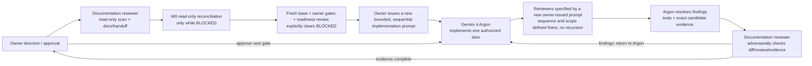

# Phase R1 — W0 Baseline & Decision Register

> **Status:** W0 CLOSEOUT & DECISION REGISTER · §10/§11 OWNER DECISIONS RECORDED · OWNER **W1-ONLY** AUTHORIZATION ACTIVE (READINESS VERDICT REMAINS `BLOCKED`; `W2–W6` NOT AUTHORIZED)
> **W1 state (2026-10-31, mới nhất):** 5 BLOCKER của W1 đã được remediation và kiểm chứng; owner đã chốt hai chính sách W1 ([owner delta §12](W0_OWNER_DECISION_DELTA_2026-10-29.md#12-w1-policy-decisions-2026-10-31)). W1 không còn blocker mở; owner đã xác nhận đóng W1, nên **W1 hoàn tất** ([closure status](IMPLEMENTATION_READINESS_BLOCKED_2026-10-27.md#2026-10-31-w1-owner-policy-decisions-and-closure-status)). Readiness tổng thể vẫn `BLOCKED` cho `W2–W6`. Các nhãn "W1 implements …" trong bảng OD bên dưới mô tả **phạm vi W1**, không phải kết quả đã đạt.
> **Updated:** 2026-10-31
> **Purpose:** give Gemini 4 Argon one bounded, evidence-labelled basis for W0 closeout and owner-authorized **W1-only** execution. This record does not claim a new readiness review (`READY`) and does not authorize `W2–W6`, production migration, EC2 work, live database mutation, merge, or deploy.

## Delivery grouping

R1 được điều phối thành ba đợt để giảm overhead nhưng vẫn giữ mã W0–W6 cho acceptance/review: **Đợt 1 — Foundation & secure case operations (`W0`–`W2`)**, **Đợt 2 — Business actions & shared AI (`W3`–`W4`)**, và **Đợt 3 — UI, verification & rollout (`W5`–`W6`)**. Thứ tự delivery là tuần tự **`W0 → W1 → W2 → W3 → W4 → W5 → W6`**, không chạy song song ([owner chốt 2026-10-31](W0_OWNER_DECISION_DELTA_2026-10-29.md#10-final-owner-decisions-2026-10-31)). Readiness review vẫn ở trạng thái `BLOCKED` (chưa có review mới trả về `READY`); ngày 2026-10-31 owner cấp ủy quyền có giới hạn **chỉ cho `W1`** (sau khi chốt W0), còn `W2–W6` vẫn khóa. Từng gate W0–W6 vẫn giữ nguyên. Bản phân nhóm chi tiết nằm trong [canonical R1 design](README.md) và [implementation handoff tham khảo](archive/R1_IMPLEMENTATION_HANDOFF_2026-10-26.md).

## 1. Read this first

- [Canonical R1 design](README.md) defines the product and security target.
- [Current implementation-readiness result](IMPLEMENTATION_READINESS_BLOCKED_2026-10-27.md) remains `BLOCKED` (no new readiness review `READY` is claimed); on 2026-10-31 the owner granted an explicit **W1-only** execution exception while `W2–W6` must not start.
- [R1 implementation handoff](archive/R1_IMPLEMENTATION_HANDOFF_2026-10-26.md) retains workstream/acceptance context; its former embedded execution prompt is retired and must not be restored, even if readiness later clears. Any future implementation prompt must be newly issued by the owner.
- [Historical owner decision snapshot 2026-10-28](OWNER_DECISIONS_2026-10-28.md) is a historical decision snapshot. Current OD-03 timer, OD-01/OD-02 follow-ups and OD-08 image/file phase scope are in the 2026-10-29 W0 owner delta linked in the next item.
- [W0 owner decision delta/proposals 2026-10-29](W0_OWNER_DECISION_DELTA_2026-10-29.md) supersedes the older record for OD-01–OD-08; its **[§10](W0_OWNER_DECISION_DELTA_2026-10-29.md#10-final-owner-decisions-2026-10-31) and [§11](W0_OWNER_DECISION_DELTA_2026-10-29.md#11-accepted-mechanics-2026-10-31) record the settled 2026-10-31 owner decisions and accepted mechanics** (superseding earlier §1–§9 open/proposal labels).
- [W0 review reconciliation](W0_REVIEW_RECONCILIATION_2026-10-28.md) is the only review chronology; completed reviews and retired prompts are in the [archive index](archive/README.md). The docs-review loop is closed; the next review is the single implementation-readiness review.
- [W0 review reconciliation](W0_REVIEW_RECONCILIATION_2026-10-28.md) distinguishes the stale dirty `dd544800` checkout from the `bbfd11d0` review base, records source corrections and remaining limits, and qualifies remote-verification evidence.
- [W0 read-only role inventory 2026-10-29](W0_ROLE_INVENTORY_2026-10-29.md) records source role, Google-login and deployment-schema behavior at source revision `bbfd11d0`; GitHub remote evidence is timestamp-bounded and live membership counts remain unavailable.
- [W0 contract freeze and gap register 2026-10-29](W0_CONTRACT_FREEZE_AND_GAP_REGISTER_2026-10-29.md) records the partial contract freeze and keeps policy-dependent fields and transitions `OPEN`.

**Important distinction:** the 2026-10-26 Argon owner-direction checklist was recorded as passed in that reviewed documentation. The later 2026-10-28 Argon follow-up found documentation consistency gaps, which this reconciliation addresses. Neither result means every endpoint, migration, approval, retention, or role-provisioning decision needed for implementation has been made; the unresolved implementation decisions below remain gates.

## 2. Baseline and evidence provenance

### Source baseline

| Claim | Evidence/status | Boundary |
|---|---|---|
| PR #46 merge | Merge SHA `146401f1831b81d5af4a110f6ddc06e50465b9a8` | Owner-provided project record. |
| GitHub `main` HEAD | Argon's follow-up report records the read-only command `git ls-remote origin HEAD refs/heads/main` against `https://github.com/tuteemovaixlong/CSKH_ban_le.git` at `2026-10-29T23:11:17+07:00`, and Argon repeated `git ls-remote origin refs/heads/main` on `2026-10-31` during W1 preflight; both returned `bbfd11d0ba4c13514a197a6b25802c4e217bedb3`, the PR #47 merge whose first parent is the PR #46 merge SHA above. | Timestamp-bounded read-only Git checks; do not infer EC2/deployment state from this Git ref. |
| Local ref and transport | W0 worktree `HEAD` and cached local `origin/main` are `bbfd11d0…`. | A separate local `git ls-remote origin refs/heads/main` attempt on 2026-10-28 failed to connect to GitHub on port 443. Keep that failure separate from Argon's successful timestamp-bounded check above; do not treat the cache as proof of a newer remote. Repeat a read-only remote check before any future branch, release or deployment action. Do not infer EC2/deployment state from this Git ref. |
| Prior code-review refs | `dd544800bb087d54a7faf564e723736905620045` and cached `bbfd11d0…` | Historical audit basis only. Do not transplant the dirty `dd544800` working-tree patch over the post-PR-46 baseline. |
| W0 branch/worktree | `docs/phase-r1-w0-owner-decisions` is based on `bbfd11d0ba4c13514a197a6b25802c4e217bedb3`. It was created clean; it now contains uncommitted tracked and untracked documentation changes. | The worktree is not currently clean. No application code was edited in this W0 pass. The original `dd544800` checkout and its dirty patch remain untouched. |

### Owner-supplied runtime evidence (2026-10-27)

The owner-pasted SSM output after configuring the demo tenant reported:

- instance `i-0fd116d8927d0e412`, public IPv4 `54.91.79.192`;
- public host `retailops.54-91-79-192.sslip.io`;
- active tenant `browser-demo-20260908014853` and `RETAILOPS_DEMO_TENANT_ID` loaded by the web container;
- PR #46 image digest unchanged: `sha256:25193c65e52e7cf7ec41a3a366fa3f76d63c034f686232f405affa04cf1eab63`;
- Compose valid, web healthy, HTTPS `/healthz` returned HTTP 200;
- no database mutation in that configuration step.

The owner subsequently said the tenant-routing bug was resolved. This is an **owner-reported operational snapshot**, not an independently repeated check. The pasted SSM output is not itself proof of a successful fresh-Google-account OAuth flow. The IP/host may change after EC2 Stop/Start. These facts concern the deployed PR #46 baseline only: **R1 implementation/runtime remains not started/not verified**.

### Read-only role/source inventory at verified `bbfd11d0`

This is a **static source/schema inventory only**; no production, EC2, Colab, or local application database was queried, and no personal data was read or emitted.

| Surface | Source finding | W0 implication |
|---|---|---|
| Role grants | `retailops/business/permissions.py`: `viewer` has only `READ`; `platform_admin` has `READ`, `CANCEL`, `STAFF`, `MANAGER`, and `PLATFORM_ADMIN`. | Neither role can be silently equated with a target business role or with `opsadmin`. |
| Membership schema | `retailops/identity/store.py`, `retailops/storage/pg_schema.py`, and `retailops/storage/pg_repositories.py` allow `viewer` and `platform_admin`; SQLite also has a role-constraint rebuild migration in `retailops/identity/store.py`. | Need aggregate-only counts and linked-session implications before any migration; no database inventory has been performed. |
| Google role selection/update | `retailops/http/auth_google.py:resolve_role_from_email` uses the configured allowlists, then `DEFAULT_ROLE` or `customer`. `retailops/identity/store.py:get_or_create_google_member` updates an existing membership when its current role differs from the newly resolved role and increments `auth_version`. | Source supports the reported promotion/demotion risk, including a `viewer` becoming `customer` and an existing staff/manager role being replaced when it is absent from allowlists. Treat as a blocker; no fix was applied. |
| Viewer/customer ID sharing | Membership creation applies customer-link collision checks only for role `customer`; a `viewer` can be assigned an ID also used by a customer. Viewer has `READ`, and read routes use the session customer scope. | Potential customer-data exposure is source-confirmed; actual membership counts and collisions are unknown. Include this relation in the aggregate-only inventory before executing safe removal or app-access disablement. |
| `platform_admin` use | `retailops/http/routes.py` includes `platform_admin` in a store-wide orders read condition; the admin-account governance implementation in `retailops/identity/store.py` recognizes both Manager and `platform_admin` in distinct scopes. Tests and CLI also retain the role. | This is not control-plane-only in the reviewed source. Owner direction is now gradual deprecation/removal; do not alias it to Manager or map it to `opsadmin`. ADR, aggregate inventory and migration/rollback mechanics remain open. |
| Runtime data counts | Not checked. EC2 is owner-reported OFF; no DB credentials or production connection were used. | Counts by tenant/active status, session links, and rollback impact remain unknown. |

## 3. W0 contract-freeze snapshot (candidate, not implementation authorization)

The R1 design contains a partial contract candidate with owner direction recorded for role taxonomy, gradual `platform_admin` retirement, Viewer fail-closed handling, trusted identity, selected-case context binding, case lifecycle and satisfaction feedback, pending-order cancellation, Staff/Manager return approval and JSONL as the shared integration format. The latest 2026-10-29 input supersedes the earlier 20-minute target: 3 minutes without a customer reply marks the interaction inactive, and every customer reply resets the timer. The 1.5-minute flag is restricted to non-production evaluation and specialized test states and must never be enabled in production; system overload must never auto-close staff-owned work. The [2026-10-31 owner decisions](W0_OWNER_DECISION_DELTA_2026-10-29.md#10-final-owner-decisions-2026-10-31) settle the `/api/admin/*` boundary, timer start/transition, Continue resumes the same `case_id` after resolution, Staff order-action scope, legacy-route compatibility, return/refund vocabulary, migration guardrails and W1→W4 order. Still **not implementation-frozen**: migration runbook, claim/history mechanics, JSONL field schema/delivery and evidence policy (accepted in [owner delta §11](W0_OWNER_DECISION_DELTA_2026-10-29.md#11-accepted-mechanics-2026-10-31)). Refund is Staff-requested, Manager-decided. Freeze only approved invariants; defer exact DTO fields, grants, migrations, and policy-dependent transitions until the remaining choices are recorded.

| Contract | Candidate invariant to preserve | Still open |
|---|---|---|
| Per-request `ExecutionContext` | Immutable/new per invocation; derive actor, role and tenant from the authenticated server session; include `execution_profile` and server-bound `case_id` plus only verified optional links/allowlists; never keep selected case or role override on mutable `Application.current_binding`. | Exact serialized schema/version and principal/customer FKs; `manager_ops_assist` scope; approved allowed-order/evidence projections. |
| API schemas | UI-supplied `case_id` is an opaque selector, not authorization; server resolves and rechecks tenant/object/state. Actor display name comes from session, not `staff_name` in request body. Customer `/api/events` must return only explicitly customer-safe events. Internal tool execution must bind profile and case server-side and fail closed if binding is absent. | Exact route/DTO versioning; legacy `/api/cancellation-proposals*`; which staff/manager endpoints and resolved-history reads are allowed. |
| Case/handoff/order-action separation | Case buckets remain exactly `waiting`, `in_progress`, `resolved`; do not use `cancelled` as a case status; handoff episodes and order-action requests have separate identities/lifecycles; case closure does not mean order cancellation/refund. Feedback links to a case outcome and maps to `chosen`/`rejected`; raw evidence is excluded from model payload by default. | Assignment/claim and timer concurrency; resolved-case history; evidence policy; migration runbook. |

These are the smallest safe contract invariants, not approval to implement them. API/state tables and candidate transitions are in the [canonical design](README.md); do not turn unresolved options into schema defaults.

## 4. Owner directions already reflected in the design

The eight-item checklist in the Argon review result is a record of direction, not eight remaining approvals:

1. Business roles are `customer`, `staff`, `manager`; store owner uses `manager`.
2. `opsadmin` is a separate Admin Console login path; it is not an alias for `platform_admin`.
3. `viewer` is legacy and must not be silently promoted to `customer`.
4. Staff/Manager UI must not use a canned “Nguyễn Mai Anh” identity; use trusted session `display_name` or no greeting.
5. Customer, Staff, and Manager share one workflow/graph with request profiles.
6. Staff Desk has `waiting`, `in_progress`, `resolved`; handoff is a separate view and has a separate lifecycle.
7. Cancel/return is a human-reviewed request with a required reason and optional protected evidence; AI cannot decide or mutate it.
8. Staff/Manager AI context is server-bound to the selected case and isolated from the customer transcript.

**Owner clarification (2026-10-28):** the owner has now directed that `platform_admin` be phased out as technical debt. This is a target disposition, not permission to alias it to `manager`, transfer cross-tenant privileges, or mutate a live database. The migration/retirement packet (ADR, aggregate inventory, eligibility, session invalidation, audit, backup and rollback) remains an implementation gate. See the [current owner decision delta](W0_OWNER_DECISION_DELTA_2026-10-29.md); the 2026-10-28 record is historical.

**Owner clarification (2026-10-28):** Staff/Manager display identity must come from the server-side authenticated Google account. Client `staff_name` is untrusted and cannot be used as actor/audit attribution; if trusted `display_name` is unavailable, no canned greeting is shown. For internal AI, `case_id` identifies the selected chat segment; vector retrieval is a separate, filtered evidence projection and cannot identify the segment on its own.

**Historical owner snapshot (2026-10-28; superseded where noted by the latest delta):** the earlier 20-minute auto-resolution target was superseded on 2026-10-29 by the 3-minute inactivity-marker direction; it must not be treated as current policy. The old GGUF/vision-projector note does not describe the supplied safetensors Colab launch. Current OD-03 direction, OD-08 model/app distinction, Colab target and safety boundary are recorded in the latest owner decision delta linked in the preceding paragraph. Other 2026-10-28 owner directions remain as historical context; use the decision table below for current status.

## 5. Implementation decisions still requiring explicit disposition

The identifiers below are the current decision register. Argon’s conservative Option A recommendations are not owner approval. OD-01–OD-04 record owner direction with migration/lifecycle mechanics and detailed data contracts open. OD-05's API scope is clarified but disposition remains open; OD-06, OD-07 and OD-08 attachment-policy details still require explicit disposition.

| ID | Decision | Status |
|---|---|---|
| OD-01 | Recorded W0 baseline is `bbfd11d0` (re-verified via `git ls-remote` on 2026-10-31). Keep `opsadmin` in its separate read-only Ops Console. Manager retains same-tenant `/api/admin/*` account/quota/audit administration (tenant strictly from session; deny self-suspend and suspending last active Manager; no role-change route). Retire `platform_admin` with no alias to Manager/`opsadmin` and no cross-tenant privilege transfer. | **DECIDED & ACCEPTED ([§10](W0_OWNER_DECISION_DELTA_2026-10-29.md#10-final-owner-decisions-2026-10-31), [§11.1](W0_OWNER_DECISION_DELTA_2026-10-29.md#111-apiadmin-route-inventory-od-01), [§11.5](W0_OWNER_DECISION_DELTA_2026-10-29.md#115-migration-runbook-od-07)) — W1 implements RBAC + identity v5 code/tests only; live DB migration remains gated** |
| OD-02 | Disable all legacy `viewer` app access (fail-closed across login/session/API; never auto-promote Viewer to `customer`). Disable legacy `viewer` memberships in identity v5 (`active=0`, `disabled_reason`, `auth_version` bump, session revocation) without deleting membership, customer, order, conversation or audit rows; physical row deletion only after aggregate integrity proof. | **DECIDED & ACCEPTED ([§10](W0_OWNER_DECISION_DELTA_2026-10-29.md#10-final-owner-decisions-2026-10-31), [§11.5](W0_OWNER_DECISION_DELTA_2026-10-29.md#115-migration-runbook-od-07)) — W1 implements fail-closed runtime + identity v5 disablement code/tests; live DB inventory/deletion not authorized** |
| OD-03 | Exactly three case statuses/buckets: `waiting`, `in_progress`, `resolved`; do not use case `cancelled`; 3-minute inactivity timer from bot message awaiting customer when `holder IS NULL` resolves with `inactivity` (`version`-guarded); customer reply resets/keeps open; 1.5-minute flag forbidden in production; `feedback_prompted_at` starts single 5-minute completion timer (`completed`); Continue or typed message after `resolved` resumes the **same `case_id`** into `waiting` while retained (new linked `case_id` after retention ends). Like/4–5→`chosen`, Dislike/1–3→`rejected`. | **DECIDED & ACCEPTED ([§10](W0_OWNER_DECISION_DELTA_2026-10-29.md#10-final-owner-decisions-2026-10-31), [§11.2](W0_OWNER_DECISION_DELTA_2026-10-29.md#112-timer-vs-concurrent-customer-message-and-resume-od-03-revised), [§11.3](W0_OWNER_DECISION_DELTA_2026-10-29.md#113-timer-after-feedback-od-03)) — deferred to W2/W5 (out of scope for W1)** |
| OD-04 | Customer submits cancel/return requests (agent fills detail panel); Staff or Manager approves/rejects; Staff-raised delivery-failure cancellation and refund requests are Manager-decided; Manager keeps direct status update; transactional `integration_outbox` + JSONL `retailops.order_action` v1 sink option A (daily-rotated protected file). | **DECIDED & ACCEPTED ([§10](W0_OWNER_DECISION_DELTA_2026-10-29.md#10-final-owner-decisions-2026-10-31), [§11.4](W0_OWNER_DECISION_DELTA_2026-10-29.md#114-jsonl-envelope-and-outbox-od-04od-06)) — deferred to W3 (out of scope for W1)** |
| OD-05 | Keep `/api/cancellation-proposals*` as a compatibility facade creating/confirming a `pending_review` cancel request rather than directly cancelling the order. | **DECIDED ([§10](W0_OWNER_DECISION_DELTA_2026-10-29.md#10-final-owner-decisions-2026-10-31)) — deferred to W3 (out of scope for W1)** |
| OD-06 | Separate request status (`pending_review`, `approved`, `rejected`, `withdrawn`), order status (`pending`, `shipping`, `delivered`, `cancelled`, `returned`), and refund status (`none`, `refund_requested`, `refund_approved`, `refund_rejected`, `refunded`). | **DECIDED ([§10](W0_OWNER_DECISION_DELTA_2026-10-29.md#10-final-owner-decisions-2026-10-31)) — deferred to W3 (out of scope for W1)** |
| OD-07 | Identity v5 and Business v5 forward migration, aggregate preflight, backup/scratch verification, `auth_version` session invalidation, postcheck invariants and rollback/compensating rules. | **DECIDED & ACCEPTED ([§10](W0_OWNER_DECISION_DELTA_2026-10-29.md#10-final-owner-decisions-2026-10-31), [§11.5](W0_OWNER_DECISION_DELTA_2026-10-29.md#115-migration-runbook-od-07)) — W1 touches identity v5 code & isolated tests only; Business v5 & live execution remain gated** |
| OD-08 | Evidence intake (JPEG/PNG/WebP/PDF, ≤5 files, ≤10 MB image, ≤20 MB/≤20 pages PDF, magic bytes, EXIF strip, malware scan, 90-day retention) and production inference on Colab GPU (compact case-bound context, 8,192-token limit; two-layer auth via vLLM `--api-key` + tunnel policy required before any live customer data). | **DECIDED & ACCEPTED ([§10](W0_OWNER_DECISION_DELTA_2026-10-29.md#10-final-owner-decisions-2026-10-31), [§11.6](W0_OWNER_DECISION_DELTA_2026-10-29.md#116-evidence-and-production-inference-on-colab-od-08-revised)) — deferred to W3/W4/W6 (no Colab/live data in W1)** |

| Area | Known owner direction | Still unresolved; do not guess in implementation |
|---|---|---|
| Legacy `viewer` and new-account default | Only three business roles; Viewer app access is disabled first, fail-closed and never auto-promoted. | Remove an existing Viewer membership only after aggregate inventory and integrity checks prove it safe; otherwise freeze/lock it and affected sessions, then retire gradually. Define collision handling, role-resolution guard, migration and rollback; preserve linked data and history. |
| `platform_admin` disposition | Owner direction: deprecate/remove gradually; keep separate from `opsadmin`; no runtime alias to Manager and no privilege transfer. | Enumerate source/schema/CLI/API/permission references; define eligible mapping, principal/membership/session/audit handling, compatibility window, migration version, backup and rollback. Separate ADR and tests are required before migration code. |
| Manager’s existing human admin rights | Manager is the store-owner business role; `opsadmin` remains a separate login. | Tracked centrally under OD-01: exact same-tenant `/api/admin/*` scope remains open. Do not transfer `platform_admin` cross-tenant capability to Manager or AI. |
| Staff Desk access and history | Shared Staff/Manager workspace; exactly three case buckets; all case endings enter `resolved`/Completed; after 3 minutes without customer reply the interaction is inactive; customer reply resets the timer; do not auto-close staff work due to overload; 1.5-minute flag is evaluation/specialized-test only and never production; customer reply after resolution returns work to waiting. | Timer start/eligible state and inactive-vs-resolved transition, atomic claim/assignment, intent handling, race/idempotency, reopening identity, resolved-history access and retention; case closure never means order cancellation. |
| Cancel/return authority | Customer submits cancel/return requests; Staff or Manager reviews the agent-built panel and approves/rejects; Staff-raised delivery-failure cancellation and refund requests are Manager-decided; Manager may directly update order status; legacy routes stay as a compatibility facade ([2026-10-31](W0_OWNER_DECISION_DELTA_2026-10-29.md#10-final-owner-decisions-2026-10-31)); preserve audit/history and DB state; integration input/output share one JSONL format; AI advisory only. | Exact order-state/version/idempotency and JSONL schema/delivery/retry contract ([accepted mechanics](W0_OWNER_DECISION_DELTA_2026-10-29.md#11-accepted-mechanics-2026-10-31)). |
| Customer satisfaction feedback | For agent end-to-end success or staff-assisted cases, collect Like/Dislike or 1–5 stars; Like/4–5→`chosen`, Dislike/1–3→`rejected`; thank customer; retain feedback linked to outcome for future model improvement. | Event schema, privacy/consent/retention and curated offline evaluation/training governance; do not auto-train/update live model on each rating. |
| Evidence | Optional evidence, protected from unrelated users and excluded from model context by default. | Storage backend, allowed MIME/types, per-file and per-request size/count, malware/scanning controls, authorized serving, retention/deletion, audit and backup policy. |
| AI data/tools/governance | One shared graph; selected-case binding; role/profile server authorization; least-data projection. | Production availability of `/api/tools/execute`; approved Manager aggregates/fields; cache partition or bypass; quota actor attribution; internal draft/audit readers and retention. |

**W0 gate:** Gemini may inventory and report these questions, but may not silently decide a privilege, customer-data migration, return/refund transition, or destructive lifecycle rule. The owner has recorded Customer as return requester, Staff/Manager as approver and Staff's delivery-failure cancellation request scope ([2026-10-31](W0_OWNER_DECISION_DELTA_2026-10-29.md#10-final-owner-decisions-2026-10-31)); do not present those choices as unresolved. Keep other unresolved paths deny-by-default and return them for owner review before crossing the affected implementation boundary.

## 6. Documentation-only scope for Gemini’s preflight

This packet was prepared by the documentation/review role. Gemini is the **separate implementation role**. Before coding, Gemini must do a **read-only source/docs preflight** and return one implementation plan with any owner decisions that block a boundary. The preflight must:

1. Confirm its actual checkout/ref and distinguish latest remote main from the locally cached post-PR-46 baseline above.
2. Re-read the role/session/Google login, authorization, Staff Desk/handoff, cancellation, tool, graph/checkpoint, cache/quota and audit code paths named in the R1 design; cite exact paths/symbols/line ranges.
3. Produce an aggregate-only, read-only inventory design for `viewer` and `platform_admin` membership counts, tenant counts, active/inactive state, linked-session implications, and the count of `viewer` memberships sharing a `customer_id` with a `customer` membership. Do not print email, display name, customer ID, credentials, or secrets; do not mutate the database.
4. Map each owner direction to an acceptance row and map each unresolved decision above to the specific code/schema/test boundary it blocks.
5. Report stale links/source paths, including the `retailops_tools.py` path correction tracked in the handoff, and keep historical/current/planned/runtime claims distinct.
6. Return `READY FOR OWNER DECISION` or `BLOCKED`, findings, and the smallest safe next step. Do not begin feature implementation in the preflight response.

The documentation/review role does not write implementation code, run application tests/build/CI, perform Git write operations (branch/ref changes, rebase, merge, push), run migrations, use EC2/SSM, or change production data. W0 may perform read-only Git queries and documentation checks. The [archived 2026-10-27 Argon implementation trigger](archive/ARGON_R1_IMPLEMENTATION_TRIGGER_2026-10-27.md) is superseded and must not be used. Any future implementation prompt must be newly issued by the owner only after outstanding decisions are closed, a clean candidate is based on freshly verified remote `main`, and a fresh implementation-readiness review explicitly clears `BLOCKED`.

## 7. Related project records

- [Phase R1 canonical design](README.md)
- [R1 implementation handoff](archive/R1_IMPLEMENTATION_HANDOFF_2026-10-26.md)
- [Current readiness status: BLOCKED](IMPLEMENTATION_READINESS_BLOCKED_2026-10-27.md)
- [Archived Argon implementation trigger — superseded; do not execute](archive/ARGON_R1_IMPLEMENTATION_TRIGGER_2026-10-27.md)
- [Archive index for prior review iterations](archive/README.md)
- [Project status](../CURRENT_PROJECT_STATUS.md)
- [Roadmap](../PLAN_ROADMAP_INDEX.md)
- [Acceptance matrix](../03_EVALUATION/ACCEPTANCE_MATRIX.md)
- [Historical owner decision snapshot 2026-10-28](OWNER_DECISIONS_2026-10-28.md)
- [W0 owner decision delta/proposals 2026-10-29](W0_OWNER_DECISION_DELTA_2026-10-29.md)
- [Argon/Opus review reconciliation](W0_REVIEW_RECONCILIATION_2026-10-28.md)

## 8. Recurrent responsibility and review loop

Keep these roles separate for any R1 implementation slice. On 2026-10-31 the owner granted a bounded **W1-only** execution authorization (W0 closeout + W1 identity, RBAC, backend authorization, identity v5 migration code, and isolated W1 tests only); [implementation readiness](IMPLEMENTATION_READINESS_BLOCKED_2026-10-27.md) remains `BLOCKED` (no `READY` review claimed) and `W2–W6` remain unauthorized.

| Role | Responsibility | Must not do |
|---|---|---|
| Owner | Decide product/security policy; approve implementation, merge, migration, and deployment gates. | Treat a reviewer’s recommendation as owner approval. |
| Documentation/review assistant in this thread | Read-only code/docs inspection; maintain the design, handoff, evidence links and prompts; independently challenge Argon’s code-review claims/findings against the source, candidate diff and acceptance criteria; return concrete findings to Argon. | Implement or repair application code; run tests or Git write commands; deploy or mutate production. |
| Future Gemini 4 Argon implementation task (not active) | Only after fresh base verification, owner approval and a completed readiness review explicitly clears `BLOCKED`: implement one owner-authorized sequential slice, test it, and record evidence/review. | Start W1–W6 from a docs PASS or requested review; change unresolved policy by assumption; treat parallel reviewer/lane instructions as authorization; deploy or migrate production without separate owner approval. |
| Argon code reviewers | Review the exact candidate/diff independently for security, persistence/domain and workflow/UI risks. | Edit the candidate under review, approve their own changes, or recursively spawn more reviewers. |

Repeat the review cycle for each candidate until the implementation findings are resolved. The documentation/review role may mark **docs/source review** status only; only the owner may authorize code merge, production migration, or deployment. After the readiness gate is cleared, any reviewer process, number and sequence must be stated in a new owner-issued prompt; do not carry forward reviewer-count or parallel-review instructions from superseded prompts, and do not recursively delegate.
