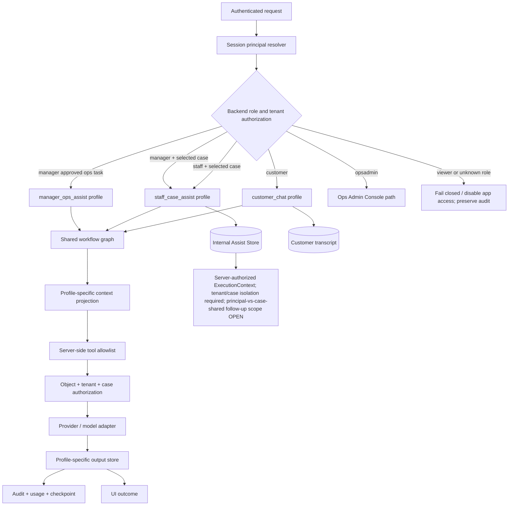
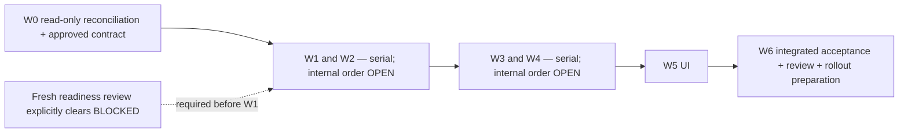

# Phase R1 Implementation Handoff — Role-aware Operations

> **Status (2026-10-30):** earlier documentation/design review `PASS` and focused Argon `PASS` cover only their historical revisions. Argon's 2026-10-30 docs-only reviews ran in five rounds: the first four finding sets (`RF`, `R2`, `R3`, `R4`) are historical; the latest recorded fifth-round review returned `CHANGES REQUIRED` (0 BLOCKER / 0 MAJOR / 3 MINOR) with findings `R5-01`–`R5-03`, recorded [here](W0_ARGON_DOCS_REVIEW_ROUND5_2026-10-30.md). Local R5 synchronization is applied and pending one bounded independent docs-only review. Implementation readiness remains `BLOCKED` (separate owner-provided Argon result: 9 BLOCKER / 6 MAJOR / 3 MINOR); R1 code not started. All implementation/readiness prompts formerly embedded below are superseded. This file is reference-only and does not authorize code or tests. The [latest W0 owner decision delta](../W0_OWNER_DECISION_DELTA_2026-10-29.md) and [current W0 register](../W0_BASELINE_AND_DECISION_REGISTER_2026-10-27.md) control.
> **Date:** 2026-10-26 · delivery grouping reconciled 2026-10-29
> **Purpose:** giữ kế hoạch implementation có kiểm soát làm tài liệu tham khảo. File này không tự cho phép code, deploy, migration production hoặc thay đổi quyền; các policy đã ghi mới là owner direction/target shape cho tới khi decision register đóng.

## 1. Read this first

Phase R1 đã có final focused documentation review `PASS` ngày 2026-10-26; đó là kết quả lịch sử. Argon cũng xác nhận `PASS` cho bản docs three-wave trước đây, không bao gồm owner delta mới nhất. Argon's latest recorded docs review dated 2026-10-30 (fifth round, `R5-01`–`R5-03`) returned `CHANGES REQUIRED` (0/0/3); the result and bounded re-review handoff are linked in the source list below. Các kết quả docs không gỡ implementation block.

- Kết quả `0 BLOCKER / 0 MAJOR / 0 MINOR` và checks PASS chỉ áp dụng cho revision 2026-10-26.
- Historical three-wave delta review: Argon `1 BLOCKER / 3 MAJOR / 2 MINOR`; Opus `CHANGES REQUIRED`. These results apply only to their cited revisions. The latest recorded docs-only result is the 2026-10-30 fifth-round review listed below.

Các review tài liệu chỉ xác nhận nội dung/tính nhất quán trong phạm vi revision đã đọc. Chúng không xác nhận code, test, CI, database, EC2, deploy hoặc production runtime, và không tự gỡ implementation readiness `BLOCKED`.

Nguồn chuẩn:

- [Canonical Phase R1 design](../README.md)
- [Final Argon docs PASS result](ARGON_FINAL_FOCUSED_DOCS_REVIEW_2026-10-26_RESULT.md)
- [Independent audit synthesis](INDEPENDENT_AUDIT_SYNTHESIS_2026-10-26.md)
- [Current project status](../../CURRENT_PROJECT_STATUS.md)
- [Roadmap](../../PLAN_ROADMAP_INDEX.md)
- [Acceptance matrix](../../03_EVALUATION/ACCEPTANCE_MATRIX.md)
- [W0 baseline and decision register](../W0_BASELINE_AND_DECISION_REGISTER_2026-10-27.md)
- [Argon/Opus review reconciliation](../W0_REVIEW_RECONCILIATION_2026-10-28.md)
- [Completed historical W0 Argon → Opus handoff](W0_ARGON_RECONCILIATION_HANDOFF_2026-10-28.md)
- [Historical owner decision snapshot](../OWNER_DECISIONS_2026-10-28.md)
- [Latest W0 owner decision delta/proposals 2026-10-29](../W0_OWNER_DECISION_DELTA_2026-10-29.md) supersedes older OD wording where explicitly noted; it is not implementation authorization.
- [Historical 2026-10-29 owner-delta review prompt](W0_LATEST_OWNER_DELTA_REVIEW_HANDOFF_2026-10-29.md) and [historical Argon result](W0_ARGON_LATEST_OWNER_DELTA_REVIEW_2026-10-29.md)
- [Latest recorded Argon docs review result (fifth round, `R5-01`–`R5-03`)](W0_ARGON_DOCS_REVIEW_ROUND5_2026-10-30.md), [historical fourth-round result (`R4-01`–`R4-03`)](W0_ARGON_DOCS_REVIEW_ROUND4_2026-10-30.md), [historical third-round result (`R3-01`–`R3-05`)](W0_ARGON_DOCS_REVIEW_ROUND3_2026-10-30.md), and [bounded re-review handoff](W0_ARGON_DOCS_REVIEW_HANDOFF_2026-10-30.md)
- [Historical three-wave Argon docs review prompt](W0_THREE_WAVE_DOCS_REVIEW_HANDOFF_2026-10-29.md)
- [Archived implementation trigger — superseded; do not execute](ARGON_R1_IMPLEMENTATION_TRIGGER_2026-10-27.md)

> **Execution gate:** the owner-provided implementation-readiness review remains `BLOCKED` (9 BLOCKER / 6 MAJOR / 3 MINOR). Only W0 read-only reconciliation is authorized. Neither the historical three-wave docs `PASS` nor the latest docs `CHANGES REQUIRED` result changes this gate; use the latest owner delta and W0 register for current policy/status.

## 2. Owner direction recorded — implementation policy not frozen

Các điểm sau ghi nhận định hướng/invariant đã được owner xác nhận. Chúng không đóng băng DTO, schema, migration hay các state transitions còn mở:

1. Business roles chính xác là `customer`, `staff`, `manager`. Chủ shop dùng `manager`.
2. `opsadmin` là account/auth path riêng cho Ops Admin Console, không phải business-chat role.
3. `viewer` là legacy role ngoài target; phải inventory và xử lý fail-closed. Không tự động map `viewer` thành `customer`.
4. `platform_admin` là technical debt phải deprecate/remove dần; không runtime-alias vào `manager`, không chuyển quyền cross-tenant cũ sang Manager, và không mặc định đồng nhất với `opsadmin`.
5. Customer, Staff và Manager dùng **một shared workflow/graph**; khác biệt nằm ở request profile, context projection, tool allowlist, output store và authorization.
6. Staff Desk có đúng ba lifecycle bucket: `waiting`, `in_progress`, `resolved`. Handoff là view/filter riêng, không phải bucket thứ tư.
7. `case_id` là identity của work item; `handoff_id` và `order_action_request_id` nhận diện linked lifecycle riêng. Cardinality, case reopen và quy tắc re-handoff sau khi đóng vẫn mở trong OD-03.
8. Cancel/return phải tạo request có order ownership, reason bắt buộc, evidence tùy chọn và human review. AI chỉ advisory, không tự hủy đơn, refund hoặc approve.
9. Mọi lượt internal AI phải được server bind theo actor, role, tenant, execution profile và selected `case_id`; không có case thì `staff_case_assist` fail-closed. Cách phân vùng/lưu lịch sử follow-up trong nội bộ vẫn cần owner chốt.
10. Internal prompt/draft/audit không được ghi vào customer transcript hoặc customer-facing event API.
11. Display name nội bộ chỉ dùng `display_name` tin cậy từ session; nếu không có thì không hiển thị canned greeting/demo name.
12. Authorization phải nằm ở backend/API/tool executor; prompt, schema và ẩn nút UI không phải security boundary.
13. Case selection uses an opaque server-authorized `case_id`; vector/lexical retrieval is a separate filtered evidence projection and cannot identify the requested chat segment by itself.

## 3. Phạm vi implementation

### In scope

- Chuẩn hóa role/profile và authorization matrix.
- Case domain và Staff Desk lifecycle.
- Handoff persistence/integrity và queue views.
- Order-action request cho cancel/return.
- Selected-case internal AI trên shared graph.
- Tool/data/context allowlist, checkpoint, cache, quota và audit isolation.
- Staff/Manager UI, internal chat, case panel và evidence presentation.
- Direct API/security tests, UI tests, PostgreSQL tests, CI và rollout checklist.

### Out of scope trong R1 implementation đầu tiên

- Tách thành ba agent graph độc lập.
- Tạo role Owner riêng.
- Tự động migration Viewer → Customer.
- Runtime alias hoặc chuyển nguyên trạng quyền `platform_admin` vào `manager`; retirement requires its own ADR, inventory, migration and rollback evidence.
- Tự động refund/cancel bằng model.
- Tích hợp presence/ETA nhân viên thật nếu chưa có backend support.
- Thay đổi frozen benchmark 250 cases hoặc mở G4–G7 gate.
- Production migration/deploy trước khi acceptance và owner review hoàn tất.

## 4. Target architecture



**Không được** dùng `Application` singleton để giữ selected case, role override hoặc mutable request context. Mọi context phải được tạo mới cho từng request và kiểm tra lại ở backend.

## 5. Ba đợt delivery và các work package W0–W6

Bản handoff tham khảo này giữ các mã W0–W6 để nối với acceptance/reviewer, nhưng cách điều phối được gom thành ba đợt:

| Đợt | Mã | Phạm vi |
|---|---|---|
| **Đợt 1 — Foundation & secure case operations** | `W0`–`W2` | Contract/reconciliation, identity/RBAC/backend authz, case/handoff/Staff Desk |
| **Đợt 2 — Business actions & shared AI** | `W3`–`W4` | Cancel/return request, evidence boundary, shared graph và selected-case AI |
| **Đợt 3 — UI, verification & rollout** | `W5`–`W6` | UI, direct acceptance, independent review, CI và rollout preparation |

`W0` hiện chỉ là read-only reconciliation/design work; không bao gồm viết/chạy application tests, code, migration, build/CI hay runtime operation khi readiness `BLOCKED`. Dependency delivery: `W0 → (W1, W2) → (W3, W4) → W5 → W6`; không work package nào chạy song song. Thứ tự nội bộ của `W1`/`W2` và `W3`/`W4` chưa được owner chốt; phải làm rõ trước khi schedule/implement. Gộp vào một đợt không mở quyền implementation.

### Đợt 1 — Foundation & secure case operations

#### W0 — Read-only reconciliation và contract-freeze proposal

**Mục tiêu:** lập và đối chiếu contract/DTO/route matrix để owner phê duyệt sau này; chưa có contract nào được coi là frozen chỉ vì được ghi trong handoff này.

**Việc phải làm:**

- Inventory read-only `viewer`/`platform_admin` role handling ở mức tổng hợp, không xuất PII/secrets và không sửa database.
- Ghi nhận OD-01–OD-08, phân biệt owner direction đã ghi với mechanics/policy còn mở; không tự quyết định policy quyền/tài chính.
- Draft `ExecutionContext`, API/DTO boundary, lifecycle/state-transition contract và role/profile/tool matrix để owner review.
- Thiết kế (chưa viết/chạy) baseline negative-test cases cho unknown/legacy role, actor spoofing, unbound tools và cross-tenant/object/case access.
- OD-08 W0 contract: record the attachment threat/data-flow boundary, distinguish model capability from app/endpoint capability, exclude raw bytes from model payloads by default, and keep the current public ngrok endpoint disallowed for real customer data; do not decide open MIME/size/retention policy here.
- Xác minh nguồn/base/ref; prior SHA `bbfd11d0…` là evidence có mốc thời gian, không giả định đó là `main` mới nhất. Trước readiness review/branch tiếp theo, kiểm tra remote mới và tạo candidate chỉ sau khi được owner cho phép.

**Gate:** khi implementation readiness còn `BLOCKED`, chỉ W0 read-only/documentation actions được phép; cấm W1–W6, kể cả viết/chạy app tests. W1–W6 chỉ mở khi OD và contract liên quan được owner chốt, base được xác minh mới, candidate sạch được chuẩn bị theo owner authorization, và fresh implementation-readiness review trả rõ trạng thái cho phép đi tiếp.

#### W1 — Identity, role và backend authorization

**Mục tiêu:** mọi ingress/API/tool call nhận actor từ session và kiểm tra role, tenant, object scope ở server.

**Acceptance:**

- Manager bao gồm owner; không có Owner role mới.
- `opsadmin` không đi vào business chat graph.
- Viewer/platform-admin drift không được auto-promote.
- Body `staff_name` không thể giả danh actor.
- Mọi Staff Desk read/reply/resolve đều kiểm tra case tồn tại, tenant, state và principal capability.
- `/api/tools/execute` không thể gọi unbound internal tool.
- Upload, read, download and preview routes for evidence must enforce server-side tenant/case authorization and validated content handling; client-supplied identifiers or MIME labels cannot grant access.

#### W2 — Case, handoff và Staff Desk lifecycle

**Mục tiêu:** persistence đúng trước UI acknowledgment.

**Acceptance:**

- Mỗi handoff episode có identity riêng; `case_id` reuse hay tạo mới khi customer reply/reopen sau resolve vẫn OPEN theo OD-03.
- Resolve chỉ đóng đúng case/episode được xác định.
- Queue không đếm `resolved` như pending.
- Handoff persistence fail không được trả “đã kết nối”.
- Latest owner direction supersedes the earlier 20-minute target: after 3 minutes without customer reply, mark the interaction inactive; each customer reply resets the timer. The 1.5-minute flag is allowed only for non-production evaluation and specialized test states and must never be enabled in production. Exact timer start/eligible event and mapping from inactivity to case state remain open; inactivity alone does not mean `resolved`. Never auto-close staff-owned `in_progress` work because of system overload. When customer signals completion, ask if anything else is needed, collect Like/Dislike or rating, then follow the prior approximately 5-minute post-feedback direction once its anchor is approved; customer reply after `resolved` returns work to `waiting`; case has no `cancelled` status. See [OD-03 latest delta](../W0_OWNER_DECISION_DELTA_2026-10-29.md#4-od-03--3-minute-target-and-timer-safety).
- Concurrent message, resolve, re-handoff và polling có regression tests.
- Store only case-linked attachment reference/metadata in the lifecycle contract; define ownership, deletion/retention and episode linkage before implementation. Raw file bytes remain outside transcript/model context by default.
- Staff/Manager được nhận/claim, release và transfer; atomicity, timer anchor/reset, race/idempotency, resolved-history access và feedback schema/privacy mechanics còn phải chốt.
- Proposed responsibility split (not yet owner-frozen): W2 feedback event/persistence, W5 UI controls, W6 integrated acceptance.

### Đợt 2 — Business actions & shared AI

#### W3 — Order-action request cancel/return

**Mục tiêu:** tách yêu cầu hủy/đổi-trả khỏi conversation/case closure.

**Acceptance:**

- Chỉ chọn order thuộc customer của case.
- `reason` bắt buộc; evidence optional.
- Evidence có auth, size/type validation, retention, audit và không gửi raw bytes vào model mặc định.
- Request có trạng thái review riêng; không nhét `return`/`refund` vào order-status enum hiện tại nếu chưa có policy.
- Owner direction: pending-order cancellation được nêu cho Customer/Staff/Manager; Manager có thể dùng direct order-status update path. Customer là người yêu cầu return; authenticated Staff hoặc Manager có thể approve/reject; lưu lịch sử, update DB và thống nhất một JSONL format/schema family cho integration input/output.
- Exact Staff acting-for-customer scope, canonical return/refund state vocabulary (OD-06), order version/idempotency, transaction/audit/outbox/retry, JSONL envelope/consumer, evidence policy và disposition của app endpoints `/api/cancellation-proposals*` (OD-05) vẫn OPEN trước implementation. `/api/cancellation-proposals*` là API ứng dụng, không phải DeepSeek/OpenAI API.
- Human authorization is required; AI is advisory and cannot approve, refund or mutate. Do not infer that case resolution cancels an order or that an order action resolves a case.

#### W4 — Shared graph và selected-case AI

**Mục tiêu:** một graph, profile-specific context và tool boundary.

**OD-08 cross-cutting boundary:** R1 may prepare a production-capable Colab inference path for real customer data only after separate endpoint, privacy and release approval. The default payload is a minimized, server-authorized projection bound to the selected `case_id`, not a full transcript. The current serving limit is 8,192 tokens; 16,384 is an evaluation candidate only after L4 memory, latency and quality evidence. The supplied public ngrok/vLLM path has no configured vLLM `--api-key` and unverified privacy/request controls, so it is not approved for real data. The application currently suppresses image pixels for the named Gemma model and has no PDF/OCR extraction; raw attachments remain excluded from model payloads by default.

```mermaid
sequenceDiagram
    participant U as Staff/Manager UI
    participant API as API + session principal
    participant CTX as Case context builder
    participant WF as Shared workflow graph
    participant TOOL as Tool executor
    participant DB as Tenant/identity/business stores
    participant AUD as Audit/checkpoint/usage

    U->>API: select case_id + ask question
    API->>API: authorize principal, tenant, case state
    API->>CTX: build projection for case_id
    CTX->>DB: load verified case links and allowlisted evidence
    DB-->>CTX: bounded projection; raw evidence excluded by default
    CTX->>WF: immutable execution_profile + case context
    WF->>TOOL: only approved profile tools
    TOOL->>DB: re-check tenant/object/case scope
    DB-->>TOOL: result or deny
    WF-->>API: answer + citations/next-step advisory
    API->>AUD: actor, profile, case, usage, checkpoint
    API-->>U: internal answer; never customer transcript
```

**Acceptance:**

- Không có selected case → `400/403` và không chạy internal assist.
- Chuyển Case A → Case B không tái sử dụng history/cache/checkpoint của A.
- Internal data must never cross tenant/case boundaries. Persisted follow-up history may be per principal or shared within a case; the exact principal-sharing policy and cache/checkpoint key contract are OPEN and must align with the approved `ExecutionContext`. Do not hard-code a proposed partition tuple as owner-approved policy.
- Provider payload được kiểm tra thực tế ở mọi adapter.
- Customer-only instructions/tool schema không xuất hiện trong Staff/Manager profile.
- AI không được mutate order, refund, resolve hay approve.
- Image/file handling must use an explicit model-capability allowlist and protected, scanned projections; no raw base64/file bytes in prompts, tools, caches, checkpoints or logs by default. Colab validation uses synthetic or sanitized fixtures until the eventual protected production path is separately approved.

### Đợt 3 — UI, verification & rollout

#### W5 — UI Staff Desk, Manager Console và internal chat

**Mục tiêu:** UI phản ánh state backend, không mô phỏng quyền.

**Acceptance:**

- Có ba bucket rõ ràng: Hàng chờ, Đang xử lý, Đã xử lý.
- Handoff view/filter riêng.
- Case detail panel hiển thị order request, lý do, cancel/return, evidence metadata và recommendation.
- Có selected-case indicator trong internal chat.
- Staff/Manager không thấy “Nguyễn Mai Anh” hoặc canned greeting demo.
- Không có case → Send bị disable ở UI và backend vẫn fail-closed.
- Manager mở Staff Desk từ cả các entry points hiện có đều load queue/poll đúng.
- Provide explicit upload, preview, progress, unsupported-type, validation-error and access-denied UI states; never expose an attachment preview without an authorized case.

#### W6 — Test, review và rollout

**Mục tiêu:** chứng minh behavior bằng direct tests trước merge/deploy.

**Bắt buộc:**

- API role × tenant × object × state matrix.
- Cross-tenant/cross-case negative tests.
- Viewer/platform-admin migration tests.
- Handoff race/retention tests.
- Cancel/return evidence/security/idempotency tests.
- Shared graph/profile/provider payload tests.
- Checkpoint/cache/quota isolation tests.
- Image/file tests for MIME spoofing, corrupt/oversized/multiple inputs, image grounding, bounded PDF/OCR projection and page provenance; provider payload tests must prove raw evidence is excluded by default.
- Colab L4 evaluation pins model revision, vLLM version and chat-template digest, compares the 8,192-token baseline with an optional 16,384-token candidate, and records memory/latency/quality evidence. Use synthetic/sanitized fixtures only until endpoint authentication, request limits, privacy, retention/deletion and release approval are complete.
- UI lifecycle and no-demo-name tests.
- Independent code review trước merge.
- CI trên candidate immutable SHA.
- Read-only runtime verification sau deploy.

## 6. Dependency order — no parallel execution



The slash/pair notation groups scope; it does not authorize parallel execution. Owner must choose whether W1 precedes W2 or vice versa, and whether W3 precedes W4 or vice versa, before scheduling. No work may cross the preceding group's acceptance/review gate. While readiness is `BLOCKED`, W0 is read-only: do not write/run application tests, change code, build, run CI, migrate, or touch runtime/data.

## 7. Review gates

### Gate A — trước khi viết behavior

- OD-01–OD-08 dispositions and the contract for the first authorized slice are explicitly owner-approved; unresolved decisions remain fail-closed and outside that slice.
- Before any implementation candidate is prepared, current GitHub `main` must be freshly verified read-only; the candidate base SHA must be stated exactly; any candidate worktree/branch creation must be separately owner-authorized and clean.
- Fresh implementation-readiness review on that exact candidate explicitly clears `BLOCKED`; a requested or pending review is not approval.
- Order within W1/W2 and W3/W4 is owner-confirmed; no parallel lanes.
- Applicable migration/forward-compatibility/rollback plan is approved before any migration-related implementation.

### Gate B — trước khi merge implementation

- Direct API/tool tests pass.
- Independent security/RBAC review pass.
- No cross-tenant/cross-case context leak.
- Evidence browser/storage controls pass.
- No demo-name fallback.

### Gate C — trước deploy

- CI chạy trên immutable candidate.
- Migration dry-run/read-only checks pass.
- Rollback plan và backup evidence có sẵn.
- Owner sign-off cho approval boundaries.

### Gate D — sau deploy

- Read-only health/API/UI checks.
- Kiểm tra actual serialized provider payload nếu được phép.
- Kiểm tra queue counts, case transitions, audit và quota.
- Không tuyên bố Phase R1 hoàn tất nếu chưa có runtime evidence.

## 8. Historical sub-agent prompts — superseded

The former Security/RBAC, Domain/API and AI/UI read/write lane prompts are removed from this active handoff because they permit parallel work and do not require a fresh readiness clearance. Do not reuse them. No implementation or sub-agent assignment is currently authorized.

## 9. Focused documentation re-review prompt

The [three-wave Argon docs re-review handoff](W0_THREE_WAVE_DOCS_REVIEW_HANDOFF_2026-10-29.md) is historical and its `PASS` covers only that prior revision. For the bounded docs-only re-review after local checks, use the [2026-10-30 re-review handoff](W0_ARGON_DOCS_REVIEW_HANDOFF_2026-10-30.md) and [latest recorded fifth-round Argon findings (`R5-01`–`R5-03`)](W0_ARGON_DOCS_REVIEW_ROUND5_2026-10-30.md); neither can clear implementation readiness.

## 10. Implementation prompt status

There is **no active Argon implementation prompt** in this handoff. The historical implementation prompt has been removed because its W0/testing and parallelization instructions conflict with the current gate. After all owner gates are closed and a fresh readiness review explicitly clears `BLOCKED`, the owner must issue a new, bounded, sequential implementation prompt tied to a freshly verified clean base. The archived [2026-10-27 implementation trigger](ARGON_R1_IMPLEMENTATION_TRIGGER_2026-10-27.md) is superseded and must not be executed.

## 11. Handoff completion checklist

- [x] Historical documentation/design PASS (2026-10-26) and focused Argon PASS for the earlier three-wave revision; the latest recorded fifth-round docs review returned `CHANGES REQUIRED` (0/0/3; `R5-01`–`R5-03`), and local synchronization is applied pending bounded independent review.
- [x] Owner direction and role taxonomy recorded.
- [x] Shared workflow direction recorded.
- [x] Case/handoff/order-action identity recorded.
- [x] Acceptance and Mermaid diagrams recorded.
- [x] Sequential dependency and review gates recorded; historical parallel lanes superseded.
- [x] Argon docs review results are recorded for rounds RF, R2, R3, R4 and R5; the R5 result and bounded next docs-only review handoff are linked above.
- [x] Historical readiness/execution prompts removed from active handoff.
- [ ] W0 contract freeze approved.
- [ ] Fresh remote base verified and clean implementation candidate prepared after owner authorization.
- [ ] Fresh implementation-readiness review explicitly clears `BLOCKED`.
- [ ] Owner confirms exact serial order within `W1/W2` and `W3/W4`.
- [ ] Code changes started.
- [ ] Tests/CI pass on immutable candidate.
- [ ] Runtime/deploy verification completed.

**Current next action:** finish local docs checks for R5 synchronization and, if desired, request the one bounded Argon docs-only re-review using [W0_ARGON_DOCS_REVIEW_HANDOFF_2026-10-30.md](W0_ARGON_DOCS_REVIEW_HANDOFF_2026-10-30.md) on the exact current working tree. Its PASS can close only the docs review. Keep W1–W6 blocked until remaining owner decisions are closed, GitHub main is freshly reverified, a clean candidate is authorized, and a fresh implementation-readiness review explicitly clears the gate.

**Role boundary / recurrent review loop:** only W0 read-only docs/source review is authorized at present. Later implementation roles, reviewer count and code-review process must be specified in a new owner-approved prompt after the readiness gate is cleared. The owner alone approves merge, production migration and deployment. See [W0 register §8](../W0_BASELINE_AND_DECISION_REGISTER_2026-10-27.md#8-recurrent-responsibility-and-review-loop) and the [archived, superseded trigger](ARGON_R1_IMPLEMENTATION_TRIGGER_2026-10-27.md).
