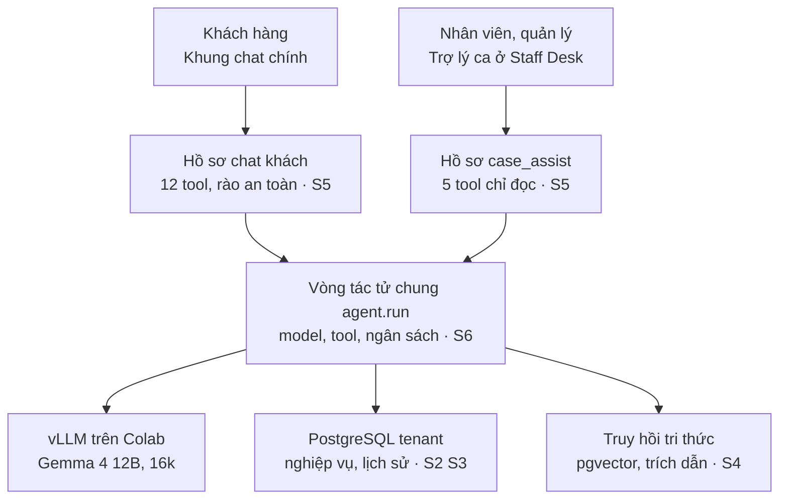
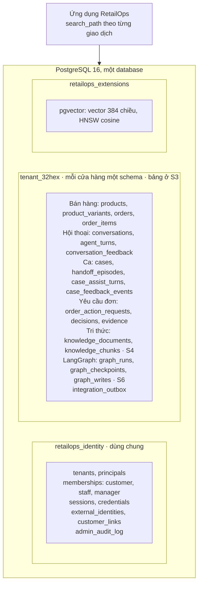
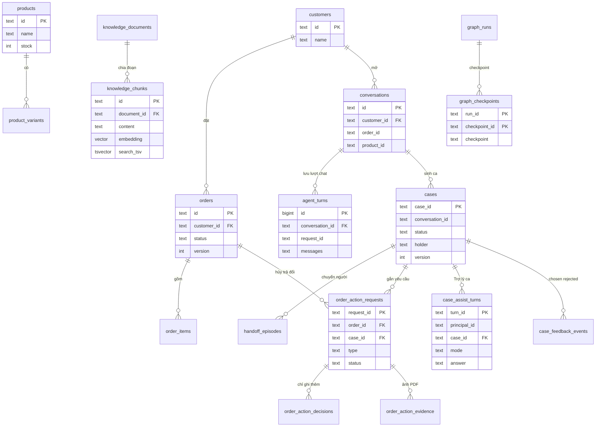
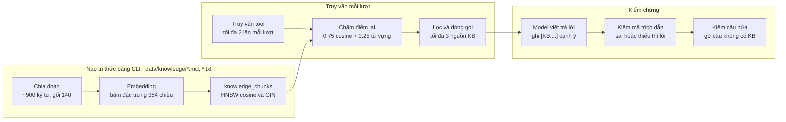
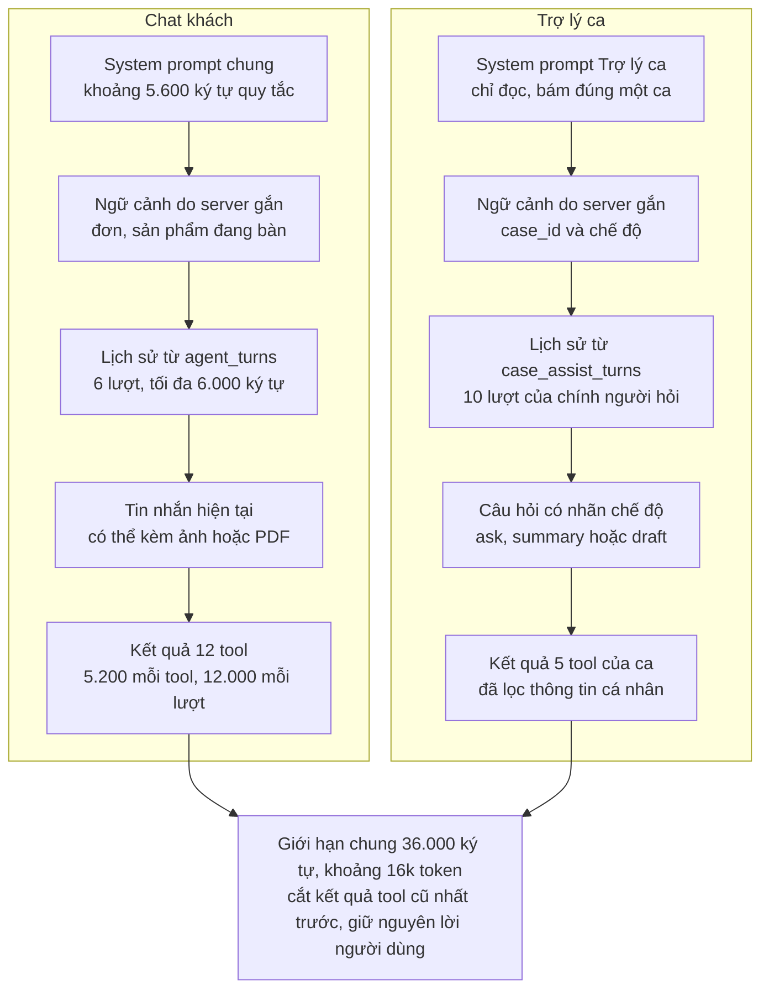
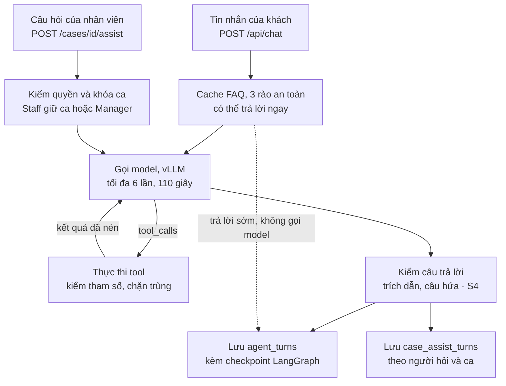

# Sơ đồ dữ liệu, truy hồi tri thức và context engineering

Tài liệu tham chiếu cho Chương 2 và Chương 3. Kiểm tra trên code ngày 2026-11-06, nhánh `main` tại `e13716f`. Sáu sơ đồ đánh số S1–S6, tham chiếu chéo nhau. Mã Mermaid dán vào https://mermaid.live để xuất PNG hoặc SVG chèn vào Word.

Dùng cho khóa luận: S1 → mục 2.1; S2, S3 → mục 2.5 và 3.4; S4 → mục 2.4 và 3.5; S5 → mục 2.3.4; S6 → mục 2.3.2, 2.3.5 và 3.3.

---

## S1. Tổng quan hai luồng chat

Chat chính của khách và Trợ lý ca ở Staff Desk không phải hai hệ thống riêng. Cả hai gọi cùng hàm `retailops.workflow.agent.run`, khác nhau ở hồ sơ truyền vào. Chat khách dùng system prompt chung và 12 tool. Trợ lý ca dùng `AgentProfile` tên `case_assist` với system prompt chỉ đọc và 5 tool gói trong một ca.

| | Chat khách | Trợ lý ca |
|---|---|---|
| Endpoint | `POST /api/chat` | `POST /api/staff/cases/<id>/assist` |
| Ai được dùng | khách đã đăng nhập, chỉ dữ liệu của mình | Staff đang giữ ca `in_progress`, hoặc Manager |
| Tool | 12: `list_orders`, `get_order`, `search_products`, `get_product`, `get_context`, `prepare_order_action`, `get_runtime_info`, `get_current_time`, `search_knowledge`, `track_shipment`, `check_inventory`, `request_human_support` | 5: `get_case_transcript`, `list_case_orders`, `get_case_order`, `list_case_order_actions`, `search_knowledge` |
| Rào an toàn từ khóa | có, trước khi gọi model | bỏ qua, `skip_safety_gate=True` |
| Cache | cache FAQ tĩnh và cache kết quả tool | không dùng cache nào |
| Lịch sử | `agent_turns` của hội thoại | `case_assist_turns` của chính người hỏi |
| Checkpoint LangGraph | có, `graph_checkpoints` | không |
| Ghi dữ liệu nghiệp vụ | không; chỉ mở form, khách tự bấm xác nhận | không |

## S2. Kiến trúc lưu trữ PostgreSQL

Một database PostgreSQL 16 chia theo schema. `retailops_identity` dùng chung, chứa cửa hàng, người dùng, vai trò, phiên đăng nhập và nhật ký quản trị. Mỗi cửa hàng có một schema `tenant_<32 hex>` chứa toàn bộ dữ liệu nghiệp vụ, hội thoại, ca, tri thức và checkpoint, nên dữ liệu hai cửa hàng tách nhau ở mức schema. pgvector cài riêng trong `retailops_extensions`.

Mỗi giao dịch đặt `SET LOCAL search_path` về đúng schema, `statement_timeout` 15 giây, `lock_timeout` 5 giây. Giao dịch ghi lấy `pg_advisory_xact_lock` theo schema. Phiên bản schema lưu trong bảng `retailops_schema`: identity v5, business v8; khởi động bị chặn khi schema cũ hơn bản yêu cầu, migration chỉ chạy bằng lệnh operator có xác nhận backup.

Ràng buộc toàn vẹn đáng nêu trong khóa luận:
- Chỉ mục duy nhất từng phần bảo đảm mỗi hội thoại có tối đa một ca chưa đóng, mỗi ca có tối đa một lượt chuyển người đang chờ, và mỗi đơn có tối đa một yêu cầu hủy, trả, đổi đang mở.
- `order_action_decisions` có trigger chặn `UPDATE` và `DELETE`, tức là nhật ký duyệt chỉ được ghi thêm.
- `CHECK` ràng buộc máy trạng thái của yêu cầu đơn: yêu cầu hủy chỉ đóng ở trạng thái approved hoặc rejected; trả và đổi chỉ đóng ở rejected hoặc completed.
- `orders.version` và `cases.version` dùng cho khóa lạc quan; sai version trả `409`.
- Bằng chứng ảnh tối đa 10 MB; PDF tối đa 20 MB và 20 trang, đã quét ClamAV. Tệp nằm trên đĩa, DB chỉ giữ `sha256` và đường dẫn.

## S3. Sơ đồ quan hệ thực thể của schema tenant

`conversations` và `cases` là chỗ hai luồng gặp nhau. Chat khách ghi `agent_turns`. Nhân viên thao tác trên `cases` và `order_action_*`. Trợ lý ca ghi `case_assist_turns`. Phản hồi khách lưu ở `case_feedback_events` với nhãn `chosen` hoặc `rejected` làm dữ liệu cho DPO về sau.

## S4. Pipeline truy hồi tri thức và kiểm trích dẫn

Dùng chung cho cả hai luồng: tool `search_knowledge` của Trợ lý ca gọi cùng `KnowledgeTool`.

Chi tiết từng bước:
- **Chia đoạn** theo `retailops/knowledge/chunking.py`. Chia theo đoạn văn trống, đoạn quá dài thì chia theo từ, gom tới khoảng 900 ký tự, gối 140 ký tự sang đoạn sau, mỗi đoạn tối đa 4.000 ký tự. Mỗi tài liệu có `checksum` SHA-256 để biết nội dung có đổi không.
- **Embedding** theo `embedding.py`: **không phải mô hình nơ-ron** mà là hàm băm đặc trưng `feature-hash-v1`. Đặc trưng gồm từ đơn trọng số 1,0, cặp từ liền kề 1,35 và trigram ký tự 0,30 cho từ dài từ 5 ký tự, băm BLAKE2b vào 384 chiều có dấu, rồi chuẩn hóa L2. Tất định, chạy offline, không phụ thuộc thư viện. Code ghi rõ đây là baseline, có thể thay bằng embedder nơ-ron mà không đổi schema.
- **Chỉ mục**: HNSW với `vector_cosine_ops` cho vector; GIN trên `search_tsv`, cột sinh tự động bằng `to_tsvector('simple', content)`. Cấu hình `simple` không tách từ tiếng Việt, nên khớp theo từng âm tiết.
- **Chấm điểm lai** theo `repository.py`: `score = 0,75 × (1 − khoảng cách cosine) + 0,25 × min(ts_rank_cd, 1)`, lấy top 5.
- **Lọc và đóng gói** theo `tool.py`: bỏ kết quả có điểm dưới `MIN_SCORE = 0,15` hoặc không có từ chung nào với câu hỏi, vì va chạm băm không phải bằng chứng. Mỗi trích đoạn tối đa 1.100 ký tự, tối đa 3 nguồn, tối đa 2.800 ký tự mỗi lần gọi và 3.600 ký tự mỗi lượt. Mã trích dẫn `KB:` cộng 24 ký tự hex là băm của khóa nguồn và trích đoạn. Không có bằng chứng thì trả `no_evidence` kèm lời dặn không được bịa chính sách.
- **Kiểm mã trích dẫn** theo `citations.py`: mọi `[KB:...]` phải nằm trong các nguồn trả về ở lượt này; đã tìm được bằng chứng mà câu trả lời không trích thì lỗi `knowledge_citation_missing`. Hàm này kiểm nguồn gốc, không kiểm nội dung có suy ra được từ đoạn trích hay không.
- **Kiểm câu hứa** theo `answer_check.py`: gỡ câu hứa về phí, giao nhận, thời hạn không có `[KB:...]`, và câu khẳng định đã hủy, đổi, trả, hoàn tiền khi không tool nào của lượt cho thấy điều đó; thay bằng một câu ghi chú.

## S5. Context engineering của hai luồng

Các kỹ thuật, theo `agent_protocol.py`, `workflow/compaction.py`, `business/store.py`:
- **Ngữ cảnh do server gắn.** Đơn và sản phẩm đang bàn, hoặc `case_id` và chế độ, được server nối vào cuối system prompt. Người dùng không sửa được, nên model không thể tự đổi phạm vi khách hoặc ca.
- **Định hình lịch sử** bằng `model_history`. Lượt cũ chỉ giữ chữ, bỏ hẳn lời gọi tool và kết quả tool cũ, vì lịch sử không được dùng làm bằng chứng cho trạng thái hiện tại. Hai tin cùng vai được gộp lại, cắt về 2.000 ký tự với tin của người dùng và 7.500 với tin của trợ lý, để luôn xen kẽ người dùng và trợ lý đúng mẫu chat của Gemma. Chỉ lượt đang chạy mới giữ tool call gốc.
- **Chọn lịch sử.** Chat khách lấy 6 lượt gần nhất của hội thoại, bỏ các lượt hệ thống `sys-reminder-`, `sys-oar-`, `sys-notice-`. Khi ca được mở lại, chỉ lấy các lượt từ khi ca hiện tại bắt đầu. Trợ lý ca chỉ lấy 10 lượt của đúng bộ ba cửa hàng, người hỏi và ca, nên hai nhân viên cùng một ca không thấy lịch sử của nhau.
- **Ngân sách ký tự.** Lịch sử tối đa 6.000 ký tự và 1.500 ký tự mỗi tin; khi vượt thì bỏ cặp cũ nhất. Mỗi kết quả tool tối đa 5.200 ký tự; tổng kết quả tool mỗi lượt 12.000; kết quả đến sau vẫn được ít nhất 800. Nén theo 4 nấc, cắt chuỗi về 240, 160, 120, 80 ký tự và cắt danh sách về 10, 6, 4, 2 phần tử, luôn giữ JSON hợp lệ kèm cờ `_truncated`. Chốt cuối `fit_transcript` thu nhỏ kết quả tool cũ nhất cho tới khi vừa 36.000 ký tự; không đụng system prompt, lời người dùng và lời model.
- **Phân loại chế độ.** `request_mode` dùng danh sách từ khóa để đưa câu hỏi kiến thức chung hiển nhiên sang chế độ general, không có tool và có system prompt riêng; câu mơ hồ kế thừa chế độ của câu gần nhất. Trợ lý ca luôn ở chế độ bán lẻ.
- **Dữ liệu không tin cậy.** Cả hai system prompt coi tin của người dùng, đoạn trích tri thức, mô tả sản phẩm và tệp đính kèm là dữ liệu chứ không phải lệnh. Kết quả của `search_knowledge` mang ghi chú như vậy.

## S6. Vòng lặp tác tử của hai luồng

Đồ thị LangGraph có 3 nút `guard → model → tools → model …`, theo `workflow/agent.py`:
- **guard.** Với chat khách: kiểm 3 rào an toàn bằng từ khóa trong `workflow/safety.py`, gồm chủ đề cấm, khách quá bức xúc như dọa kiện hay bóc phốt, và yêu cầu gặp người. Rào thứ hai và thứ ba gọi `request_human_support` rồi trả câu soạn sẵn. Trước đó, ở tầng ứng dụng, cache FAQ tĩnh chỉ áp dụng cho lượt đầu, không đính kèm, không có mã đơn hay sản phẩm, khớp mẫu câu hỏi giờ mở cửa, địa chỉ, hotline, lời chào, với ngưỡng cosine 0,65. Cache chạy trong bộ nhớ, dù DDL `semantic_cache` có sẵn. Với Trợ lý ca: bỏ guard; thay vào đó `authorize_case_assist` kiểm vai trò và người giữ ca trước mọi kiểm tra khác, kèm khóa theo ca và phát lại theo `request_id`.
- **model.** Tối đa 6 lần gọi model và 110 giây mỗi lượt, 45 giây mỗi lần gọi. Lần gọi cuối không được dùng tool, buộc model trả lời bằng dữ kiện đã có. Kiểm cờ dừng trước và sau khi gọi model.
- **tools.** Tối đa 10 lần gọi tool mỗi lượt. Mỗi lời gọi được kiểm tên và tham số theo schema; tool lạ hoặc tham số lạ trả `tool_not_allowed`; lời gọi trùng y hệt trong cùng lượt trả `duplicate_call`. Kết quả được nén theo S5. Mọi tool đều chỉ đọc; `prepare_order_action` chỉ kiểm điều kiện và mở form, khách phải tự bấm xác nhận.
- **Kiểm câu trả lời** theo S4. Sau đó chat khách lưu lượt vào `agent_turns` và checkpoint vào `graph_checkpoints` để chạy tiếp khi lỗi giữa chừng. Trợ lý ca lưu `case_assist_turns`, không dùng checkpoint, không ghi `agent_turns` và không đụng cache.

---

## Điểm cần viết trung thực trong khóa luận

1. **Embedding hiện là băm đặc trưng, không phải mô hình nơ-ron.** Mục 1.3.5 và 2.4 phải mô tả đúng: truy hồi lai giữa vector băm và từ vựng, tức gần với truy hồi thưa hơn là truy hồi ngữ nghĩa dày. Kết quả RQ3 phải hiểu theo hướng đó. Số chiều 384 trùng với một số mô hình embedding đa ngôn ngữ nhỏ, nên có thể thay embedder mà không đổi schema. Đây là một hướng thí nghiệm loại bỏ thành phần cho W6 nếu muốn, chưa làm.
2. **`ts_rank_cd` dùng cấu hình `simple`**, không tách từ tiếng Việt.
3. **Có định tuyến bằng từ khóa ở hai chỗ:** ba rào an toàn và `request_mode` chọn chế độ general. Lời "không định tuyến theo từ khóa" chỉ đúng với việc chọn tool trong chế độ bán lẻ, nên viết rõ phạm vi như vậy.
4. **Bảng `semantic_cache` có DDL nhưng cache chạy trong bộ nhớ**, chỉ cho câu hỏi FAQ tĩnh ở lượt đầu.
5. **Trợ lý ca bỏ qua rào an toàn từ khóa** vì người dùng là nhân viên; an toàn dựa vào phân quyền, tool chỉ đọc và lọc thông tin cá nhân.
6. Trên production trước đây `search_knowledge` từng trả 0 kết quả cho câu hỏi đổi trả, dù repo có `policy_size_exchange_twoway.md`. Cần kiểm lại việc nạp tri thức cho tenant trước khi đo RQ3 ở W6.
