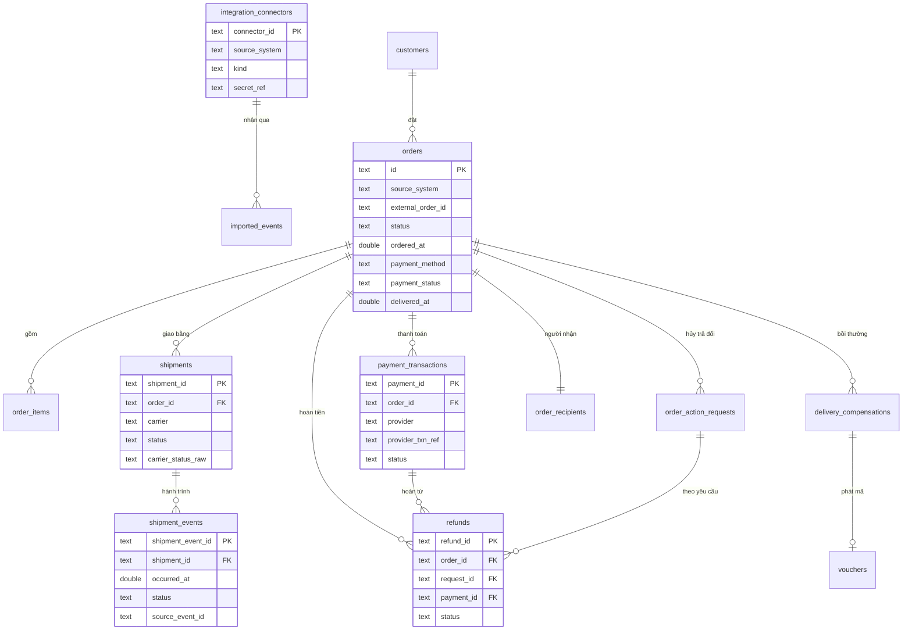
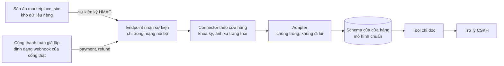

# Cơ sở dữ liệu RetailOps

Tài liệu để nắm vững database: dùng khi bảo vệ khóa luận và làm căn cứ chốt migration business v9 của W6.1. Kiểm trên code ngày 2026-11-06, `main` tại `d524373`. Phần A là hiện trạng v8 đang chạy production; phần B là thiết kế v9 đã được owner chốt hướng ngày 2026-11-06.

Nguồn chính: `retailops/storage/pg_schema.py` chứa DDL và các bước migration; `retailops/storage/postgres.py` chứa kết nối, giao dịch và số phiên bản; `retailops/business/store.py` chứa mọi thao tác đọc ghi nghiệp vụ; `retailops/workflow/schema.py` chứa bảng LangGraph.

---

# A. Hiện trạng, business v8 và identity v5

## A1. Tổ chức vật lý

Production chạy **PostgreSQL 16 với pgvector 0.8.6** trong container `postgres`, image ghim theo digest trong `deploy/compose.postgres.yaml`; giới hạn 512 MB RAM, 30 kết nối. Một database tên `retailops`, chủ sở hữu là role `retailops` không có quyền superuser. Dữ liệu nằm trong volume `postgres_data`.

Database chia thành ba loại schema:

| Schema | Số lượng | Chứa gì |
|---|---|---|
| `retailops_identity` | 1, dùng chung | cửa hàng, người dùng, vai trò, phiên đăng nhập, liên kết Google, nhật ký quản trị; 16 bảng |
| `tenant_<32 ký tự hex>` | mỗi cửa hàng một schema | toàn bộ dữ liệu nghiệp vụ, hội thoại, ca, yêu cầu đơn, tri thức, checkpoint; 27 bảng |
| `retailops_extensions` | 1 | extension pgvector, cung cấp kiểu `vector` và toán tử khoảng cách |

Tên schema của một cửa hàng là `tenant_` cộng `storage_key` trong bảng `retailops_identity.tenants`. Hàm `valid_schema` chỉ chấp nhận đúng mẫu `tenant_[a-f0-9]{32}` hoặc `retailops_identity`, nên không thể chèn tên schema tùy ý. Khi tạo schema, quyền `PUBLIC` bị thu hồi.

Môi trường dev và test dùng **SQLite** với cùng logic nghiệp vụ; số phiên bản schema SQLite lệch một bậc so với PostgreSQL. Bộ chạy kịch bản đánh giá dùng SQLite tạm.

## A2. Giao dịch, khóa và an toàn đồng thời

Mọi truy cập đi qua hàm `transaction` trong `postgres.py`. Mỗi giao dịch:

1. `SET LOCAL search_path` về đúng một schema, nên câu SQL của cửa hàng này không thể đọc nhầm bảng của cửa hàng khác.
2. `statement_timeout` 15 giây, `lock_timeout` 5 giây; giao dịch chỉ đọc đặt `READ ONLY`.
3. Giao dịch ghi lấy `pg_advisory_xact_lock` theo tên schema: **mọi lần ghi trong một cửa hàng được xếp hàng tuần tự**. Đổi lại sự đơn giản và đúng đắn là giới hạn thông lượng ghi của một cửa hàng; với quy mô CSKH hiện tại không thành vấn đề.
4. Lỗi PostgreSQL được đổi thành lỗi ứng dụng: `409 read_only_store` hoặc `503 database_unavailable`, không lộ chi tiết kết nối.

Thêm ba cơ chế ở tầng nghiệp vụ:

- **Khóa lạc quan bằng version.** `orders.version`, `cases.version`, `order_action_requests.version`. Người gửi yêu cầu phải gửi kèm version đang thấy; lệch thì `409`. Ví dụ chuyển ca, duyệt yêu cầu, tạo yêu cầu đổi trả.
- **Chống làm trùng bằng khóa duy nhất.** `agent_turns` có `UNIQUE(conversation_id, request_id)`; `case_assist_turns` có `UNIQUE(tenant_id, principal_id, case_id, request_id)`; `imported_events` có `UNIQUE(source_system, event_id)`. Gửi lại cùng mã yêu cầu thì nhận lại kết quả cũ.
- **Chỉ mục duy nhất từng phần** để giữ bất biến: mỗi hội thoại tối đa một ca chưa đóng; mỗi ca tối đa một lượt chuyển người đang chờ; mỗi đơn tối đa một yêu cầu hủy, trả, đổi đang mở.

## A3. Schema `retailops_identity`

| Bảng | Vai trò |
|---|---|
| `tenants` | cửa hàng; `storage_key` quyết định tên schema nghiệp vụ |
| `principals` | một người dùng, không phụ thuộc cửa hàng |
| `memberships` | người dùng thuộc cửa hàng nào, vai trò `customer`, `staff`, `manager`; `customer_id` nối sang khách trong schema nghiệp vụ; vai trò cũ `viewer`, `platform_admin` chỉ còn ở trạng thái bị khóa |
| `credentials`, `sessions` | khóa đăng nhập dạng băm; phiên có hạn và gắn `auth_version` để thu hồi hàng loạt |
| `external_identities` | liên kết tài khoản Google theo cặp `issuer`, `sub` |
| `customer_links`, `unresolved_collisions`, `reconciliation_journal` | ghép người dùng với khách hàng; xử lý trường hợp hai tài khoản trùng một khách |
| `external_customer_mappings` | ánh xạ mã khách của hệ thống ngoài, như sàn, sang khách nội bộ |
| `membership_quota_overrides` | hạn mức gọi model mỗi ngày riêng cho từng thành viên |
| `identity_rate` | bộ đếm giới hạn tần suất, ví dụ 120 request mỗi phút mỗi phiên |
| `provider_daily_usage`, `identity_events`, `admin_audit_log` | đếm lượt gọi model, sự kiện định danh, nhật ký mọi thao tác quản trị kèm trước và sau |

## A4. Schema nghiệp vụ của một cửa hàng

**Bán hàng**

| Bảng | Vai trò | Ghi chú |
|---|---|---|
| `customers` | khách của cửa hàng | chỉ có `id`, `name` |
| `products`, `product_variants` | catalog và biến thể có `size`, `color`, `stock` | `products.variants` là danh sách JSON cũ, `product_variants` là nguồn tồn kho thật |
| `orders` | đơn hàng | `status` chỉ có `pending`, `delivered`, `cancelled`; có `version`, `delivered_at`; **không có** ngày đặt, thanh toán, địa chỉ, hoàn tiền |
| `order_items` | dòng hàng của đơn nhập từ hệ thống ngoài | |
| `imported_events` | mọi sự kiện đã nhận từ hệ thống ngoài, kèm chữ ký | chống nhận trùng |
| `order_purge_tombstones` | dấu vết khi xóa đơn demo | |
| `proposals` | luồng xác nhận hủy đơn đời cũ | giữ để tương thích |

**Hội thoại và ca hỗ trợ**

| Bảng | Vai trò |
|---|---|
| `conversations` | một cuộc chat; có `expires_at` để hết hạn; `order_id`, `product_id` là đơn và sản phẩm đang bàn |
| `agent_turns` | mỗi lượt chat lưu cả danh sách tin nhắn và kết quả dạng JSON, kèm `request_id`, `input_hash` |
| `cases` | ca hỗ trợ: `waiting`, `in_progress`, `resolved`; người giữ ca; các mốc nhắc, hết hạn, hoàn tất; `previous_case_id` khi mở lại |
| `handoff_episodes` | mỗi lần chuyển sang người: `pending`, `resolved`, `customer_closed` |
| `case_feedback_events` | đánh giá của khách, chuẩn hóa thành nhãn `chosen` hoặc `rejected` cho học theo ưu tiên |
| `conversation_feedback` | phản hồi theo hội thoại: đánh giá lượt, CSAT và sự kiện chuyển người; vẫn được ghi khi chuyển người và khi nhân viên trả lời |
| `case_assist_turns` | lượt hỏi của Trợ lý ca, tách theo cửa hàng, người hỏi và ca |

**Yêu cầu hủy, trả, đổi**

| Bảng | Vai trò |
|---|---|
| `order_action_requests` | yêu cầu với `type`, `status`, `refund_status`, lý do, biến thể đích; `CHECK` ràng buộc trạng thái nào thì phải đóng hay mở |
| `order_action_decisions` | nhật ký từng bước duyệt; **trigger chặn UPDATE và DELETE**, chỉ được ghi thêm |
| `order_action_evidence` | ảnh, PDF bằng chứng: kích thước, số trang, SHA-256, kết quả quét ClamAV; tệp nằm trên đĩa, DB giữ đường dẫn |
| `integration_outbox` | sự kiện chờ gửi ra ngoài, có số lần thử và trạng thái `pending`, `published`, `dead` |

**Tri thức, tác tử, vận hành**

| Bảng | Vai trò |
|---|---|
| `knowledge_documents`, `knowledge_chunks` | tài liệu chính sách và các đoạn; `embedding vector(384)` với chỉ mục HNSW cosine; `search_tsv` với chỉ mục GIN |
| `graph_runs`, `graph_checkpoints`, `graph_writes` | checkpoint LangGraph của chat khách để chạy tiếp khi lỗi giữa chừng |
| `business_events` | nhật ký sự kiện nghiệp vụ |
| `provider_daily_usage` | đếm lượt gọi model |
| `retailops_schema` | số phiên bản schema |

## A5. Máy trạng thái

**Ca hỗ trợ.** `waiting` → `in_progress` khi nhân viên nhận ca → `resolved` khi đóng, khách im lặng quá hạn hoặc hoàn tất sau phản hồi. Khách bấm "Tiếp tục" thì mở lại đúng ca đó về `waiting`, sinh episode mới.

**Yêu cầu hủy.** `requested` → `under_review` → `approved` hoặc `rejected`; đóng ở hai trạng thái cuối.

**Yêu cầu trả, đổi.** `requested` → `under_review` → `approved` → `received` → `inspected` → `completed`, hoặc `rejected` ở bước duyệt. Kèm `refund_status`: `not_applicable`, `pending`, `refunded`, `failed`.

Ràng buộc đóng mở được kiểm bằng `CHECK` trong DB, không chỉ trong code.

## A6. Ai ghi vào bảng nào

| Nguồn ghi | Bảng | Hàm chính trong `store.py` |
|---|---|---|
| Server sau mỗi lượt chat của khách | `agent_turns`, `conversations`, `cases`, `graph_*` | `finish_turn`, `customer_message` |
| **Khách bấm nút xác nhận** trên form | `order_action_requests`, `order_action_decisions`, `integration_outbox` | `_create_order_action_request_in_tx` |
| Nhân viên, quản lý | `cases`, `handoff_episodes`, `order_action_*`, `orders` | `claim_case`, `release_case`, `staff_reply`, `transition_order_action_request`, `decide_order_action_refund`, `record_order_action_refund_outcome`, `manager_update_order_status` |
| Server sau mỗi lượt Trợ lý ca | `case_assist_turns` | `save_case_assist_turn` |
| Khách đánh giá | `case_feedback_events` | `record_feedback` |
| Bộ hẹn giờ | `cases`, `agent_turns` | `process_due_case_timers` |
| Cổng tích hợp hệ thống ngoài | `imported_events`, `orders`, `order_items` | `retailops/sales/adapter.py` |
| CLI nạp tri thức | `knowledge_*` | `retailops/knowledge/repository.py` |
| Seed demo | `customers`, `products`, `product_variants`, `orders` | `seed`, `seed_catalog`, `seed_demo_sample_orders` |

**AI không có tool nào ghi vào database.** Tool `prepare_order_action` chỉ đọc điều kiện và mở form; yêu cầu chỉ được tạo khi khách tự bấm nút. Lịch sử hội thoại và checkpoint là do server ghi sau lượt chat, không phải do model quyết định.

Hiện **kết quả hoàn tiền do nhân viên ghi tay** qua `record_order_action_refund_outcome`. Ở v9 việc này chuyển sang nhận từ sự kiện của cổng thanh toán.

## A7. Lịch sử migration

| Phiên bản | Đợt | Thêm gì |
|---|---|---|
| business v1 | nền | `customers`, `orders`, `proposals`, `business_events`, `conversations`, `agent_turns`, `provider_daily_usage` |
| v2 | | bảng LangGraph `graph_runs`, `graph_checkpoints`, `graph_writes` |
| v3 | | `knowledge_documents`, `knowledge_chunks` với pgvector |
| v4 | | `products`, `product_variants`, cột `orders.product_id`; `conversation_feedback` |
| bổ sung Phase 5 | không tăng số | `order_items`, `imported_events`, `order_purge_tombstones`; bên identity thêm `external_customer_mappings`, `membership_quota_overrides`, `admin_audit_log` |
| v5 | W2 | `cases`, `handoff_episodes`, `case_feedback_events`, có backfill ca từ hội thoại cũ |
| v6 | W3 | `orders.delivered_at`; `order_action_requests`, `order_action_decisions` có trigger chỉ ghi thêm, `order_action_evidence`, `integration_outbox` |
| v7 | W3.2 | đổi hàng tổng quát: `exchange_kind` là `other_variant` hoặc `same_variant`, cột biến thể đích |
| v8 | W4 | `case_assist_turns`; bằng chứng nhận PDF, số trang, kết quả quét |
| identity v1–v5 | đến W1 | liên kết khách, xử lý trùng, nhật ký hòa giải; v5 khóa vai trò cũ |

Ứng dụng **từ chối khởi động** khi schema cũ hơn bản yêu cầu. Migration chỉ chạy bằng lệnh operator có cờ `--confirm-preflight --confirm-backup`, theo runbook: backup, diễn tập trên DB nháp, dừng web, backup cuối, migrate, rollout.

## A8. Tự xem dữ liệu trên EC2, chỉ đọc

Vào EC2 bằng SSM, `sudo -i`, `cd /opt/retailops`, tạo mảng `cweb` như ở runbook W5, rồi mở psql trong container:

```bash
"${cweb[@]}" exec -T postgres psql -U postgres -d retailops
```

Trong psql, mở giao dịch chỉ đọc trước khi truy vấn để không thể ghi nhầm:

```sql
BEGIN READ ONLY;

-- Các schema đang có
SELECT nspname FROM pg_namespace WHERE nspname LIKE 'tenant_%' OR nspname LIKE 'retailops_%';

-- Cửa hàng nào ứng với schema nào
SELECT id, name, 'tenant_' || storage_key AS schema, active FROM retailops_identity.tenants;

-- Phiên bản schema
SELECT * FROM retailops_identity.retailops_schema;
SELECT * FROM tenant_xxx.retailops_schema;

-- Kiểm C3 của W6: kho tri thức đã được nạp chưa
SELECT count(*) AS docs FROM tenant_xxx.knowledge_documents WHERE active = 1;
SELECT count(*) AS chunks FROM tenant_xxx.knowledge_chunks;

-- Đơn theo trạng thái
SELECT status, count(*) FROM tenant_xxx.orders GROUP BY status;

-- Ca hỗ trợ theo trạng thái
SELECT status, count(*) FROM tenant_xxx.cases GROUP BY status;

-- Yêu cầu hủy, trả, đổi đang mở
SELECT request_id, type, status, refund_status, order_id
FROM tenant_xxx.order_action_requests WHERE closed_at IS NULL;

ROLLBACK;
```

Thay `tenant_xxx` bằng tên schema lấy ở câu thứ hai. Không dán kết quả có dữ liệu cá nhân vào chat hay tài liệu.

---

# B. Thiết kế business v9 cho W6.1, đã chốt hướng ngày 2026-11-06

Owner đã đồng ý hướng thiết kế dưới đây. Chi tiết cột và kiểu dữ liệu vẫn được rà lại khi viết handoff W6.1b.

## B1. Nguyên tắc

1. **Mô hình dữ liệu chuẩn cộng connector.** RetailOps không bắt cửa hàng đổi hệ thống. Mỗi nguồn dữ liệu, như sàn, phần mềm bán hàng, hãng vận chuyển, cổng thanh toán, có một connector ánh xạ dữ liệu của nó vào mô hình chuẩn. Bán cho cửa hàng mới thì chọn và cấu hình connector, không sửa code. Trong R1 chỉ có khung connector, **sàn ảo** `marketplace_sim/` và cổng thanh toán giả lập. Connector thật cho Shopee, Haravan và các nền tảng khác để sau R1; connector nhập CSV là tùy chọn, chưa đưa vào R1.
2. **Dữ liệu nghiệp vụ chỉ vào DB qua cổng tích hợp:** kiểm chữ ký, chống nhận trùng, không cho trạng thái đi lùi. Thiếu khóa ký thì từ chối, không có khóa mặc định.
3. **RetailOps không chạm vào tiền.** Thu tiền và hoàn tiền do cổng thanh toán có giấy phép của Ngân hàng Nhà nước thực hiện, theo Nghị định 52/2024/NĐ-CP; hóa đơn và thuế thuộc sàn và nhà cung cấp hóa đơn. RetailOps chỉ lưu tên cổng, mã tham chiếu, số tiền, trạng thái, mốc thời gian. **Không bao giờ lưu** số thẻ, số tài khoản, OTP.
4. **Thông tin người nhận lưu đầy đủ nhưng có rào chắn**, theo W6.1a-D11: tên, số điện thoại, địa chỉ đầy đủ ở bảng riêng `order_recipients`, các cột cá nhân được mã hóa; model AI chỉ nhận bản đã che; khách xem của chính mình; nhân viên giữ ca xem bản đầy đủ và mỗi lần xem đều ghi nhật ký. Số điện thoại shipper lưu dạng đã che. R1 chỉ dùng dữ liệu giả lập; chạy với khách thật cần danh sách tuân thủ Luật Bảo vệ dữ liệu cá nhân 91/2025/QH15 được duyệt riêng.
5. **Trường nào nguồn không cung cấp thì để trống**, và trợ lý nói là chưa có thông tin.
6. **Điều kiện do server tính:** còn bảo hành, đủ điều kiện đổi, giao lại được không, thời gian giao còn lại, đã trễ hạn cam kết chưa, là giá trị tính khi đọc, không lưu sẵn.
7. **Bồi thường do hệ thống và con người, không do AI.** Server phát hiện trễ hạn, tạo đề xuất; nhân viên duyệt; sàn phát mã voucher và báo lại. AI chỉ nói về voucher khi mã đã có trong dữ liệu.

## B2. Thay đổi bảng `orders`

| Cột | Kiểu | Ràng buộc | Nguồn |
|---|---|---|---|
| `id` | text | khóa chính, **RetailOps tự sinh** cho đơn mới; đơn cũ giữ nguyên mã | |
| `source_system` | text | not null sau backfill | connector |
| `external_order_id` | text | duy nhất theo cặp `source_system`, `external_order_id` | mã đơn của nguồn |
| `status` | text | thêm `shipping`; tập mới `pending`, `shipping`, `delivered`, `cancelled` | sự kiện đơn và vận chuyển |
| `ordered_at` | double | not null sau backfill | sự kiện tạo đơn |
| `payment_method` | text | `cod`, `bank_transfer`, `e_wallet`, `card` hoặc trống | sự kiện tạo đơn |
| `payment_status` | text | `unpaid`, `paid`, `partially_refunded`, `refunded` | tính từ `payment_transactions` và `refunds` |
| `shipping_fee` | bigint | ≥ 0 hoặc trống | sự kiện tạo đơn |
| `ship_to_area` | text | tối đa 120 ký tự, quận và tỉnh; bản tóm tắt an toàn để đưa cho model | sự kiện tạo đơn |
| `promised_delivery_by` | double | thời hạn giao đã cam kết lúc đặt | sự kiện tạo đơn |
| `delivered_at` | double | đã có, nay được điền | sự kiện vận chuyển `delivered` |

**Luật mới:** đơn `shipping` không mở được yêu cầu hủy tự phục vụ; trợ lý giải thích và chuyển nhân viên. Trả, đổi vẫn chỉ cho `delivered`.

**Sửa hai lỗi của adapter hiện tại:** ánh xạ `shipping → delivered` trong `retailops/sales/events.py` thành `shipping → shipping`; adapter đang dùng mã đơn của nguồn làm luôn `orders.id`, nên hai nguồn trong một cửa hàng có cùng mã đơn sẽ bị từ chối hoặc ghi đè nhau.

`product_variants.sku` trở thành khóa ánh xạ biến thể với nguồn: duy nhất trong một cửa hàng khi khác trống.

## B3. Bảng mới

**`order_recipients`**, người nhận của đơn, theo W6.1a-D11

| Cột | Ghi chú |
|---|---|
| `order_id` | khóa chính, FK `orders` |
| `name_enc`, `phone_enc`, `address_line_enc` | đã mã hóa; khóa nằm trong kho secret, không nằm trong DB |
| `phone_lookup_hmac` | HMAC của số điện thoại đã chuẩn hóa, để nhân viên tìm đơn theo số mà không giải mã toàn bảng |
| `ward`, `district`, `province` | không mã hóa, dùng cho thống kê và cho bản đã che |
| `phone_masked` | ví dụ `0123.xxx.456`, dùng cho model và giao diện mặc định |
| `created_at`, `retention_until` | hết hạn lưu thì xóa phần đã mã hóa |

Mọi lần nhân viên mở bản đầy đủ đều ghi một dòng vào nhật ký truy cập dữ liệu cá nhân, gồm người xem, vai trò, ca, thời điểm. Cách mã hóa, bằng `pgcrypto` hay thư viện mã hóa ở tầng ứng dụng, chốt khi viết handoff W6.1b; hiện repo chưa có thư viện mã hóa nào.

**`delivery_compensations`**, đề xuất bồi thường giao trễ, theo W6.1a-D13

| Cột | Ghi chú |
|---|---|
| `compensation_id` | khóa chính |
| `order_id`, `shipment_id` | FK |
| `reason` | `late_delivery` |
| `late_by_hours` | số giờ trễ so với `promised_delivery_by` lúc phát hiện |
| `voucher_type`, `value` | theo cấu hình của quản lý; mặc định voucher 50.000 VNĐ khi trễ quá 48 giờ |
| `status` | `proposed`, `approved`, `rejected`, `requested`, `issued`, `failed` |
| `decided_by_principal_id`, `decided_at`, `note` | người duyệt |
| `request_id` | mã yêu cầu `voucher.requested` gửi sàn qua outbox |

**`vouchers`**, voucher do sàn phát

| Cột | Ghi chú |
|---|---|
| `voucher_id` | khóa chính |
| `source_system`, `external_voucher_id` | duy nhất theo cặp |
| `customer_id`, `order_id` | FK |
| `compensation_id` | FK, có thể trống khi sàn tự phát |
| `code`, `voucher_type`, `value`, `valid_until`, `issued_at` | AI được đọc để báo cho đúng khách sở hữu |

**`integration_connectors`**, cấu hình nguồn của một cửa hàng

| Cột | Ghi chú |
|---|---|
| `connector_id` | khóa chính |
| `source_system` | duy nhất, ví dụ `marketplace_sim`, `payment_sim` |
| `kind` | `marketplace`, `carrier`, `payment` |
| `secret_ref` | **tên** khóa ký trong kho secret; bản thân khóa không nằm trong DB |
| `status_mapping_json` | bảng ánh xạ mã trạng thái gốc sang trạng thái chuẩn |
| `enabled`, `created_at`, `updated_at` | |

**`shipments`**, một dòng cho mỗi vận đơn

| Cột | Ghi chú |
|---|---|
| `shipment_id` | khóa chính, RetailOps sinh |
| `order_id` | FK `orders` |
| `source_system`, `external_shipment_id` | duy nhất theo cặp |
| `carrier`, `tracking_code` | ví dụ GHN, GHTK, SPX, Viettel Post, J&T |
| `status` | **trạng thái chuẩn:** `created`, `picked_up`, `in_transit`, `out_for_delivery`, `delivered`, `delivery_failed`, `returning`, `returned`, `cancelled` |
| `carrier_status_raw` | mã gốc của hãng, ví dụ `transporting` của GHN |
| `current_area`, `shipper_name`, `shipper_phone_masked` | có thể trống |
| `estimated_delivery_at`, `delivered_at`, `delivery_attempts`, `updated_at` | |

**`shipment_events`**, nhật ký hành trình, chỉ ghi thêm

| Cột | Ghi chú |
|---|---|
| `shipment_event_id` | khóa chính |
| `shipment_id` | FK |
| `occurred_at` | thời điểm tại hãng |
| `status`, `carrier_status_raw`, `description`, `fail_reason` | |
| `hub_name`, `district`, `province` | bưu cục hoặc kho, quận, tỉnh của mốc, để trả lời "hàng đang ở đâu" |
| `estimated_delivery_at` | dự kiến giao mới nhất do hãng báo tại mốc này |
| `source_event_id` | duy nhất, nối với `imported_events` |

**`payment_transactions`**, mỗi lần thanh toán một dòng

| Cột | Ghi chú |
|---|---|
| `payment_id` | khóa chính |
| `order_id` | FK |
| `provider`, `provider_txn_ref` | duy nhất theo cặp; với COD, `provider` là hãng thu hộ |
| `method`, `amount` | |
| `status` | chuẩn: `pending`, `succeeded`, `failed`, `cancelled`; kèm `provider_status_raw` |
| `created_at`, `settled_at` | |

**`refunds`**, hoàn tiền do cổng thực hiện

| Cột | Ghi chú |
|---|---|
| `refund_id` | khóa chính |
| `order_id` | FK |
| `request_id` | FK `order_action_requests`, có thể trống |
| `payment_id` | FK `payment_transactions`, trống với đơn COD |
| `provider`, `provider_refund_ref` | duy nhất theo cặp |
| `amount` | > 0, không vượt số đã thu |
| `channel` | `original_method`, `bank_transfer`, `e_wallet` |
| `status` | chuẩn: `pending`, `processing`, `completed`, `failed`; kèm `provider_status_raw` |
| `initiated_at`, `completed_at`, `failure_reason` | |

Cột `order_action_requests.refund_status` giữ để tương thích, nhưng được cập nhật từ `refunds` thay vì nhân viên ghi tay.

## B4. Sơ đồ quan hệ v9



## B5. Luồng dữ liệu



## B6. Migration v9

1. Thêm cột vào `orders`, thay `CHECK` của `status`. Backfill đơn cũ: `source_system` là `retailops_seed`, `external_order_id` bằng `id`, `ordered_at` bằng thời điểm migrate, ghi rõ là giá trị điền bù.
2. Tạo 8 bảng mới: `integration_connectors`, `shipments`, `shipment_events`, `payment_transactions`, `refunds`, `order_recipients`, `delivery_compensations`, `vouchers`, cùng chỉ mục và ràng buộc duy nhất; chỉ mục duy nhất từng phần cho `product_variants.sku`.
3. Trigger chỉ ghi thêm cho `shipment_events`, như `order_action_decisions`.
4. Một giao dịch, chạy lại an toàn, theo runbook như v8.
5. Seed demo được thay bằng kịch bản sự kiện của sàn ảo phát qua connector. Gỡ dict vận chuyển trong `retailops_tools.py` và `data/mock_shipments.json`.

## B7. Quyết định đã chốt ngày 2026-11-06

- Thêm trạng thái `shipping`; đơn đang giao không tự hủy, chuyển nhân viên.
- Mô hình chuẩn: tách mã nội bộ và mã nguồn; vận chuyển, thanh toán, hoàn tiền dùng trạng thái chuẩn kèm mã gốc.
- 4 bảng nghiệp vụ mới cùng `integration_connectors`.
- Connector trong R1: sàn ảo và cổng thanh toán giả lập. Connector CSV chưa làm.
- W6.1 tách thành **W6.1a** sàn ảo cùng khung connector, và **W6.1b** migration v9 cùng phía RetailOps.
- Ngày 2026-11-07, W6.1a-D11 đến D14: lưu đầy đủ người nhận trong bảng riêng có mã hóa, model chỉ thấy bản đã che; thời hạn giao cam kết và vị trí theo từng mốc hành trình; bồi thường giao trễ do nhân viên duyệt, sàn phát mã; thông báo chủ động cho khách ở các mốc chính.

Còn chốt khi viết handoff: cổng thanh toán nào làm mẫu cho định dạng webhook giả lập; mã hóa bằng `pgcrypto` hay thư viện ở tầng ứng dụng; danh sách kiểu dữ liệu và chỉ mục chi tiết.
